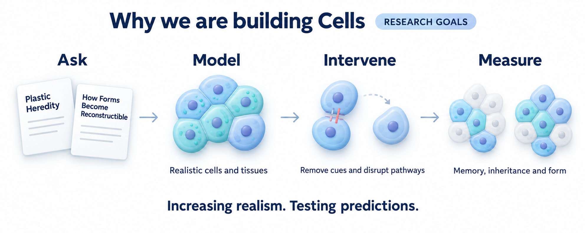

# Cells


Cells is a GPU-native multiscale simulator for investigating how
molecular assembly, cell physiology and communication shape memory, inheritance
and tissue organisation. We are building toward integrated whole-cell models,
whole organs and interacting organ systems. It is written in **Python and JAX**,
so the same models compile for NVIDIA GPUs and for CPUs, and the CPU runs serve
as independent references. [Progress](PROGRESS.md) holds the detailed current
status and evidence.


This schematic links cell structures and biological processes;
whole-cell integration is ongoing.

## Why we are building Cells

One of Cells' central goals is to test the ideas in our
[*Plastic Heredity*](https://doi.org/10.5281/zenodo.22143269) and
[*How Patterns Return*](https://doi.org/10.5281/zenodo.23327869) (early draft)
preprints in the most biologically and physically realistic simulations we can
build and verify.



- **Plastic Heredity:** When does inherited organisation break, recover or
  persist? What lets an acquired state pass to new carriers and be renewed?
- **How Patterns Return:** How do experience, retained cellular
  state and tissue organisation affect which patterns and functions can be
  expressed, repaired or reconstructed?

We are building toward experiments that remove cues, disrupt candidate memory
mechanisms, change cell membership and challenge cells with matched visible
states but different histories. The aim is to identify what carries history,
what it changes, and when it survives replacement.

Realism means explicit physical mechanisms, material and energy accounting, and
calibration against measurements. Bioelectricity, chemistry and assembly provide
the starting point; metabolism, mechanics, growth and turnover are planned
extensions. Cells' purpose is to study how these processes work together in the
same evolving cells and tissues. When an experiment shows that a mechanism is
missing, we add it to the engine as a cited, biologically grounded model rather
than working around it. The goal is to find where
the ideas hold, fail or need revision. See the
[research background](docs/SCIENTIFIC_BASIS.md) and
[planned experiments](docs/EXPERIMENTS.md).

## Ambition

Cells starts small on purpose. The first versions work with one cell up to a few
hundred. The aim at that scale is to reproduce published models and experiments,
run new ones, and see which mechanisms and equations produce each result. Larger
tissues and whole organs come later, built from parts that have already held up
at the smaller scale. The [roadmap](#roadmap) shows the order.

The simulator is modular. New mechanisms are added as separate, versioned models
or options. Each is checked on its own and stays off unless an experiment selects
it, so the biology can grow one piece at a time.

On the molecular side, the one level we skip is protein folding itself. Beneath
it, we aim to simulate the gene regulation that sets how much of each protein is
made. Above it, we aim to simulate the assembly of proteins into complexes and
molecular machines, from protein cages today toward structures such as the
proteasome and larger, and how those machines are used in cells and tissues.

A complete and faithful simulation of a real cell is still a long way off. In our
view, progress in AI and in mathematics may shorten that road more than it seems
today.

## Where things stand (11 November 2026)

Plain-language summary. Details, numbers and evidence are in
[Progress](PROGRESS.md), and choices are in [Decisions](docs/DECISIONS.md).

| Track | In simple terms | State |
| --- | --- | --- |
| **Checking the physics against BETSE** | We run the established BETSE simulator separately and compare its saved outputs with Cells' own physics, under rules fixed before each run. | Passes for every mechanism tested so far (one rung only after a revised method): BETSE's default tissue, calcium and its pump, extracellular barriers, scheduled interventions (pump block, sodium and potassium permeability, junction block), and voltage-gated channels including the heredity channels NaV1.2 and Kir2.1. Still open: GPU runs of the later rungs, several intervention types, noise, networks and channel time constants. See the [current results](PROGRESS.md#plan-betse-parity-on-cpu-and-l4-then-jupiter-from-8-november), the [coverage map](docs/BETSE_CAPABILITY_ROADMAP.md) (which also records the earlier, superseded comparison track) and the [comparison tools](validation/betse/README.md) |
| **First heredity experiment** | Can a brief signal write a voltage pattern into a tissue, and does the pattern survive while its cells are replaced? | Designed, not yet run. In development runs a brief cue writes a depolarised disc, and freshly written discs held for 70 minutes. Renewal through cell turnover is still open. With newcomers fully coupled on arrival, the disc eroded. A rule that kept the departing cell's junction state renewed one large disc, but it has no biological basis and is excluded. The literature rule, in which newcomers arrive uncoupled and form junctions over time, has not been run under turnover yet. The design is being revised as water, volume and cell replacement enter the engine. See the [experiment design](docs/HEREDITY_FIRST_EXPERIMENT.md) |
| **New biology in the engine** | Mechanisms the experiments showed were missing. | Qualified and on main: osmotic water and cell volume. Volume regulation is on main with its stationary states judged. In development: cell replacement in which new cells form junctions over time. Planned: gene regulation coupled to tissue |
| **Long-run time modes** | Faster ways to study hours to months, all optional. | A fixed-point and continuation analysis is qualified. Projective time-stepping failed its qualification. A quasi-steady electrical mode is planned |
| **Morphogenesis** | How tissues take and repair shape. | A morphogen gradient and a bistable voltage domain wall passed. 2-D cell mechanics (vertex model) has started. See the [morphogenesis plan](docs/MORPHOGENESIS_PLAN.md) |
| **Papers to test** | Published models we review and test in Cells. | Three reviewed, each with a test plan. A track of gene-network models validated against wet-lab experiments is logged for the coming gene-regulation layer. See the [paper backlog](docs/PAPER_BACKLOG.md) and [GRN wet-lab validations](docs/GRN_WETLAB_VALIDATION.md) |
| **Computing** | Where it runs. | Local CPUs and one NVIDIA L4 GPU, with many independent worlds batched on the GPU. JUPITER (GH200) throughput is not yet measured. See [GPU execution](docs/GPU_ENSEMBLES.md) and the [JUPITER runbook](docs/JUPITER_RUNBOOK.md) |

## What Cells can do (as of 11 November 2026)


- **Electrical cells and tissues:**
  - ion transport, membrane voltage and pumps;
  - voltage-gated and leak channels;
  - gap junctions and extracellular fields;
  - all with material, charge and energy accounting.
- **Tissue preparation and interventions:** tissue geometry, timed changes to pump,
  channel and junction availability, and cell removal, in selected model families.
- **Cell chemistry:** calcium and IP3 signalling, internal compartments,
  reactions, fuel and osmotic water in selected families.
- **Regulatory cell state:** isolated regulatory circuits and a bounded two-cell
  regulatory and ionic model.
- **Molecular assembly:** stochastic formation of a protein cage from folded
  subunits, with finite material pools. Folding itself is out of scope.
- **Repeatable experiments:**
  - checkpoints, restart and branching into alternative futures;
  - batched independent worlds;
  - CPU and GPU comparisons.

Each capability's scope and limits are in its model guide; see the
[documentation index](docs/README.md).

## Roadmap


See the [roadmap](docs/ROADMAP.md) for priorities and [progress](PROGRESS.md)
for current results.

## References and calibration

| Part of Cells | Reference and role |
| --- | --- |
| Bioelectric layer | [BETSE](docs/BETSE_CAPABILITY_ROADMAP.md): an external reference, run out of process, for electrical transport, channels, pumps, junctions and fields |
| Regulation and cellular-state transmission | [BITSEY](docs/ROADMAP.md#bitsey-replication): regulatory and ionic reference models |
| Protein-cage assembly | [Asor et al.'s measurements and stochastic model](docs/CAPSID_ASSEMBLY.md) |
| Physical chemistry and electrodiffusion | [Thermodynamic and electrodiffusion references](docs/SCIENTIFIC_BASIS.md#calibration-across-the-cells-stack) |

Comparisons cover declared models and conditions; experimental calibration needs
measured data. The [calibration plan](docs/SCIENTIFIC_BASIS.md#calibration-across-the-cells-stack)
lists the resources planned for whole-cell and organ work.

## Get started

Use Python 3.13 (tested with 3.13.5):

```bash
python3 -m venv .venv
.venv/bin/python -m pip install --no-cache-dir -r requirements-lock.txt
.venv/bin/python -m pip install --no-build-isolation --no-deps -e .
.venv/bin/python -m cells run configs/single_cell_pulse.json --output runs/my-first-cell --checkpoint-at 6
```

This simulates one cell for 12 seconds with an input pulse, and writes the
resolved configuration, trajectories, a summary and complete checkpoints. Every
output directory must be new. More examples, including restart and branching,
are in [Running the model families](docs/RUN_EXAMPLES.md). The lock is CPU-only;
see [GPU execution](docs/GPU_ENSEMBLES.md) for the CUDA environment.

## Verify

The routine gate runs the test tiers and compares each file's outcome with the
recorded baseline:

```bash
.venv/bin/python scripts/test_tiers.py run --tiers tests/test_tiers.json --tier 1 --out runs/my-gate --cpus 0,1,2,3
.venv/bin/python scripts/test_tiers.py run --tiers tests/test_tiers.json --tier 1 2 --out runs/my-gate-12 --cpus 0,1,2,3
```

`--cpus` lists the cores to pin test files to; the default is 4–7. The tier baseline
was recorded on the project host, so file times elsewhere will differ, but
outcomes should match. Tier 1 takes about 6 minutes on four cores. Add tier 2
before landing engine changes; tier 3 holds the slow files. [AGENTS.md](AGENTS.md) gives the full
working rules. The original spatial-build verification matrix is kept in the
[development history](docs/DEVELOPMENT_HISTORY.md#original-spatial-build-verification-matrix-moved-from-the-readme).

## Documents

| Document | Purpose |
| --- | --- |
| [Progress](PROGRESS.md) | Current status, per-run summaries and evidence |
| [Decisions](docs/DECISIONS.md) | Choices made with the user, with dates |
| [Roadmap](docs/ROADMAP.md) | Development priorities and completion criteria |
| [Heredity experiment](docs/HEREDITY_FIRST_EXPERIMENT.md) and [morphogenesis plan](docs/MORPHOGENESIS_PLAN.md) | The two experimental tracks |
| [Paper backlog](docs/PAPER_BACKLOG.md) | Papers under test, with reviews and plans |
| [GRN wet-lab validations](docs/GRN_WETLAB_VALIDATION.md) | Gene-network models checked against experiments, as benchmarks for the gene-regulation layer |
| [Architecture](docs/ARCHITECTURE.md) | Simulator structure, state, numerical execution and checkpoints |
| [Multiscale and parallel design](docs/MULTISCALE_EXECUTION_ARCHITECTURE.md) | How mechanisms, resolution, coupled clocks and device placement fit together |
| [Scientific basis](docs/SCIENTIFIC_BASIS.md) | Research sources, hypotheses and evidence limits |
| [Running the model families](docs/RUN_EXAMPLES.md) | Command examples for each model family |
| [Project principles](docs/PROJECT_PRINCIPLES.md) | Working principles and how the documents are kept current |
| [Development history](docs/DEVELOPMENT_HISTORY.md) | Earlier milestones, qualifications and retained failures |
| [Documentation index](docs/README.md) | All model guides and specifications, plus the full capability overview |

## License

Cells is licensed under the [MIT License](LICENSE). Third-party materials retain
their existing license notices.
