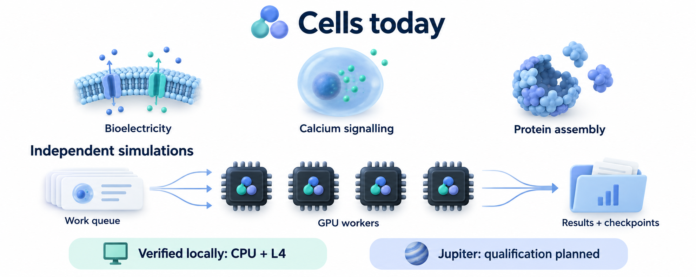
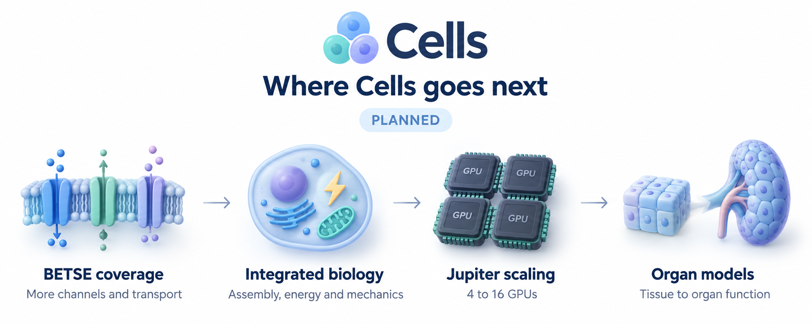

# Cells


Cells is an early-stage multiscale simulator for investigating how cellular state,
communication, and tissue organisation affect memory, inheritance, and adaptation.
The long-term goal is a whole-organ model and later multiple interacting organs.
The simulation stack is **Python and JAX**, with independent CPU references and
local NVIDIA GPU execution. See [Progress](PROGRESS.md) for current verification
status and [Scientific basis](docs/SCIENTIFIC_BASIS.md) for the research background.

## Current functionality



- **Electrical cells and tissues:** ion transport, membrane voltage, pumps,
  channels, gap junctions and extracellular fields in selected model families.
- **Cell chemistry:** calcium and IP3 signalling, internal compartments and
  chemical reactions.
- **Protein assembly:** stochastic cage formation, finite material pools,
  breakable bonds and experimental coupling to cell models.
- **Repeatable experiments:** checkpoints, restart, branching and independent
  simulation ensembles, with CPU/L4 comparisons and conservation checks.

For GPU ensembles, workers take batches of independent simulations from a shared
queue and save their results and checkpoints. The four-worker illustration shows
that execution design. Numerical qualification has used CPUs and one L4; Jupiter
execution remains to be qualified. Distributing one interacting tissue across
multiple GPUs requires further development. See the
[GPU and ensemble guide](docs/GPU_ENSEMBLES.md).

Verified results apply to the declared models and test conditions. Selected
BETSE comparisons pass; full BETSE equivalence and biological validation remain
unfinished. The [assembly-to-cell coupling](docs/CAPSID_ASSEMBLY.md) is an
experimental modelling hypothesis.

## In progress

- Combining spatial fields, active membrane transport and dynamic junctions in
  BETSE comparisons.
- Extending verification of the integrated cell, tissue and assembly models.
- Bringing new components into the shared configuration, checkpoint and ensemble
  workflows.

## Planned



The next directions are broader BETSE coverage, richer cell physiology including
water and mechanics, and Jupiter qualification from four to sixteen GPUs.
Experimental calibration and organ models are longer-term goals. The organ
illustration is schematic; it does not select a particular organ to build first.
Detailed scope and priorities are recorded in [Progress](PROGRESS.md) and the
[Roadmap](docs/ROADMAP.md).

## Development history

The entries below record earlier development milestones. Current run status is
maintained in [Progress](PROGRESS.md).

D108 [independently closes the Na/K kinetic source contact](reports/REF005A_PUMP_CONTACT_CLOSEOUT.md):
1,240 comparisons and 248 raw flux triplets. D110 now also
[closes the coupled six-case numerical candidate](reports/NUM011_COUPLED_CLOSEOUT.md):
4,070 comparisons, 3,756 physical-state records and 12 restart checks, without
solver reruns. These are short 10 ms cases, not biological or equilibrium validation.
D111's [process gate is reviewed](reports/SPEC010_PROCESS_CLOSEOUT.md):
930 reference comparisons and all 348 targeted regression tests pass.
D113 now integrates the law into **`finite_extracellular@2` / 0.16.0.dev0**,
with explicit metabolism parameters, conservative shared-bath accounting and
stage/interpolation safeguards. D114 now
[independently closes its bounded acceptance](reports/SPEC010_FAMILY_CLOSEOUT.md):
**422 tests pass**, with 12 saved-reference trajectories, 12 exact restart
suffixes and independently reconstructed material, charge and energy accounting.
This is not a full release promotion. D116 independently
[closes the native pump–leak lifecycle](reports/REF005B_PUMP_LOOP_CLOSEOUT.md):
73,188 comparisons, all 48 observed updates and six exact observer pairs pass.
D117's [matched 1 ms pilot](docs/BETSE_MATCHED_PUMP_PILOT.md) completed all runs
but failed its final energy criteria. D118's
[independent diagnosis](reports/REF005C_PILOT_FAILURE_DIAGNOSIS.md) reproduces
six misses and identifies native first-order timestep error; all 36 refinement
groups and six complete restart checks pass. That original attempt stays rejected.
D119's [finer native ladder](docs/BETSE_PUMP_REFINEMENT.md) now reports
**616,806 comparisons / zero failures in 501.812 s**, with unchanged physics and
tolerances. Existing Cells/reference runs are reused, not rerun. Cells does not
adopt upstream numerical errors as target behavior; production remains unchanged.
D120's independent review now passes in **337.048 s**: **203,274 acceptance
comparisons with zero failures**, plus 10,610,676 additional law/conservation/link
checks. D121 [closes the bounded 1 ms pilot](reports/REF005C_PUMP_PILOT_CLOSEOUT.md),
preserving the original rejection and all Cells/reference evidence.
D122 adds the [longer-duration plan](docs/BETSE_PUMP_RELAXATION_PLAN.md):
qualify lossless bounded recording first, then a separately registered 10 ms
extension, followed by relaxation and controlled recovery. **35 planning checks
pass**; no long simulation, new solver or biological acceptance is implied.
D123 implements the [lossless native recorder](validation/betse/native_recording/README.md):
**132 checks pass**; the full 36-row conversion now passes exact reconstruction
in **215.987 s**, reducing native JSON from **1.51 GB to 18.1 MB** (83.6× smaller).
D124 adds a [separately implemented decoder/review](validation/betse/native_recording_audit/README.md),
with **133 passing preflight checks**. Its full review now passes **54.7 million
exact comparisons with zero failures**; D125 [closes the offline gate](reports/REF005D_CODEC_CLOSEOUT.md)
and implements [live recording and matched window/restart qualification](reports/REF005D_LIVE_HANDOFF.md).
That new same-1 ms gate leaves both simulators' physics unchanged. BETSE's own
histories remain intact; no bounded-native-memory or longer-duration claim.
D126 [closes the 79-test preflight and proceeds to the full same-1 ms campaign](reports/REF005D_LIVE_QUALIFICATION_LAUNCH.md),
using the exact tested source context. This is a detached qualification run,
not a passing full-matrix result or independent live closure at launch.
D127 [preserves its controller-only logging failure and continues with Cells](reports/REF005D_LIVE_CONTINUATION_LAUNCH.md):
all 36 native comparisons/eighteen pairs reported exact agreement, but the
script-name prefix differed from the smoke invocation. **54 new regression
checks pass**; all native hash links verify. Reuse that saved work and run only
the outstanding Cells matrix, with unchanged frozen simulator code and limits.
Full producer acceptance and independent review remain pending.
D128 [corrects the subsequent output-path collision](reports/REF005D_OUTPUT_LAYOUT_LAUNCH.md):
ordinary baselines and window recordings now have separately owned directories.
**51 fast harness checks pass**. One detached job gates the full matrix on a
real checkpoint-heavy case through the same campaign worker. The old attempts
stay failed, native results are reused, and simulator physics remains unchanged.
The probe and full matrix subsequently **passed in 553.910 s**. D129 adds the
[independent saved-evidence review](reports/REF005D_LIVE_AUDIT_LAUNCH.md): exact
native-stream and saved Cells-array checks, plus reconstructed expected receipts
for unsaved windows. **The independent review passed in 128.769 s**, with zero
failures. D130 [closes that bounded recording scope](reports/REF005D_LIVE_CLOSEOUT.md)
and launches an [18-solve 10 ms reference/domain study](reports/REF005E_REFERENCE_SCOPE_LAUNCH.md)
detached after **73 passing preflight checks**, before native timestep/resource
selection and a full matched campaign. The study's result remains pending. No
longer-horizon correspondence, biological or GPU claim; both earlier attempts
remain failed. Junction topology and original-data readiness have separate gates.
See [Progress](PROGRESS.md) for current evidence and next gates.
Try the [one-cell configuration](configs/kinetic_finite_cell.json); see the
[contract](docs/KINETIC_FINITE_BATH_MODEL.md) and
[acceptance handoff](reports/SPEC010_FAMILY_HANDOFF.md).
The synthetic v1 model remains available. Its fourteen initial-case fingerprints,
layouts and complete derivatives match the pre-edit archive exactly. The
1,273-file pre-integration context and accepted 0.15.0.dev0 remain separately
preserved; old checkpoint source checks are not weakened.

Completed development acceptance (D063–D064): a [versioned runtime amendment](reports/CORE010_ACCEPTANCE_V2.md)
sets a two-hour limit for a fresh complete spatial panel, with unchanged CPUs,
artifact limits, definitions, equations and tolerances. All 106 new resource and
byte-replay tests and 228 combined preflight checks pass. The full acceptance-02
capture passed in **73 minutes**, covering 57 scalar runs and 12 streams, with
352 unchanged captured files. Its separate audit, **4190-test six-context matrix**
and [development closeout](reports/core-010-v2-closeout.json) now pass. The detached
closeout took 36 minutes. The first stopped capture remains immutable; stable
production remains 0.14.0 and accepted development remains 0.15.0.dev0.

First executed BETSE contact (D065/REF-003a): [54 passive-law probes pass](reports/REF003A_PASSIVE_CONTACT.md)
against the unmodified pinned upstream function, with 1047 tolerance comparisons,
15 exact-blocking checks, an independent saved-data audit and 52 adapter tests.
Native and matched constants are reported separately; the capture took 4.681 s.
Production is unchanged. This is component correspondence, not a whole-cell
trajectory or biological validation.

Completed BETSE alignment (D067–D068/REF-003c): the [explicit seven-cell capture passes](reports/REF003C_CLUSTER_ALIGNMENT.md)
19,691 numerical checks in 18.666 s, using the existing Cells finite-bath family
on NumPy, eager JAX and compiled JAX. It covers native initialization, charge,
instantaneous rates and prescribed single updates—not a full trajectory.
The [independent audit and closeout](reports/REF003C_CLOSEOUT.md) now pass all
171 short adapter tests, including 43 new saved-evidence checks; production remains unchanged. The earlier
[one-cell fixture](reports/REF003B1_PREPARATION.md) stays rejected, and a literal
one-centre SVG also fails native triangulation.

First BETSE trajectory (D069/REF-003d): all 32 native/Cells runs completed in
79.695 s without warnings, but 36 of 129,384 checks failed on shared-bath Na/K
amount changes. The [saved-data audit](reports/ref-003d-failure-audit.json)
exactly reproduces the rejection; the original packet stays unchanged.

D070–D071's [refined trajectory and independent closeout](reports/REF003D_CLOSEOUT.md)
now pass **435,144 numerical comparisons** and **325 adapter tests**, including
49 new evidence checks. Native 25/12.5/6.25 µs refinement meets the unchanged
criteria; the capture took 104.031 s. Repeated native 25 µs records and all eight
Cells numerical records match v1 exactly. Neither simulator was rerun for closeout;
all 352 accepted files / 51 production modules remain unchanged. This qualifies
only the 1 ms seven-cell passive/blocked finite-bath comparison, not biology or
general BETSE parity. No follow-up capture is launched automatically.

D072's [intervention design/control review](reports/REF003E_INTERVENTION_DESIGN.md)
passes **38 focused tests in 3.67 s**, without integrating either simulator.
BETSE fires interventions only in its SIM phase and uses a smooth additive pulse;
our qualified run used INIT. Its event clock needs an explicit conversion to
elapsed time. The [next design](docs/BETSE_INTERVENTION_PLAN.md) first bridges
the phase without intervention, then compares corresponding held controls and
responses. No production changes or new numerical/biological qualification.

D073 adds the [SIM preparation adapter and event observer](docs/BETSE_SIM_PHASE_BRIDGE.md).
Its first native preflight **failed in 9.491 s**: the old profiles-off setup lacks
the default tissue/target map needed by targeted interventions. All **73 focused
software and negative-evidence checks pass**, but no preparation or trajectory
is qualified. The failure is preserved, and the unchanged candidate cannot retry.
Next separate the phase, default-profile and zero-amplitude-event transitions;
production and all previously accepted evidence remain unchanged.

D074's [explicit profile bridge](reports/REF003E0_PROFILE_BRIDGE.md) now passes:
**six native preparations / 30 direct event dispatches in 17.360 s**, with
**87 focused tests passing**. Profiles-off, default-profile-on and zero-amplitude
event configurations preserve the same physical setup; partial state is saved
before metadata checks. The first failure remains unchanged. Next qualify the
full-loop phase/profile/event bridge; no new trajectory, biology or GPU claim.

D075 adds the [bounded full-loop pilot](reports/REF003E0_FULL_LOOP_PILOT.md):
**100 focused tests pass in 7.45 s**, before a separately registered 12-run
native SIM capture. It tests the same preparation inputs through 1 ms of actual
integration, with observer-off partners and exact retained INIT comparisons.
The capture is detached and user-polled; results and independent audit remain
separate. No new Cells run, production change or expanded bridge qualification.

D075's capture subsequently passed all 12 runs / 240 observed steps in
**26.139 s**. D076's [independent closeout](runs/ref-003e0-loop-audit-2026-09-12/audit-01/completion.json)
now passes **88,956 numerical comparisons and 165 focused tests in 32.682 s**.
It qualifies only the narrow matched-constant 25 µs / 1 ms SIM pilot; neither
simulator was rerun. D077's expanded capture now passes **72 runs / 3360 observed
steps in 203.562 s**, covering both constant sets and all three refined timesteps,
with exact observer/variant/pilot-overlap controls and no Python warnings.
The native runner, observer, Cells production and earlier evidence are unchanged.
D078's [joint independent closeout](runs/ref-003e0-expanded-audit-2026-09-12/audit-01/completion.json)
now passes **1,232,616 numerical comparisons and 433 focused tests in 167.679 s**.
This qualifies the expanded zero-amplitude SIM bridge only; no simulator was
rerun. Its original prelaunch/capture receipts remain unchanged.

D079 adds the [prescribed suppression/recovery design](docs/BETSE_HELD_INTERVENTION.md)
and input compiler. Control-only probes check actual pinned-pulse arithmetic
and 36 Cells grids, keeping the input hold, solver refinement and observation
side separate. The proposed pilot has four conditions, eight native runs and
24 eager/compiled Cells runs at matched constants and a fixed 25 µs hold.
D079 itself registers/launches no trajectory; production is unchanged, with no
new biological/GPU claim. All **80 focused design/control tests pass in 14.14 s**.

D080's [actual nonzero-event preflight](reports/REF003E1_DISPATCH_PREFLIGHT.md)
now passes **four preparations / 160 dispatches in 24.463 s**, including 40
nonzero targeted events and 57,600 diffusion-value checks. Actual targets,
modifiers and state invariance pass; no transport or time integration ran.
All **75 focused tests pass in 8.48 s**; previous evidence and production remain
unchanged. D081 below implements the separately approved response pilot.
No response, biological, GPU or restart qualification is inferred from dispatch.

D081's [held-input response pilot](docs/BETSE_HELD_RESPONSE_PILOT.md) adds
control-aware native capture and model-free saved-data comparison for eight
native / 24 eager-JIT Cells runs. It keeps the fixed 25 µs input hold separate
from Cells solver refinement, and distinguishes state, fresh current and
interval/cumulative transfer. Production and old evidence remain unchanged.
The [prelaunch handoff](reports/REF003E1_RESPONSE_PILOT.md) binds focused checks
and resources before detached execution: **122 tests pass in 21.41 s**, with
359 Python files passing quality checks. Status is user-polled; independent
audit/regression is separate. Known coarse-native baseline errors remain
failures under unchanged criteria, not a reason to claim convergence or biology.

D081 subsequently completed all 32 runs in **715.769 s**, without warnings,
then rejected **150 of 345,576 comparisons**. D082's [joint saved-data closeout](runs/ref-003e1-response-audit-2026-09-13/audit-01/completion.json)
now completes in **50.390 s**, independently rebuilding 147,312 surface checks
and preserving all 150 shared-bath failures. A separate report-list correction
does not change the rejection. All **70 new tests pass**; the unchanged legacy
suite records 121 passes / one expected metadata-guard failure from the user's
exact `.gitignore` change. No original evidence or production was altered.

D083 implements the [finer-input dispatch preflight](docs/BETSE_REFINED_DISPATCH_PREFLIGHT.md):
eight fresh preparations / 960 direct event dispatches at 12.5 and 6.25 µs,
without transport or integration. All **109 software tests pass in 36.21 s**.
The [prelaunch handoff](reports/REF003E1_REFINED_DISPATCH_HANDOFF.md) binds a
98-input capsule and six-minute detached attempt; actual native results are
separate and user-polled. This first refinement step checks input application,
not a finer response or biological/GPU qualification. The
[actual preflight](runs/ref-003e1-refined-dispatch-2026-09-13/preflight-01/completion.json)
now passes in 116.002 s, with no warnings or integration. No automatic trajectory.

D084 implements [two finer response panels](docs/BETSE_REFINED_RESPONSE_PANEL.md),
with 16 new native / 48 new Cells runs and explicit reuse of the rejected coarse
packet. The first software run found four checker/test issues, now corrected;
its receipt remains intact and all 24 targeted checks pass in 31.84 s.
The final [114-test regression](runs/ref-003e1-response-refined-preflight-2026-09-13/checks-01/completion.json)
now passes in 95.688 s total, without failures/errors/skips or simulation launch.
The separately approved capture stopped after **1830.727 s**, with all 16 native
and 26 Cells runs completed: the next row exceeded its configured 16 MiB trace
reservation, before integration. The failed attempt remains unchanged under
`runs/ref-003e1-response-refined-2026-09-13/capture-01`.
The [historical handoff](reports/REF003E1_REFINED_RESPONSE_HANDOFF.md) stays frozen.
No automatic polling or follow-up audit. Finest held-input correspondence,
input-sampling sensitivity and solver convergence remain distinct. No production
change or new numerical/biological/GPU qualification.

D085's [resource-only continuation](docs/BETSE_TRACE_BUDGET_CONTINUATION.md)
raises eight unexecuted definitions to **64 MiB**; the largest estimated trace
reservation is 24.6415 MiB, not measured peak RAM. All **48 production resource
checks and 47 focused tests pass**. Completed rows pass 666,108 internal checks
and are reused directly, without rerunning BETSE or relabelling old results.
The **22 remaining Cells runs** and unchanged comparison completed in
**2239.322 s**, under the two-hour / 1 GiB combined artifact cap. All
**2,298,936 required checks pass**; 4173 diagnostic failures remain within
2,494,936 total checks. The
[handoff](reports/REF003E1_TRACE_RESUME_HANDOFF.md) records exact provenance and
limits; only actual receipts under `runs/ref-003e1-trace-resume-2026-09-13/capture-01`
establish launch/completion. Its earlier handoff and both capture attempts stay frozen.

D086's [independent finer-response audit](docs/BETSE_REFINED_RESPONSE_AUDIT.md)
replays the complete saved comparison and separately rebuilds 1,121,904 surface
checks, preserving all 4173 failures. All **105 new software checks pass in
28.38 s** after correcting a new test's import-guard exception expectation;
the failed receipt is retained. The user-reviewed
[joint completion](runs/ref-003e1-refined-response-audit-2026-09-13/audit-01/completion.json)
now passes in **249.644 s**, with **336/336 tests** and **2,298,936 required
comparisons**, zero failures. This closes only the seven-cell, 1 ms, matched-
constant, finest-held 6.25 µs response on the registered CPU backends/subdivisions.
The original [handoff](reports/REF003E1_REFINED_AUDIT_HANDOFF.md), captures and
4173 diagnostic failures remain intact. No simulator was rerun. Native/forcing
convergence, biological validation and GPU qualification remain separate.

D087/REF-004a adds the [isolated voltage-gated channel comparison](docs/BETSE_VOLTAGE_GATE_CONTACT.md).
It exercises the existing Kv1.5 kinetics and shared RK4 against the pinned native
channel: six voltage protocols, fast/slow state, three timesteps, and distinct
discrete/continuous references. The engineering temperature is 298.15 K; this
does not add a temperature law, whole-cell voltage clamp or coupled-cell result.
All **63 short preflight tests pass in 1.11 s**, before one detached
**180-second / 64 MiB** capture.
Actual status belongs to `runs/ref-004a-kv1p5-2026-09-13/capture-01`, with no polling,
retry or automatic audit. Production equations, releases and old evidence are unchanged.

D088 closes that channel benchmark independently: the
[actual audit](reports/REF004A_KV1P5_CLOSEOUT.md) passes in **0.979 s**, replaying
and independently reconstructing all **11,266 comparisons**. All **102 focused
tests pass in 2.58 s**, with all old capture/source evidence unchanged and neither
simulator rerun. This qualifies the registered isolated kinetics, not coupled
cells or biology. The next [coupled-channel preflight design](docs/BETSE_COUPLED_CHANNEL_PLAN.md)
checks face-to-cell gate mapping, channel permeability/flux and conservative
cell/bath updates before a full dynamic comparison. No additional job was launched
at that closeout.

D089 implements that [channel setup / single-transfer preflight](docs/BETSE_CHANNEL_TRANSPORT_PREFLIGHT.md).
All **76 focused software tests pass in 2.03 s**; production and earlier evidence
remain unchanged. Four minimal native network controls, explicit face-to-cell
gate mapping and separate ion/current ledgers precede any coupled trajectory.
The Cells check uses matched-state RHS and a prescribed transfer, not a new
integrator. The [handoff](reports/REF004B_TRANSPORT_PREFLIGHT_HANDOFF.md) registers
one detached **300-second / 128 MiB** attempt at
`runs/ref-004b-transport-2026-09-14/capture-01`; actual receipts establish results.
No automatic polling, retry or audit; no new biological or GPU qualification.

That attempt stopped after **4.672 s** on an adapter setup error: BETSE requires
an empty biomolecule list, not null. D090's [configuration-only correction](docs/BETSE_CHANNEL_SETUP_FIX.md)
preserves the failed packet and all numerical criteria. **107 focused tests
pass in 7.00 s**, including actual BETSE YAML loading and type-contract checks;
this is not yet evidence of successful network initialization or transport.
The [new handoff](reports/REF004B_SETUP_FIX_HANDOFF.md) binds one fresh detached
attempt at `runs/ref-004b-setup-fix-2026-09-14/capture-01`, with the same limits
and no polling or automatic follow-up. Production remains unchanged.

D090 subsequently executed all twelve native cases, then stopped after
**7.084 s** before any Cells transfer: our launcher set `JAX_DISABLE_JIT=false`
against the registered absent value. D091's [environment-only correction](docs/BETSE_CHANNEL_RUNTIME_FIX.md)
reproduces registered flags exactly, keeping the strict runtime check intact.
All **152 focused tests pass in 13.25 s**, including five real-worker startup
probes (4.589 s). Corrected startup reaches the input read; all four negative
controls are rejected. No transport runs in those probes. Both failed captures
and all production/equations/criteria remain unchanged. The
[handoff](reports/REF004B_RUNTIME_FIX_HANDOFF.md) registers a fresh detached
300-second / 128 MiB capture at `runs/ref-004b-runtime-fix-2026-09-14/capture-01`.
Actual receipts and a later independent closeout remain separate; no polling,
automatic retry or new biological/GPU qualification.

D091's capture now passes all **37,068 comparisons in 21.272 s**, without
warnings. D092's [independent audit](docs/BETSE_CHANNEL_TRANSPORT_CLOSEOUT.md)
replays the saved comparison and separately rebuilds every numerical row with
80-digit arithmetic, including explicit geometry, ion, current and charge
accounting. All **220 focused tests pass in 33.27 s**, with earlier software
failures retained and no change to production or captured evidence. The
[handoff](reports/REF004B_TRANSPORT_AUDIT_HANDOFF.md) binds one detached
**120-second / 64 MiB** saved-data audit. Its actual independent closeout now
**passes in 3.215 s**, with zero failures, twelve definition contracts and two
hidden-state controls. No simulator was rerun or original evidence rewritten.
Only this bounded single-transfer contact is qualified.

D093 prepares both [native full-loop initialization/observation](docs/BETSE_CHANNEL_LOOP_PREPARATION.md)
and the [small channel–voltage feedback pilot](docs/BETSE_CHANNEL_FEEDBACK_DESIGN.md).
Eight short native runs check four controls with observer-on/off counterparts,
an explicit once-only initial m/h fixture, gate/transfer/current ordering and
elapsed-time semantics. Twelve candidate Cells definitions check initial coupled
rates and resource eligibility through the unchanged engine. A pure independent
continuous vector field is prepared; no Cells trajectory or dynamic convergence
claim follows from readiness. The separate bounded capture is detached under
240 s / 128 MiB, with no polling, retry or automatic follow-up. Production,
biological validation and GPU status are unchanged. The actual preparation now
**passes in 18.031 s**: 73,744 native boundary comparisons and 348 Cells initial
rate comparisons, zero failures and no warnings. D094 adds a separate
[saved-data closeout](docs/BETSE_CHANNEL_LOOP_CLOSEOUT.md), independently rebuilding
all 74,092 comparisons plus full-state, byte, clock and resource contracts.
No simulator is rerun. The registered audit and any later dynamic pilot remain
separate; original pending-audit evidence is not rewritten.

D094's actual audit now **passes in 5.541 s**, independently reconstructing all
**74,092 comparisons with zero failures**. D095 implements the next
[reference-gated feedback pilot](docs/BETSE_CHANNEL_FEEDBACK_PILOT.md): independent
DOP853 refinement and a Radau cross-check precede a fixed 2 ms native/Cells
comparison. The panel uses full native observer pairs and the actual eager/JIT
production runner, including complete checkpoint resumes. Reference convergence
must pass before simulator workers start. Neither engine receives the other's
evolving state. Capture and subsequent independent qualification remain separate;
no production, biological or GPU capability is promoted by this implementation.

The D095 capture now **passes in 338.424 s**: reference convergence, all finest-grid
requirements, 5,181,760 native accounting identities, four restart pairs and four
eager/JIT pairs pass. Fourteen coarse native diagnostic misses are retained and
errors shrink under refinement. D096 implements the separately requested
[independent saved-data audit](docs/BETSE_CHANNEL_FEEDBACK_CLOSEOUT.md), including
numeric-only checkpoint decoding and separate mathematical reconstruction.
The actual D096 audit now **passes in 172.504 s**: **5,806,006 independent
comparisons**, zero mismatches, all 24 complete checkpoints / 1,296 arrays, and
unchanged fourteen coarse misses. The [closeout](reports/REF004B_FEEDBACK_CLOSEOUT.md)
qualifies only the fixed 2 ms coupled pilot. No simulator/reference integration
was rerun, and biology, broader BETSE parity and GPU remain unqualified.
D097's [history preparation](docs/BETSE_CHANNEL_HISTORY_PREFLIGHT.md) passes
2,442 comparisons in 14.036 s. D098's [saved-data closeout](reports/REF004C_HISTORY_PREPARATION_CLOSEOUT.md)
now passes in 3.062 s, including 1,404 alternate rate checks and 528 layout-array
checks, without integration. D099 implements the next
[reference-gated paired comparison](docs/BETSE_CHANNEL_HISTORY_PILOT.md): twelve
reference solves must pass before a detached 24-native / 16-Cells trajectory
panel with refinement, full-state restart and a-minus-b response contrasts.
All **56 focused software tests pass in 22.96 s**. The actual
[paired capture](reports/REF004C_PAIRED_HISTORY_CAPTURE.md) now passes in
**391.917 s**, with 7,367,280 native accounting identities, all required
trajectory/refinement/restart checks and all paired contrasts passing. Preserve
21 coarse diagnostic misses. The approximately 0.722 mV final active reference
separation passes the registered signal gate; blocked voltage stays equal.
D100's actual [independent closeout](reports/REF004C_PAIRED_HISTORY_CLOSEOUT.md)
now **passes in 240.629 s**: **8,036,300 independently reconstructed comparisons**,
zero mismatches, all 24 complete checkpoints and 21 coarse misses preserved.
This closes the fixed 2 ms paired numerical scope, not biological memory,
suppression/release, broad BETSE parity or GPU qualification.

D101's [suppression/release input design](docs/BETSE_CHANNEL_RELEASE_DESIGN.md)
uses existing availability schedules without production changes. All **107
focused tests pass in 11.88 s**, including 54 real instantaneous CPU/JAX probes
that preserve gate evolution and accumulated transfers while blocking transport.
The native candidate is an explicit numeric parameter input, not a built-in
BETSE tissue event or a drug model. Actual native application/single-update
preflight is implemented separately in D102; D101 launched no trajectory.

D102's [native input preflight](docs/BETSE_CHANNEL_RELEASE_PREFLIGHT.md) now
passes **71 software tests in 14.01 s**, including real block/release application
on fresh BETSE objects, observer partners and independent single-update checks.
The actual native panel completed all **144 phases / 288 updates**, without
warnings, but its checker rejected a one-ULP bath change during zero-flux
averaging. The [failure](reports/REF004D_RELEASE_PREFLIGHT_FAILURE.md) is retained.
D103's [saved-data review](docs/BETSE_CHANNEL_RELEASE_REVIEW.md) reconstructs the
exact averaging operation without changing captured data or physical tolerances.
All **66 review tests pass in 10.66 s**; the actual
[saved-input closeout](reports/REF004D_RELEASE_INPUT_CLOSEOUT.md) now passes
**916,176 comparisons in 24.469 s**, including 1,776 exact source-order means.
All 104 original rejections remain. Input queries are not elapsed simulated
times; this closes input/single-update readiness, not dynamic release.

D104 adds the [independent piecewise reference](docs/BETSE_CHANNEL_RELEASE_REFERENCE.md):
**102 focused tests pass in 4.35 s**. Its detached seven-cell candidate has two
histories, four conditions and three solver settings (**24 paths / 48 segments**),
exact state carry at block/release boundaries, analytic blocked-gate checks,
no-op controls and a fixed signal/convergence gate. Its actual
[reference capture](reports/REF004D_RELEASE_REFERENCE_CAPTURE.md) passes
**1,485,380 comparisons with zero failures in 160.675 s**. It runs neither BETSE
nor Cells trajectories. Its independent saved-reference review subsequently
closed in D105; the original D104 receipt is unchanged.

D105 adds that review followed, **only if it passes**, by the
[timed native/Cells comparison](docs/BETSE_CHANNEL_TIMED_RELEASE.md): 48 native
phases, 32 Cells trajectories and eight release-boundary restarts. Preserve the
same 2 ms experiment and tolerances; check elapsed input timing, both sides of
switches, complete state, refinement and signed history contrasts. Long execution
is detached with no polling or automatic post-capture audit. Production is
unchanged; this does not establish biological validation or GPU qualification.

The actual [timed capture](reports/REF004D_TIMED_RELEASE_CAPTURE.md) now passes
in **1,004.27 s**, including **14,772,920 native boundary comparisons** and all
required/refinement checks. All **49 coarse misses** remain. D106 adds its
[independent saved-data audit](docs/BETSE_CHANNEL_RELEASE_CLOSEOUT.md): alternate
numerical columns, full state, both switch sides and all 48 checkpoints. It runs
detached without new trajectories, production changes or automatic follow-up.
That audit now [closes successfully](reports/REF004D_TIMED_RELEASE_CLOSEOUT.md)
in **387.772 s**, reconstructing **15,042,946 comparisons / 182 groups** with
zero column mismatches. The 49 coarse misses remain. This closes the registered
numerical scope only; the original capture's pending-audit receipt is preserved.

Completed development work (D061/CORE-010): the [passive spatial family](docs/SPATIAL_EXTRACELLULAR.md)
is implemented in **0.15.0.dev0**. One cell can exchange ions with near/far
finite outside volumes through a same-stage electrical field solve. Independent
cell/outside/membrane/face axes also support pure-bulk transport, loops and
two-cell chains. All [156 development tests pass](reports/CORE010_IMPLEMENTATION.md);
all **3962 implementation-stage regression tests pass** across six source contexts.
The subsequent full development acceptance above now passes; stable promotion
remains separate. Accepted 0.14.0 and its
reference context are [preserved](reports/core-010-preservation.json).

D062 adds [recorded acceptance tooling](reports/CORE010_ACCEPTANCE.md) for that unchanged development build.
All 122 new independent-audit/corruption preflight checks pass. Compiled, refined,
restart and window/cohort artifacts are captured; all 1,022 scalar-restart arrays
match bytes exactly. The full attempt stopped at its fixed one-hour budget after
ten of fourteen eager cases completed; the evidence is preserved, not accepted
as a complete panel. All **4084 tests pass** in the new six-context regression
matrix, with no failures, errors or skips. The separately budgeted v2 capture
and its development closeout above now pass; stable production remains 0.14.0.

Latest production slice (D058/CORE-009): the [finite-outside CPU/JAX family](docs/FINITE_EXTRACELLULAR.md)
is implemented and [accepted](reports/CORE009_ACCEPTANCE.md) in 0.14.0.
Cells can now change a shared, finite ion supply, which feeds back into their
transport. All **150 new targeted and 3616 maintained/historical regression
tests pass**, with no failures, errors or skips in the final matrix.
Fourteen reference cases, full restart/branch/window/cohort checks and exact
earlier-model replay pass. A retained historical
[launcher failure](reports/core-009-regression-correction.json) was corrected
without changing physics or original tests; the final capture reproduces all
25,654 saved numerical arrays exactly. [Release closeout](reports/core-009-closeout.json)
is complete. Spatial extracellular design and its bounded numerical reference
now pass separately; the spatial development family is under CORE-010 qualification,
and organ models remain future work.

Completed numerical slice (D057/NUM-009 v2): the [amended finite-outside reference](reports/NUM009_REFERENCE_V2.md)
passes all fourteen short cases / 112 attempts at the reference gate and selects
1 ms RK4/cubic with passing 0.5 ms refinement. Every inventory is explicitly
integrated; the general reference correction preserves exact blocking without
projecting state or weakening checks. The audit exactly replays 251400 observations;
168 targeted tests and all **3466 maintained/historical regression tests pass**.
The [first failed attempt](reports/NUM009_REFERENCE.md) and all its sources remain
unchanged. Production stayed 0.13.0 during that reference-only qualification.

Latest completed design slice (D059/SPEC-009): the [spatial extracellular contract](docs/SPATIAL_EXTRACELLULAR_SPEC.md)
and [independent arithmetic reference](reports/SPEC009_DESIGN_CHECK.md) now cover
one cell with near/far outside compartments, without independently grounding them.
Eight synthetic definitions and 44 state/control evaluations pass 1,016 scalar
comparisons against a separate 70-digit calculation; all 85 new unit tests pass.
This was design/reference work only: production stayed 0.14.0 during that slice.

Latest numerical reference (D060/NUM-010): [short spatial trajectories](reports/NUM010_REFERENCE.md)
pass fourteen cases / 140 attempts, selecting **0.125 ms RK4/cubic with passing
0.0625 ms refinement**. Analytic salt relaxation, 8/16/32-volume grid refinement,
full accounting and all fourteen bitwise restarts pass. The read-only audit
verifies 339 payloads / 21 sources; seven rejected coarse trials and two completed
accuracy failures are retained. All 190 preflight tests and **3806 regression
tests across five source contexts pass**; [preservation closeout](reports/num-010-closeout.json)
is complete. CORE-010 is the separate CPU/JAX implementation gate, not a
GPU or biological promotion.

Previous design slice (D055/SPEC-008): the [finite extracellular-compartment contract](docs/FINITE_EXTRACELLULAR_SPEC.md)
and [independent reference](reports/SPEC008_DESIGN_CHECK.md) pass 10,671 arithmetic/
accounting checks and all **3298 regression tests**, including 88 new tests,
with no failures, errors or skips. That design-only slice added no production model.
Outside amounts, opposing membrane charge and
the outside's chemical energy are explicit, with a shared reduction for later GPUs.

Previous production slice (D054/CORE-008): the [physical ionic graph family](docs/PHYSICAL_IONIC_GRAPH.md)
is implemented and [accepted](reports/CORE008_ACCEPTANCE.md) in 0.13.0, with
**3210 passing regression tests**, including 114 new tests. It connects heterogeneous
cells through sparse state-bearing junctions using the existing CPU/JAX solver,
complete checkpoints and window/cohort execution. Twelve short reference cases,
exact restart/branch/cohort replay and independent physical accounting pass.
SPEC-008 and NUM-009 supply the finite-outside design and numerical reference;
CORE-009 now implements that distinct family. GPU qualification, spatial environments
and organ models remain later gates.

The [first endpoint pilot is closed](reports/BIO003_PILOT_CLOSEOUT.md)
as a descriptive comparison, not biological validation. Its C1/C2-only prediction
of C3 remains -14.59 mV versus approximately -18 mV; the supplement review did not
resolve measurement uncertainty or recording-boundary assumptions.

We now target [BETSE-level scientific coverage](docs/BETSE_CAPABILITY_ROADMAP.md)
through our [multiscale and parallel execution architecture](docs/MULTISCALE_EXECUTION_ARCHITECTURE.md).
The design distinguishes independent GPU experiments from splitting one
interacting tissue across GPUs, with multi-host operation later. This is a
roadmap, not achieved parity or a GPU implementation.
[SPEC-005's one-cell multispecies contract](docs/MULTISPECIES_MEMBRANE_SPEC.md)
and independent scalar reference are now complete: [1,546 instantaneous checks
and 352 targeted tests pass](reports/SPEC005_DESIGN_CHECK.md).
[NUM-006 now qualifies short multispecies trajectories](reports/NUM006_REFERENCE.md):
14 cases, independent solvers/refinement, a bounded 0.01 s RK4/cubic candidate,
passing saved-evidence audit and 446 targeted tests.
CORE-006 now implements the [multispecies CPU/JAX assembly](docs/MULTISPECIES_MEMBRANE.md)
as `multispecies_membrane@1` in 0.11.0: data-defined species/valence, explicit
charge support, role-bound transport, complete energy/exchange history and shared
scalar/cohort execution. [Production acceptance passes](reports/CORE006_ACCEPTANCE.md):
all 14 frozen cases in eager/JIT, exact fresh-process restarts and cohort replay,
and **2565 tests** across current-production and preserved-reference contexts.
The seven older families retain exact regression results; accepted 0.10.0 sources
were archived before edits. D049 now delivers [SPEC-006's first state-bearing
channel contract](docs/VOLTAGE_GATED_CHANNEL_SPEC.md): a pinned Kv1.5-style
two-gate reference, separate kinetics/abundance/availability and explicit
ionic-current/charge accounting. [All 7528 reference checks and 105 new tests
pass](reports/SPEC006_DESIGN_CHECK.md); all **2670 regression tests** pass across
the current-production and preserved-reference contexts, with no failures or skips.
That specification alone is not a production channel or whole-cell voltage clamp. D050 now completes
[NUM-007 coupled-cell numerical qualification](reports/NUM007_REFERENCE.md):
14 cases, 98 attempts and a selected **0.5 ms coupled RK4/cubic** candidate with
passing 0.25 ms refinement. Coarse failures are retained; the 214-payload audit
replays 947939 sampled rows, and all 205 targeted tests pass, including 100 new.
All **2770 regression tests pass** (1799 current-production and 971
preserved-reference), with no failures or skips at that stage.
D051 / CORE-007 now implements the [state-bearing membrane channel](docs/VOLTAGE_GATED_MEMBRANE.md)
as `voltage_gated_membrane@1` in 0.12.0. Two retained gates, independent channel
availability and a separate transfer ledger use the existing scalar/window/cohort
engine. All **2883 regression tests** and 113 targeted tests pass;
[full production acceptance](reports/CORE007_ACCEPTANCE.md) is complete on all
fourteen frozen cases in eager/JIT, with exact restart, branch and cohort checks.
Accepted 0.11.0 sources/checkpoints are preserved; older model laws and timestep
limits are unchanged. D052 now supplies the [physical ionic graph contract](docs/PHYSICAL_IONIC_GRAPH_SPEC.md)
and [independent instantaneous reference](reports/SPEC007_DESIGN_CHECK.md):
14,116 checks and 114 new tests pass on single/disconnected cells, heterogeneous
pairs and shared-recipient stars. All **2997 regression tests pass** across three
source contexts at that stage; production remained 0.12.0. D053 then completed
[NUM-008 short graph numerical qualification](reports/NUM008_REFERENCE.md):
twelve cases, 84 graph attempts and five independent component solves. The
predeclared rule selects **2 ms RK4/cubic**, with passing 1 ms refinement, only
for this short panel. The 194-payload/26-source audit exactly replays 256283
sampled rows without rerunning a solver. All **3096 regression tests pass** across
three source contexts, including 99 new tests, with no failures or skips.
**CORE-008 production assembly and bounded acceptance are now complete**;
this reference does not extend old model timestep bounds or qualify arbitrary
graph sizes, stronger coupling, multirate execution, biology or GPU behavior.
Optimization, GPU execution
and long E02 candidate work remain paused/deferred; historical evidence and
unfinished numerical gates are preserved below.

## Earlier milestones

The following records retain their original version, test counts and scope.
Current status is summarized above and in [Progress](PROGRESS.md).

For the new channel examples and their numerical/physical limits, see the
[channel guide](docs/VOLTAGE_GATED_MEMBRANE.md#run-and-inspect).

Version 0.10.0 adds [bounded independent-world cohorts](docs/WINDOWED_WORLDS.md):
each world's own clock and complete state, reusable prepared execution, incremental
recording and complete round checkpoints. That release passed **1057 tests**. Accepted scalar
and batch trajectories are exactly unchanged; new cohort recording and replay
pass across all seven models. In CPU profiles, 256-step cohorts use smaller history
buffers and finish faster than sequential scalar windows, but full batches still
finish sooner.
See [CORE-005b acceptance and measurements](reports/CORE005B_ACCEPTANCE.md).

The next scientific gate is now frozen: [E02-SW1](docs/E02_SWITCHING_PROTOCOL.md),
fresh preparation followed by 14 controlled switching conditions. Its primary
case needs a recipient and two neighbours; the current pair model cannot yet
run it. The [independent numerical plan](docs/E02_SWITCHING_NUMERICS.md) precedes
a general fixed-graph source model and assay execution. This is a design-only
addition: production remains 0.10.0, and no longer switching result is claimed.
That design gate passed **1086 tests**, including 29 new protocol checks;
see [SPEC-004 evidence](reports/SPEC004_PROTOCOL_CHECK.md).

The [independent graph reference](docs/SOURCE_EMT_GRAPH_REFERENCE.md) now passes
45 native derivative cases, 17 pair settings and 118 new tests. It composes
local dynamics once per cell with explicit reciprocal edges, including stars,
chains and disconnected components. This completes NUM-005a, not long-time
qualification or production graph support. That stage passed 1204 tests;
see [NUM-005a evidence](reports/NUM005A_REFERENCE.md).

The [bounded preparation reference](docs/SOURCE_PREPARATION_REFERENCE.md) now
passes all six 500-unit Radau/BDF/refined runs, cross-method agreement and the
frozen preparation criteria. Full E/M packets are hash-pinned, including ionic
state, fixed context and passive histories. The separate artifact audit passes;
regulatory phenotype remains stable while ions still drift, so these are not
equilibrium claims. [Preparation evidence](reports/NUM005B_PREPARATION.md).
That preparation gate passed **1243 tests**, including 39 new infrastructure tests.
Production remains 0.10.0. NUM-005c1 now adds a
[long-reference runner](docs/SOURCE_GRAPH_PATHS_REFERENCE.md): exact prepared-state
imports, lossless compressed evidence, and a registered 42-attempt panel under
unchanged budgets. The 44 new short engineering tests pass. Its first session
reached the one-hour cap with 24 complete trajectories/eight qualified conditions,
one retained partial attempt and 17 unstarted attempts. Independent subset auditing
and all **1287 tests pass**, including 44 new checks.
See [first-session evidence](reports/NUM005C1_LONG_REFERENCE.md).
A [registered continuation](docs/SOURCE_GRAPH_CONTINUATION.md) reuses the eight
audited trios and the same aggregate storage quota. It qualifies blocked and
ionic-only in the reverse direction, bringing the total to ten of 14. The
miRNA-only trio stops at a regulatory reference disagreement of 0.2263 against
the 0.1 limit; the remaining three controls were not started. Its artifact audit
passes without promoting that failed comparison. No tolerances changed or
automatic retry occurred. The full suite passes **1314 tests**, including 27 new
continuation/diagnostic checks. [Continuation evidence](reports/NUM005C1_CONTINUATION.md).
RK4 qualification and production graph implementation remain later gates.

The separately approved [A1 tighter-BDF diagnostic](docs/E02_BDF_REFINEMENT_A1.md)
now meets the unchanged reference threshold: maximum required disagreement
0.00533 versus 0.1. Its independent curve/grid/state/score audit passes, with the
original BDF failure retained. This supports a later amended reference policy;
it does not automatically promote the original case or complete the panel.
[A1 evidence](reports/NUM005C1_A1_BDF_REFINEMENT.md).
That diagnostic passed **1337 tests**, including 23 new refinement checks.
The user has now approved [A2 amended reference acceptance](docs/E02_REFERENCE_POLICY_A2.md),
its observers and the remaining controls. All 116 targeted engineering tests
pass, including 25 new panel checks. All 14 amended-policy conditions and their
observers now pass independent auditing; the original failed campaign remains
preserved. [A2 evidence](reports/NUM005C1_A2_REFERENCE_PANEL.md). Full regression
verification passes: **1362 tests**, including 25 new A2 checks. Production remains
0.10.0.

[Bounded RK4 engineering](reports/NUM005C2A_CANDIDATE_ENGINEERING.md) now passes
twelve short profiles and an independent audit: recording widths 16 and 256
produce identical numerical evidence, with maximum normalized error 0.00354
against the limit of 1. All **1415 regression tests pass**, including 53 new checks;
all 169 targeted tests also pass. Numerical windows are bounded, but complete checked runtime
and full evidence volume do not yet establish a fit for the long study.

[Cached diagnostic readouts](reports/NUM005C2B_DIAGNOSTIC_OPTIMIZATION.md) now
pass twelve matched short profiles and an expanded audit: all saved readouts
are bitwise identical to frozen scalar evaluation, and integration/sample
evidence is unchanged. Total checked time across six inputs falls from 38.72
to 21.06 seconds (1.84×); this is a single short comparison, not a general
speed guarantee. All **1540 regression tests pass**, including 125 new checks;
all 335 targeted tests also pass. That stage specified the
[compact-evidence options](docs/E02_COMPACT_EVIDENCE_DESIGN.md).

[Lossless RK4 recording](reports/NUM005C2C_LOSSLESS_EVIDENCE.md) now passes twelve
matched short profiles and an independent reconstruction audit. Complete window
checkpoints and retained slopes reconstruct the full numerical evidence exactly;
compressed trajectory payloads shrink **57.8%**, and total profile evidence
shrinks **16.7%**. Checked and audited runtime is essentially unchanged. All
**1707 regression tests pass**, including 167 new checks; all 384 targeted tests
also pass. This remains reference engineering, not an adopted long-study policy
or a production change.

[Reference-backed comparison recording](reports/NUM005C2D_COMPARISON_RECORDING.md)
now passes twelve short profiles and independent dependency/reconstruction
auditing. All logical sample/trajectory evidence exactly matches D039, with
bitwise scalar-equivalent readouts. Comparison payloads shrink **98.5%** and
total profile evidence **80.6%**, with **4.2% more checked time** in these single
matched measurements. All **1903 regression tests** and 541 targeted tests pass,
including 196 new checks. Long-study resource fit remains unestablished.

[Immutable scalar evaluation](reports/NUM005C2E_INTEGRATION_EVALUATION.md)
now passes twelve short profiles and the independent audit. Every one of the
30,720 recorded complete stage derivatives matches the frozen equations
bitwise, with all prior checks and logical evidence retained. RHS time falls
13.9%, checked runtime 2.9%, and checked-plus-audited runtime 0.9% in these
single matched observations. All **2178 regression tests** and 816 targeted tests
pass, including 275 new checks. Production remains unchanged.
D041 recommended further validation/audit profiling. D042 now pauses that work
in favor of the first experimental benchmark. Trajectory storage and runtime
remain unresolved gates before long-time candidate qualification or production
graph/assay work; no check or resource limit has been relaxed.

Version 0.9.0 introduced [bounded single-world windows](docs/WINDOWED_EXECUTION.md):
the same numerical path, lazy exact event clocks, complete restart state and
selectable full/observation/checkpoint recording. Arrays are retained a window
at a time; output chunks and their hash index are written incrementally.
That release passed 982 tests. GPU execution remains later work; windowing is a
memory trade-off, not a new biological model or general speedup claim.
See [CORE-005a acceptance and profile](reports/CORE005A_ACCEPTANCE.md).

Version 0.8.0 introduced [independent-world batches](docs/INDEPENDENT_WORLDS.md):
world-local state, IDs, parameters and event clocks, aggregate resource guards,
complete cohort snapshots and ordinary per-world results. Conservative compiled
mapping preserves numerical failure guards; it is not parallel world execution.
All seven model families pass batch acceptance; that release passed 896 tests.
Bounded CPU measurements and limitations are in
[CORE-004 acceptance](reports/CORE004_ACCEPTANCE.md).

Version 0.7.0 introduced the source-compatible EMT pair: typed ionic/regulatory state,
source membrane and contact laws, algebraic junction scales, independent ion and
miRNA controls, and complete diagnostic history. It uses the shared checked RK4,
graph scatter, exact event splitting, cubic observations and replay interfaces.
All six earlier models remain supported: synthetic source/decay, isolated
regulation, passive pair, local reaction/graph transport, physical one-cell and
physical gated-pair models. That release passed 852 tests.

The physical pair passes all 20 frozen independent reference cases; the physical one-cell
model retains its 18-case acceptance. This is
synthetic dimensional engineering, not calibrated biology, BETSE/source-assay
parity, a heredity result, or an organ. See [Progress](PROGRESS.md), the
[physical-pair guide](docs/BIOELECTRIC_PAIR.md), and
[physical-pair acceptance](reports/MODEL004_ACCEPTANCE.md). The
[BETSE review](docs/BETSE_DESIGN_REVIEW.md),
[physical specification](docs/BIOELECTRIC_CELL_SPEC.md), and
[NUM-002 qualification](reports/NUM002_REFERENCE.md) retain the preceding evidence.

The [source-compatible coupled model](docs/SOURCE_EMT_PAIR.md) now passes production
acceptance against all 14 frozen NUM-004 cases, with exact replay and an independent
future-control branch. It uses 0.01 **nominal source-time units**, not physical
seconds. The prior native clock discrepancy and passing refinement remain
[reference evidence](reports/NUM004_REFERENCE.md); production keeps exact event
splitting. See [MODEL-005 acceptance](reports/MODEL005_ACCEPTANCE.md). No new
dependency, physical EMT calibration or full Levin-assay parity is claimed.

## Run with bounded recording memory

```bash
taskset -c 0-3 .venv/bin/python -m cells windowed run configs/source_pair_baseline.json --window-steps 256 --recording observations --checkpoint-at 5 --output runs/my-windowed-pair
taskset -c 0-3 .venv/bin/python -m cells windowed resume runs/my-windowed-pair/snapshots/step-0000000500 --window-steps 128 --recording checkpoints --output runs/my-windowed-replay
```

Choose `full`, `observations` (default), or `checkpoints`; every configured
numerical and observation check still runs. Checkpoints always contain complete
state, including diagnostic history. Change window size/recording on resume
without changing physics. Each output must be new. See the
[window guide](docs/WINDOWED_EXECUTION.md) for the Python API, chunk format,
resource bounds and branch commands. Ordinary scalar and batch commands remain
available with their full-trace behavior.

For independent cohorts, checkpoint cadence counts execution rounds, not a shared
biological time:

```bash
taskset -c 0-3 .venv/bin/python -m cells batch windowed run configs/batch_source_pair.json --window-steps 16 --recording observations --checkpoint-every-windows 2 --output runs/my-windowed-worlds
taskset -c 0-3 .venv/bin/python -m cells batch windowed resume runs/my-windowed-worlds/snapshots/round-0000000002 --window-steps 32 --recording checkpoints --output runs/my-windowed-worlds-replay
```

Initial/final checkpoints always contain the complete cohort, including finished
worlds. See the [cohort window guide](docs/WINDOWED_WORLDS.md) for branch commands,
independent clocks, memory guards and incremental output.

## Run independent worlds

```bash
taskset -c 0-3 .venv/bin/python -m cells batch run configs/batch_source_pair.json --output runs/my-worlds --checkpoint-at 0.5
taskset -c 0-3 .venv/bin/python -m cells batch resume runs/my-worlds/snapshots/checkpoint-000000 --output runs/my-worlds-replayed
taskset -c 0-3 .venv/bin/python -m cells batch branch runs/my-worlds/snapshots/checkpoint-000000 configs/batch_source_pair_branch.json --output runs/my-worlds-branched
```

These are two independent source-pair experiments, not four communicating cells
or two interacting organs. Each world retains its own clock and complete state.
The branch changes only world 101's future miRNA control. Every output must be
new; see the [batch guide](docs/INDEPENDENT_WORLDS.md) for schema, numerical and
resource restrictions, individual-world access and profiling commands.

## Run a source-compatible pair

```bash
taskset -c 0-3 .venv/bin/python -m cells run configs/source_pair_baseline.json --output runs/my-source-pair --checkpoint-at 5
taskset -c 0-3 .venv/bin/python -m cells resume runs/my-source-pair/snapshots/step-000500 --output runs/my-source-replay
taskset -c 0-3 .venv/bin/python -m cells branch runs/my-source-pair/snapshots/step-000500 configs/source_pair_branch.json --output runs/my-source-branch
```

The branch independently inhibits/restores miRNA transfer and one cell's pump;
ionic contact remains active. Full primary state, fixed context, anchors and
exchange histories survive restart. Each output must be new. See the
[guide](docs/SOURCE_EMT_PAIR.md) for units, supported controls and remaining scope.

## Run a physical gated pair

```bash
taskset -c 0-3 .venv/bin/python -m cells run configs/bioelectric_pair_baseline.json --output runs/my-physical-pair --checkpoint-at 6
taskset -c 0-3 .venv/bin/python -m cells resume runs/my-physical-pair/snapshots/step-006000 --output runs/my-pair-replay
taskset -c 0-3 .venv/bin/python -m cells branch runs/my-physical-pair/snapshots/step-006000 configs/bioelectric_pair_branch.json --output runs/my-pair-branch
```

The gate keeps evolving during a transport block; restart retains it and all
exchange history. This model uses the independently qualified 1 ms step, not
the single-cell 5 ms bound. See the [guide](docs/BIOELECTRIC_PAIR.md) for data,
controls, accounting, numerical limits and remaining scope. Every output must be new.

## Run one physical cell

```bash
taskset -c 0-3 .venv/bin/python -m cells run configs/bioelectric_baseline.json --output runs/my-physical-cell --checkpoint-at 6
taskset -c 0-3 .venv/bin/python -m cells resume runs/my-physical-cell/snapshots/step-001200 --output runs/my-physical-replay
taskset -c 0-3 .venv/bin/python -m cells branch runs/my-physical-cell/snapshots/step-001200 configs/bioelectric_branch.json --output runs/my-physical-branch
```

This runs 10 seconds, not automatic equilibration. The branch independently
blocks/releases Na leakage and pumping. Every destination must be new; accounting
and electrical anchors survive restart. See the [guide](docs/BIOELECTRIC_CELL.md)
for units, controls, outputs, numerical limits, and remaining scope.

## Run reactions and transport

Start with one reactive cell, then a three-cell chain using the same model:

```bash
.venv/bin/python -m cells run configs/reaction_transport_single.json --output runs/my-reaction-cell
.venv/bin/python -m cells run configs/reaction_transport_chain.json --output runs/my-reaction-chain --checkpoint-at 6
.venv/bin/python -m cells branch runs/my-reaction-chain/snapshots/step-000122 configs/reaction_transport_release.json --output runs/my-reaction-release
```

Two synthetic species interconvert locally and exchange through declared contacts.
Cell count, volumes, rates, species names, topology, and contact openings are data.
The release branch closes both contacts at six seconds: transport stops while
local reactions continue. Total A+B is conserved; each species total need not be.
The [composition contract](docs/REACTION_TRANSPORT.md) defines the equations,
axes, units, numerical limits, and model boundaries. It is not a general reaction
network language or a connection to the source-scaled EMT model.
Every output directory must be new. For bounded CPU use on this host, prefix
commands with `taskset -c 0-3`.

## Run two contacting cells

From this directory, using the installed CPU environment:

```bash
.venv/bin/python -m cells run configs/pair_exchange_active.json --output runs/my-pair --checkpoint-at 6
.venv/bin/python -m cells resume runs/my-pair/snapshots/step-000120 --output runs/my-pair-replay
.venv/bin/python -m cells branch runs/my-pair/snapshots/step-000120 configs/pair_exchange_release.json --output runs/my-pair-release
```

The cells start with [8, 0] fmol in unequal volumes [1, 3] pL. Passive transport
moves them toward equal concentration while preserving total amount. The release
branch closes the contact at six seconds; the physical connection remains present
but further exchange stops. The [contact contract](docs/PASSIVE_CONTACT.md) describes
units, controls, edge state, numerical limits, and the separate source-coupling gate.
Every output directory must be new. For bounded CPU use on this host, prefix
commands with `taskset -c 0-3`.

## Run a regulatory cell

From this directory, using the installed CPU environment:

```bash
.venv/bin/python -m cells run configs/emt_isolated_e.json --output runs/my-emt-e --checkpoint-at 5000
.venv/bin/python -m cells run configs/emt_isolated_m.json --output runs/my-emt-m
.venv/bin/python -m cells resume runs/my-emt-e/snapshots/step-050000 --output runs/my-emt-replay
```

The two configurations differ only in initial regulatory state. Each runs to
10000 source-time units with fixed Snail 72; the coordinates are source-scaled,
not calibrated physical concentrations or seconds. Outputs include the three
primary trajectories, derived binding complexes, observer labels, and provenance.
Read the [reference contract](docs/EMT_REFERENCE.md) for the model's limits.

## Run the synthetic pulse fixture

From this directory, using the already installed local environment:

```bash
.venv/bin/python -m cells run configs/single_cell_pulse.json --output runs/my-first-cell --checkpoint-at 6
```

This simulates 12 seconds with an input pulse from 2.03 to 5.07 seconds. It writes
the resolved configuration, accepted/observed trajectories, a summary, hashes,
timings, and complete checkpoints. The output directory must not already exist.

Continue unchanged, or change only future inputs from the same six-second state:

```bash
.venv/bin/python -m cells resume runs/my-first-cell/snapshots/step-000122 --output runs/my-replay
.venv/bin/python -m cells branch runs/my-first-cell/snapshots/step-000122 configs/single_cell_rechallenge.json --output runs/my-rechallenge
```

The snapshot name above is for the shipped configuration; other grids list their
snapshot paths in the run manifest. Rechallenge adds a 0.5 fmol/s source at six
seconds. It changes the future without modifying the parent or its prior inputs.

For a fresh checkout, use Python 3.13 (tested with 3.13.5):

```bash
python3 -m venv .venv
.venv/bin/python -m pip install --no-cache-dir -r requirements-lock.txt
.venv/bin/python -m pip install --no-build-isolation --no-deps -e .
```

The lock is CPU-only. Supported model families can also select GPU execution;
see the [GPU and ensemble guide](docs/GPU_ENSEMBLES.md) for the separate CUDA
environment and model-specific requirements.

## Verify

```bash
.venv/bin/python scripts/test_spatial_extracellular_build.py --output reports/my-test-matrix
.venv/bin/ruff check src tests scripts
.venv/bin/ruff format --check src tests scripts
```

Tests use temporary directories and retained numerical reference fixtures; neither
network nor the upstream checkout is needed. The matrix explicitly separates
current production from ten NUM-005 modules under preserved 0.10.0, three
SPEC-006/NUM-007 modules under preserved 0.11.0 and three physical-graph reference
modules under preserved 0.12.0, plus six finite-outside reference/test-context
modules under preserved 0.13.0 and two NUM-010 reference modules under preserved
0.14.0. All three earlier drivers and the original reference guards remain unchanged.
It explicitly retains the original 13 prospective NUM-009 v1 complete-session
tests as unexecuted (that scientific run stopped), runs their maintained v2
replacement, and still runs v1 preflight/stopped-evidence tests. No skip is
counted as passing acceptance. The matrix
uses CPUs 0–3 and an independent temporary evidence copy (currently about 7.5 GB);
the historical confinement/source guards stay intact. See the
[multispecies test-context explanation](docs/MULTISPECIES_MEMBRANE.md#run-resume-and-qualify).
Generated `runs/` are local and excluded from Git. Earlier window/clock acceptance, exact seven-model scalar and cohort
regressions, preserved 0.9.0 replay and memory/cost measurements are in
[CORE-005b acceptance](reports/CORE005B_ACCEPTANCE.md). The preceding scalar-window
release is in [CORE-005a acceptance](reports/CORE005A_ACCEPTANCE.md). The preceding batch
implementation/profile is in [CORE-004 acceptance](reports/CORE004_ACCEPTANCE.md).
The preceding source-model release is in
[MODEL-005 acceptance](reports/MODEL005_ACCEPTANCE.md). Earlier physical-pair
evidence is in [MODEL-004 acceptance](reports/MODEL004_ACCEPTANCE.md). Physical-cell
evidence is in [MODEL-003 acceptance](reports/MODEL003_ACCEPTANCE.md); composition
evidence is in [CORE-003 acceptance](reports/CORE003_ACCEPTANCE.md).
The subsequent [SPEC-002 design gate](reports/SPEC002_DESIGN_CHECK.md) adds
709 instantaneous contact/source checks. [NUM-003 qualification](reports/NUM003_REFERENCE.md)
now passes all 20 independent physical-pair cases at RK4/1 ms with cubic
observations. Those design/reference stages left 0.5.0 unchanged; MODEL-004 now
implements the qualified physical pair (670 release tests). SPEC-003 adds the
complete source-compatible design/native RHS panel and 65 tests. NUM-004 adds
48 numerical, native-audit and artifact/protocol tests. MODEL-005 adds 69 production
engineering and CLI checks. CORE-004 adds 43 batch unit tests and one fresh-process
CLI case. CORE-005a adds 86 window/clock/recording/replay checks; CORE-005b adds
75 cohort-window checks. That 0.10.0 release suite passed 1057 tests.
Pair acceptance commands are in [M1c-a acceptance](reports/M1C_A_ACCEPTANCE.md);
source capture and regulatory reruns are in [M1b acceptance](reports/M1B_ACCEPTANCE.md).

Snapshots deliberately require matching source/runtime identity. Old 0.1.0,
0.2.0, 0.3.0, 0.4.0, 0.5.0, 0.6.0, 0.7.0, 0.8.0, 0.9.0 and 0.10.0 runs are preserved with archived source bundles. See the
[0.10.0 preservation receipt](reports/core-006-preservation.json),
[0.9.0 preservation record](reports/CORE005B_ACCEPTANCE.md#preserved-source-and-checkpoints),
[0.5.0 preservation instructions](reports/MODEL004_ACCEPTANCE.md#version-preservation)
and [earlier versions](reports/M1C_A_ACCEPTANCE.md#previous-model-regression-and-preserved-versions)
to inspect them. They are not silently migrated into this version.

## Start here

| Document | Purpose |
| --- | --- |
| [Finite extracellular production guide](docs/FINITE_EXTRACELLULAR.md) | CORE-009: explicit outside inventories, shared feedback, independent capacities and a runnable one-cell example |
| [Spatial extracellular contract](docs/SPATIAL_EXTRACELLULAR_SPEC.md) | SPEC-009: membrane-free bulk volumes, owned electrodiffusive faces, capacitor/current closure and future sparse field solves |
| [Spatial numerical qualification](docs/SPATIAL_EXTRACELLULAR_NUMERICS.md) | NUM-010: frozen short trajectories, independent fields/methods, temporal/spatial refinement, complete-state restart and read-only replay |
| [Spatial numerical result](reports/NUM010_REFERENCE.md) | Fourteen-case reference/audit, 0.125 ms plus 0.0625 ms refinement, analytic grid checks and retained coarse failures |
| [Spatial design/reference result](reports/SPEC009_DESIGN_CHECK.md) | Eight synthetic definitions, independent high-precision arithmetic and explicit limits before spatial trajectories |
| [Finite extracellular production acceptance](reports/CORE009_ACCEPTANCE.md) | Fourteen frozen cases, complete replay/accounting, independent worlds, preserved evidence and release status |
| [Finite extracellular-compartment contract](docs/FINITE_EXTRACELLULAR_SPEC.md) | SPEC-008: real outside inventories, capacitor countercharge, closed ionic energy and future shared reduction |
| [Finite extracellular design checks](reports/SPEC008_DESIGN_CHECK.md) | Nine synthetic cases, independent Decimal/reference reductions, correction history and unchanged production |
| [Finite extracellular numerical amendment](docs/FINITE_EXTRACELLULAR_NUMERICS_V2.md) | NUM-009 v2: explicit inventories, conservation-tangent reference linearization and unchanged acceptance gates |
| [Finite extracellular numerical results](reports/NUM009_REFERENCE_V2.md) | Fourteen cases, 1 ms / 0.5 ms refinement, depletion, saved-data audit and production boundary |
| [Original finite-outside protocol](docs/FINITE_EXTRACELLULAR_NUMERICS.md) | Immutable v1 coordinates, cases and numerical/accounting gates |
| [Original stopped attempt](reports/NUM009_REFERENCE.md) | Retained preflight correction and exact-blocking failure; not reclassified as passing |
| [Physical ionic graph production guide](docs/PHYSICAL_IONIC_GRAPH.md) | New numeric model family, state ownership, runnable three-cell example and prospective CPU acceptance contract |
| [Physical ionic graph production acceptance](reports/CORE008_ACCEPTANCE.md) | Targeted tests, preserved baseline, compiled/eager/replay/cohort evidence and release status |
| [Physical ionic graph contract](docs/PHYSICAL_IONIC_GRAPH_SPEC.md) | SPEC-007: shared bath, explicit charge closure, one-owned edge transfer and independent state axes |
| [Physical ionic graph design checks](reports/SPEC007_DESIGN_CHECK.md) | Frozen instantaneous pair/star reductions, Decimal arithmetic, conservation, history and preservation evidence |
| [Physical ionic graph numerical protocol](docs/PHYSICAL_IONIC_GRAPH_NUMERICS.md) | NUM-008 frozen cases, common-stage control/observation rules, independent methods, refinement and resource caps |
| [Physical ionic graph numerical result](reports/NUM008_REFERENCE.md) | Twelve short cases, 2 ms RK4/cubic with 1 ms refinement, complete history/energy checks, component reductions and saved-data audit |
| [Pilot closeout](reports/BIO003_PILOT_CLOSEOUT.md) | Completed descriptive comparison and supplementary review; biological validation remains unestablished |
| [BETSE capability roadmap](docs/BETSE_CAPABILITY_ROADMAP.md) | Pinned 17-family scientific target, current gaps, staged CPU build and later GPU qualification |
| [Multiscale execution architecture](docs/MULTISCALE_EXECUTION_ARCHITECTURE.md) | Operator ownership, fine/coarse coupling, parallel GPU partitions, coupled clocks and checkpoint requirements |
| [Multispecies membrane contract](docs/MULTISPECIES_MEMBRANE_SPEC.md) | SPEC-005 schema, species/charge ownership, equations, boundary support and frozen synthetic inputs |
| [Multispecies reference result](reports/SPEC005_DESIGN_CHECK.md) | Design-stage evidence: 1,546 instantaneous checks and 352 targeted tests; production unchanged |
| [Multispecies numerical qualification](reports/NUM006_REFERENCE.md) | 14 frozen trajectory cases, independent/refined methods, bounded RK4/cubic candidate and 446 targeted tests; production acceptance is next |
| [Multispecies numerical protocol](docs/MULTISPECIES_NUMERICS.md) | Frozen error/resource limits, complete event handling, accounting and method-selection rule |
| [Multispecies build sequence](docs/MULTISPECIES_MEMBRANE_NEXT.md) | Original stage-1 scope and reference gates |
| [Multispecies production guide](docs/MULTISPECIES_MEMBRANE.md) | New 0.11.0 species/charge/role schema, numerical checks, complete replay and explicit test contexts |
| [Multispecies production acceptance](reports/CORE006_ACCEPTANCE.md) | Frozen-panel eager/JIT and readout checks, exact replay/regressions, retained attempts and 2565 passing tests |
| [First state-bearing channel contract](docs/VOLTAGE_GATED_CHANNEL_SPEC.md) | SPEC-006: Kv1.5-style activation/inactivation, separate mechanism ownership, exact gate reference and coupled/GPU boundaries |
| [Channel design/reference evidence](reports/SPEC006_DESIGN_CHECK.md) | 7528 checks, seven analytic gate protocols, instantaneous ionic accounting and unchanged production |
| [Coupled channel numerical protocol](docs/VOLTAGE_GATED_NUMERICS.md) | NUM-007 frozen preparations, accuracy/resource limits, full gate/channel histories and candidate refinement rule |
| [Coupled channel numerical result](reports/NUM007_REFERENCE.md) | 14 cases/98 attempts, selected 0.5 ms RK4/cubic, retained coarse failures and source-bound dense replay audit |
| [First biological benchmark](docs/BIOLOGICAL_BENCHMARK_001.md) | One-cell endpoint pilot, retrospective fit/evaluation split, measurement-boundary gaps and evidence criteria |
| [Experimental data card](data/biology/bonzanni2020_rptec_v1/README.md) | RPTEC source figures, recipes, approximate voltages, unknown SEM and quarantined input conflicts |
| [Conditioned voltage reference](docs/CONDITIONED_VOLTAGE_REFERENCE.md) | Fixed endpoint approximation, two-coefficient equation and reading-bound propagation, separate from production cells |
| [First voltage prediction](reports/BIO002_CONDITIONED_VOLTAGE.md) | C1/C2-only fit, C3 result, comparison plot and 63 targeted checks; no biological acceptance claim |
| [Windowed cohort guide](docs/WINDOWED_WORLDS.md) | Bounded independent rounds, prepared execution, complete cohort restart, recording and failure semantics |
| [CORE-005b acceptance](reports/CORE005B_ACCEPTANCE.md) | 1057 tests, exact seven-model cohort recording/replay, unchanged regressions, archived 0.9.0 and isolated CPU trade-offs |
| [Bounded-window guide](docs/WINDOWED_EXECUTION.md) | Exact clock/storage partitioning, selectable recording, complete restart, incremental artifacts and scope |
| [CORE-005a acceptance](reports/CORE005A_ACCEPTANCE.md) | 982 tests, all accepted scalar/cohort arrays unchanged, archived 0.8.0 replay and measured memory/overhead trade-offs |
| [Independent-world guide](docs/INDEPENDENT_WORLDS.md) | Batch definitions, world-local clocks/identity, conservative mapping, cohort replay and resource limits |
| [CORE-004 acceptance](reports/CORE004_ACCEPTANCE.md) | 896 tests, 44 accepted batch-world runs, all 78 prior scalar trajectories unchanged, archived 0.7.0 and bounded CPU profiles |
| [Physical-pair guide](docs/BIOELECTRIC_PAIR.md) | Runnable selective gated pair, independent controls, complete state/replay, and numerical limits |
| [MODEL-004 acceptance](reports/MODEL004_ACCEPTANCE.md) | 670 tests, 20 frozen physical-pair cases, exact replay, five-model regressions and preserved 0.5.0 |
| [Physical-cell guide](docs/BIOELECTRIC_CELL.md) | Runnable membrane/bath model, controls, outputs, replay, and limitations |
| [Progress](PROGRESS.md) | Current milestone, task status, dependencies, and activity log |
| [Scientific basis](docs/SCIENTIFIC_BASIS.md) | Source material, reviewed findings, hypotheses, and research updates |
| [Architecture](docs/ARCHITECTURE.md) | Python/JAX design, state, coupling, numerical execution, and outputs |
| [Engineering gate](docs/ENGINEERING_GATE.md) | Completed bounded composition build and separate source-correspondence gate |
| [BETSE/software review](docs/BETSE_DESIGN_REVIEW.md) | Primary sources, experimental evidence and limits, accepted architecture lessons, and reference candidates |
| [Bioelectric cell specification](docs/BIOELECTRIC_CELL_SPEC.md) | Physical equations, membrane/bath interfaces, units, charge/energy closure, controls, and original acceptance sequence |
| [Bioelectric design checks](reports/BIOELECTRIC_DESIGN_CHECK.md) | 74 instantaneous equation checks, reproducible calculator and receipt; not trajectory or source validation |
| [Bioelectric numerical contract](docs/BIOELECTRIC_NUMERICS.md) | Independent CPU reference, bounded RK4/cubic-observation candidate, numerical domain, and multiscale implications |
| [NUM-002 qualification](reports/NUM002_REFERENCE.md) | 18 reference cases, solver/refinement and accounting checks, retained interpolation failures, and 346 passing tests; not a production model |
| [MODEL-003 acceptance](reports/MODEL003_ACCEPTANCE.md) | 447 tests, pinned production comparisons, complete replay/branches, four-model regressions, and source preservation |
| [Stateful selective contact](docs/SELECTIVE_CONTACT_SPEC.md) | Two-cell physical equations, gate/transfer contract and original 20-case qualification requirements; now implemented in MODEL-004 |
| [Source-coupling map](docs/SOURCE_COUPLING_MAP.md) | Native contact probes, units/signs/gating/charge approximations, and the distinct source-compatible acceptance gate |
| [Source-compatible pair specification](docs/SOURCE_EMT_PAIR_SPEC.md) | Complete ionic/regulatory state, fixed and derived roles, source equations/controls, prepared inputs and frozen future numerical gate |
| [SPEC-003 evidence](reports/SPEC003_DESIGN_CHECK.md) | 3192 instantaneous checks against 17 native settings, state/control negative tests and unchanged 0.6.0 production; no coupled trajectories |
| [Source-compatible numerics](docs/SOURCE_EMT_PAIR_NUMERICS.md) | Qualified nominal-clock RK4/cubic candidate, typed history, event semantics and native-clock distinction |
| [NUM-004 qualification](reports/NUM004_REFERENCE.md) | 14 independent cases, 44 native paths, retained release-timing failure and passing refinement, 783 tests; production unchanged |
| [Source-compatible pair guide](docs/SOURCE_EMT_PAIR.md) | Runnable nominal ionic/regulatory pair, independent routes, complete history, exact replay and limitations |
| [MODEL-005 acceptance](reports/MODEL005_ACCEPTANCE.md) | 852 tests, 14 frozen cases plus replay/branch, six-model regressions and preserved 0.6.0 |
| [E02-SW1 protocol](docs/E02_SWITCHING_PROTOCOL.md) | SPEC-004: fresh preparation, two-neighbour switching and 12 controls, fixed observers and source-reproduction boundaries; independent reference status in Progress, not production/native long reproduction |
| [E02-SW1 numerical plan](docs/E02_SWITCHING_NUMERICS.md) | Prospective NUM-005 graph composition, long-time references, bounded candidate selection and full preparation sensitivity checks |
| [SPEC-004 design evidence](reports/SPEC004_PROTOCOL_CHECK.md) | Frozen protocol/inventory checks and unchanged 0.10.0 production; no prepared outputs, graph model or long trajectories |
| [Independent graph reference](docs/SOURCE_EMT_GRAPH_REFERENCE.md) | NUM-005a: source-coordinate cell/edge composition and complete reference state, native derivatives and pair reduction; no integrator or production model |
| [NUM-005a acceptance](reports/NUM005A_REFERENCE.md) | 45 native inputs, 18,499 arithmetic/structural checks, 118 new tests and retained adapter failure; preparation and long-time qualification remain |
| [Bounded preparation reference](docs/SOURCE_PREPARATION_REFERENCE.md) | NUM-005b: independent live implicit integration, chunked dense-state evidence, preparation qualification and strict publication boundaries |
| [NUM-005b preparation evidence](reports/NUM005B_PREPARATION.md) | Six 500-unit trajectories, cross-method agreement, complete hash-pinned E/M packets, remaining ionic drift and independent artifact audit |
| [Long fixed-graph reference paths](docs/SOURCE_GRAPH_PATHS_REFERENCE.md) | NUM-005c1: immutable prepared-state imports, lossless bounded evidence and full-panel implicit references/readouts; candidate qualification remains separate |
| [NUM-005c1 long-reference session](reports/NUM005C1_LONG_REFERENCE.md) | Eight qualified conditions, retained one-hour resource stop and exact unfinished inventory; no full-panel or production claim |
| [A2 amended reference policy](docs/E02_REFERENCE_POLICY_A2.md) | D036: explicit mixed-setting acceptance, immutable per-case reference manifests, bounded remaining controls and independent auditing |
| [NUM-005c1 A2 panel evidence](reports/NUM005C1_A2_REFERENCE_PANEL.md) | All 14 amended-policy reference conditions/observers audited; original failure retained, production and candidate qualification still separate |
| [Bounded candidate engineering](docs/E02_CANDIDATE_ENGINEERING.md) | NUM-005c2a: complete accepted RK4 carries, checked curves, bounded reference comparison and twelve short resource profiles |
| [Candidate engineering evidence](reports/NUM005C2A_CANDIDATE_ENGINEERING.md) | Exact window/restart evidence and short-prefix accuracy pass; complete-runtime/storage estimates identify work before the long study |
| [Cached diagnostic contract](docs/E02_DIAGNOSTIC_OPTIMIZATION.md) | NUM-005c2b: static-cache isolation, bounded observation-axis batching, frozen scalar equivalence and full retained evidence |
| [Diagnostic optimization evidence](reports/NUM005C2B_DIAGNOSTIC_OPTIMIZATION.md) | Twelve matched short profiles, exact numerical/readout evidence, expanded audit and measured complete-path speed with remaining resource gates |
| [Compact-evidence proposal](docs/E02_COMPACT_EVIDENCE_DESIGN.md) | D038 output-policy options and requirements; D039 implements a selected lossless prototype, not a compact long-study policy |
| [Lossless recording contract](docs/E02_LOSSLESS_EVIDENCE.md) | NUM-005c2c: exact full/basis codecs, complete committed checkpoints, fail-closed bounded readers and unchanged numerical identity |
| [Lossless recording evidence](reports/NUM005C2C_LOSSLESS_EVIDENCE.md) | Twelve short profiles and independent reconstruction audit; exact evidence, smaller storage, unchanged runtime and remaining long-study gates |
| [Reference-backed comparison contract](docs/E02_COMPARISON_RECORDING.md) | NUM-005c2d: lossless sampled-state reconstruction, pinned dependencies, explicit reader/restart API and unchanged commit boundary |
| [Reference-backed comparison evidence](reports/NUM005C2D_COMPARISON_RECORDING.md) | Implementation, short profiles, dependency/reconstruction auditing and remaining resource gates; current closeout status in the report |
| [SPEC-002 evidence](reports/SPEC002_DESIGN_CHECK.md) | 709 instantaneous checks, native fixture, 483 tests and unchanged 0.5.0 production sources |
| [Selective-contact numerics](docs/SELECTIVE_CONTACT_NUMERICS.md) | Independent physical-pair reference, bounded RK4/1 ms candidate, gate-domain/observation/accounting checks and production handoff |
| [NUM-003 qualification](reports/NUM003_REFERENCE.md) | 20 passing cases, retained coarser/linear failures, 542 tests, two source capsules and separate native-state audit |
| [Multiscale design](docs/MULTISCALE_DESIGN.md) | Data-defined composition, scale interfaces, and future organ-to-organ exchange |
| [First build](docs/FIRST_BUILD.md) | Implemented one-cell scope, module boundaries, numerical contract, and limitations |
| [M1a acceptance](reports/M1A_ACCEPTANCE.md) | Test results, saved examples, numerical errors, and reproduction commands |
| [Isolated regulatory reference](docs/EMT_REFERENCE.md) | Source equations, units, approximations, reuse boundary, and reference capture |
| [M1b acceptance](reports/M1B_ACCEPTANCE.md) | Source comparison, solver/refinement errors, replay, and version preservation |
| [Passive contact](docs/PASSIVE_CONTACT.md) | Two-cell transport, cell/edge state, contact controls, units, and numerical contract |
| [M1c-a acceptance](reports/M1C_A_ACCEPTANCE.md) | Conservation/reference errors, blocked/release/replay checks, and earlier-model regression |
| [Reaction and transport](docs/REACTION_TRANSPORT.md) | Composed local/graph dynamics, species/cell/edge axes, controls, and numerical contract |
| [CORE-003 acceptance](reports/CORE003_ACCEPTANCE.md) | 270 tests, eight composed-model runs, independent matrix checks, and all earlier-model regressions |
| [Experiments](docs/EXPERIMENTS.md) | Reference assays, first tissue demonstration, controls, and later questions |
| [Roadmap](docs/ROADMAP.md) | Staged implementation and evidence needed to complete each milestone |
| [Decisions](docs/DECISIONS.md) | Accepted choices, their reasons, and unresolved implementation details |

## First build and first tissue destination

First run one well-mixed cell with a timed external input, explicit numerical
state, read-only observations, and verified save/restore. An analytically
checkable fixture established the engine contract; source-backed isolated
regulation, a passive two-cell contact, and reusable local-reaction/graph-transport
composition now work. The physical-cell contract is now implemented: one
Na/K/Cl cell, one membrane and maintained bath, charge-derived voltage, passive
leaks, and an explicitly energized reference pump. Independent CPU trajectories
and the bounded numerical candidate pass NUM-002; production JAX, independent
controls, identified observations, complete replay and earlier-model regressions
pass MODEL-003. D021 now specifies a stateful physical junction and records
its differences from the source's algebraic gate and transport approximation.
Independent pair trajectory qualification now passes NUM-003; production
implementation and JAX/replay/regression acceptance come next. Coupled
source compatibility and any physical regulatory unit/clock mapping remain
separate work. The [engineering gate](docs/ENGINEERING_GATE.md)
keeps engineering, numerical, and scientific acceptance distinct.
The Levin assays are reference experiments on this foundation, not special engine
behaviour. See [First build](docs/FIRST_BUILD.md) and [Passive contact](docs/PASSIVE_CONTACT.md).

The first tissue demonstration is a small 2D tissue in which a temporary local cue
changes cellular state, communication determines whether that change spreads, and subsequent carrier
replacement tests its persistence. Begin with a fixed contact graph and controlled
relay assays. Add growth, division, and turnover as an explicit later extension.

The model will represent intracellular dynamics, selective communication,
spatial context, and lineage events. Full numerical state will support multiple
readouts, including phenotype, retention, rewriting, transmission, and recovery.

## Working principles

- Keep model equations, numerical methods, experiment interventions, and
  measurements explicit and separately versioned.
- Use array-based state and JAX kernels suitable for CPU and GPU execution.
- Preserve a readable CPU numerical reference and validate accelerated execution.
- Make saved-state restoration and branching into alternative futures central
  capabilities.
- Track cell identity, ancestry, external support, and material/state transfer.
- Keep biological inheritance boundaries distinct from complete restart snapshots.
- Compose cell, tissue, and organ instances through data definitions and typed
  exchange interfaces; keep biological models separate from numerical execution.
- Preserve access controls and challenge-response measurements as models gain
  slow regulatory state, local sensing, or memory-writing mechanisms.
- Develop a headless simulation library with a separate viewer and analysis tools.
- Carry positive and negative reference outcomes into verification.
- Bring findings from the continuing exploration into Cells through reviewed,
  identifiable snapshots.

## Scope of the ideas base

The current sources are listed in [Scientific basis](docs/SCIENTIFIC_BASIS.md).
The strict-eight, ingressing-minds/Ruliad, and AI branches of `../../preprints`
have now received a targeted design review (R002). The remaining collection is
still a later ideas source. Research results are model-specific evidence, not
universal laws to encode in the engine.

R remains an optional analysis interface. Python/JAX is the selected simulation
stack; Julia, Taichi, C++, PhysiCell, and CompuCell3D are retained as alternatives
in the decision record rather than additional implementation commitments.

## Keeping the documents current

Update [Progress](PROGRESS.md) when work starts, completes, or encounters a
dependency. Record a substantive design change in [Decisions](docs/DECISIONS.md).
Add a research check-in to [Scientific basis](docs/SCIENTIFIC_BASIS.md), then
update the affected experiment or roadmap entry. Link completed tasks to their
code, tests, benchmark reports, or run artifacts.
