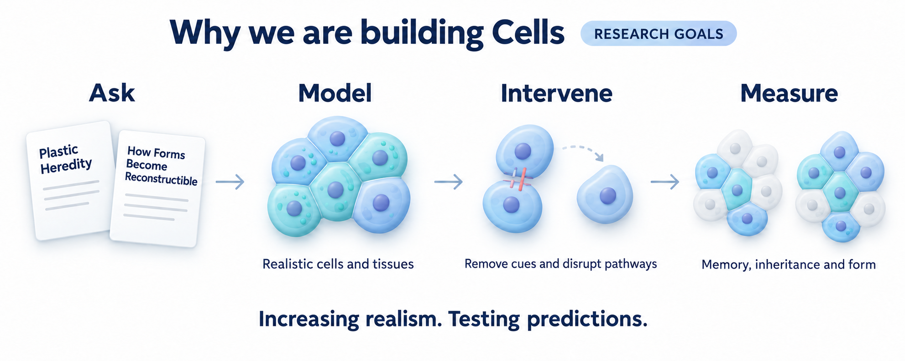

# Cells


Cells is an independent multiscale simulator for investigating how
molecular assembly, cell physiology and communication shape memory, inheritance
and tissue organisation. We are building toward integrated whole-cell models,
whole organs and interacting organ systems.
The simulation stack is **Python and JAX**, with independent CPU references and
local NVIDIA GPU execution. See [Progress](PROGRESS.md) for current verification
status and [Scientific basis](docs/SCIENTIFIC_BASIS.md) for the research background.


This schematic maps cell biology to selected Cells model capabilities;
whole-cell integration is ongoing.

## Why we are building Cells

One of Cells' central goals is to test the ideas in our
[*Plastic Heredity*](https://doi.org/10.5281/zenodo.22143269) and
[*How Forms Become Reconstructible*](https://doi.org/10.5281/zenodo.23327869)
preprints in the most biologically and physically realistic simulations we can
build and verify.



- **Plastic Heredity:** When does inherited organisation break, recover or
  persist? What lets an acquired state pass to new carriers and be renewed?
- **How Forms Become Reconstructible:** How do experience, retained cellular
  state and tissue organisation affect which patterns and functions can be
  expressed, repaired or reconstructed?

We are building toward experiments that remove cues, disrupt candidate memory
mechanisms, change cell membership and challenge cells with matched visible
states but different histories. The aim is to identify what carries history,
what it changes, and when it survives replacement.

Realism means explicit physical mechanisms, material and energy accounting, and
calibration against measurements. Bioelectricity, chemistry and assembly provide
the starting point; metabolism, mechanics, growth and turnover are planned
extensions. Cells' purpose is to study how these processes work together in the
same evolving cells and tissues.
The goal is to find where the ideas hold, fail or need revision. See the
[research background](docs/SCIENTIFIC_BASIS.md) and
[planned experiments](docs/EXPERIMENTS.md).

## References and calibration

We draw on several sources, each serving a particular part of the simulator:

| Part of Cells | Reference and role |
| --- | --- |
| Bioelectric layer | [BETSE](docs/BETSE_CAPABILITY_ROADMAP.md) provides scientific inspiration and a calibration and verification instrument for electrical transport, channels, pumps, junctions and fields. |
| Regulation and cellular-state transmission | [BITSEY](docs/ROADMAP.md#bitsey-replication) supplies regulatory/ionic reference models; reproducing the Forms paper's writing, retention and replacement experiments is the first assay target. |
| Protein-cage assembly | [Asor et al.'s mass-photometry study and stochastic model](docs/CAPSID_ASSEMBLY.md) underpin the assembly branch. The paper contains real measurements; fitting Cells to those data remains future work. |
| Physical chemistry and electrodiffusion | [Thermodynamic reaction-network and electrodiffusion references](docs/SCIENTIFIC_BASIS.md#calibration-across-the-cells-stack) guide material, charge and energy accounting and numerical checks. |

Scientific feature parity with BETSE and BITSEY remains a verification goal for
the relevant layers within this broader programme. Comparisons cover declared
models and conditions; experimental calibration requires measured data.

For whole-cell and organ development, the planned resource set includes:

- **Cell physiology and energy:** published models from
  [Physiome/CellML](https://physiomeproject.org/data-repositories/physiome-model-repository)
  and [BioModels](https://www.ebi.ac.uk/training/online/courses/biomodels-quick-tour/what-is-biomodels/),
  alongside the [mitochondrial model and measurement leads](docs/PAPER_REVIEW_MITOCHONDRIA.md).
- **Molecular quantities and locations:** [BioNumbers](https://bionumbers.hms.harvard.edu/aboutus.aspx)
  and the [Human Protein Atlas](https://www.proteinatlas.org/about/introduction),
  with each value traced to its experimental conditions.
- **Tissue composition and anatomy:** [CCI-seq](docs/PAPER_REVIEW_CCI_SEQ.md),
  [Human Cell Atlas](https://data.humancellatlas.org/), and
  [HuBMAP](https://portal.hubmapconsortium.org/)/[Human Reference Atlas](https://humanatlas.io/asctb-tables)
  for cell types, neighbourhoods and spatial organisation.
- **Measured function:** matched experiments on voltage, calcium, ATP, oxygen
  use, transport, growth and mechanical responses; later, organ-level recordings
  from resources such as [PhysioNet](https://physionet.org/about/) where appropriate.

These are candidates for future benchmarks. The first organ and species are
still to be selected; human atlases apply to compatible human targets. Anatomical
or expression data do not by themselves specify transport rates or validate organ
function. See the [calibration plan](docs/SCIENTIFIC_BASIS.md#calibration-across-the-cells-stack)
for source roles, existing evidence and the path to independent experimental tests.

## Current functionality


- **Electrical cells and tissues:** ion transport, membrane voltage, pumps,
  channels, gap junctions and extracellular fields in selected model families.
- **Tissue geometry:** [prepare passive tissue inputs from recorded BETSE meshes](docs/TISSUE_GEOMETRY.md),
  with explicit volumes, membrane properties and a portable preparation recipe.
- **Regional tissue profiles:** [prepare different membrane transport properties
  and junction barriers](docs/TISSUE_RETURN_CURRENT.md#static-tissue-profile-preparation)
  from explicit geometry for selected tissue, calcium, fuel, water and regulation
  models, with a reproducible preparation recipe. Timed interventions support
  [passive membranes](docs/TISSUE_RETURN_CURRENT.md#scheduled-passive-membrane-profiles)
  and [tissues with active channels and pumps](docs/TISSUE_RETURN_CURRENT.md#scheduled-active-membrane-profiles).
  Passive and active tissues support [carrying initialized state into a new experiment](docs/TISSUE_PHASES.md).
- **Cell removal:** [cut and resume selected tissue models](docs/TISSUE_RETURN_CURRENT.md#cell-removal-and-absolute-time-continuation),
  preserving surviving material, [channel and junction gate states](docs/TISSUE_RETURN_CURRENT.md#cell-removal-with-channels-and-maintained-fuel-pumps)
  and [calcium/ER stores](docs/TISSUE_RETURN_CURRENT.md#cell-removal-with-owned-calcium-and-er-stores),
  with complete prior history.
- **Cell chemistry:** calcium and IP3 signalling, internal compartments and
  chemical reactions, including [passive mitochondrial ion exchange and voltage](docs/TISSUE_RETURN_CURRENT.md#finite-mitochondrial-ion-and-voltage-coupling).
- **Fuel and cell volume:** finite ATP supplies and osmotic water flow, including
  a [combined calcium/ER, ATP and water model](docs/TISSUE_RETURN_CURRENT.md#owned-calcium-finite-fuel-and-compliant-water)
  with [prescribed injury and resealing](docs/TISSUE_RETURN_CURRENT.md#prescribed-repair-with-owned-calcium-finite-fuel-and-water).
- **Regulatory cell state:** BITSEY-based isolated regulation and a bounded
  [two-cell regulatory/ionic model](docs/SOURCE_EMT_PAIR.md).
- **Protein assembly:** stochastic cage formation, finite material pools,
  breakable bonds and experimental coupling to cell models.
- **Repeatable experiments:** checkpoints, restart, branching and independent
  simulation ensembles, with CPU/L4 comparisons and conservation checks.

For GPU ensembles, workers take batches of independent simulations from a shared
queue and save their results and checkpoints. The four-worker illustration shows
that execution design. Numerical qualification has used CPUs and one L4; Jupiter
execution remains to be qualified. Distributing one interacting tissue across
multiple GPUs requires further development. See the
[GPU and ensemble guide](docs/GPU_ENSEMBLES.md).

BITSEY's nominal model clock is kept distinct from physically calibrated time. The
[assembly-to-cell coupling](docs/CAPSID_ASSEMBLY.md) is an experimental modelling
hypothesis.

## In progress

- Combining spatial fields, active membrane transport and dynamic junctions in
  BETSE comparisons.
- Extending verification of the integrated cell, tissue and assembly models.
- Bringing new components into the shared configuration, checkpoint and ensemble
  workflows.
- Qualifying [regional membrane interventions with calcium stores and finite ATP](docs/TISSUE_RETURN_CURRENT.md#scheduled-membrane-profiles-with-calcium-stores-and-finite-fuel).

## Planned


The next directions are richer integrated cell physiology, broader BETSE/BITSEY
verification, reproduction of the Forms assays, and Jupiter qualification from
four to sixteen GPUs. Experimental calibration, broader energy and water
coupling, mechanics and organ models extend that programme. The organ
illustration is schematic; it does not select a particular organ to build first.
Detailed scope and priorities are recorded in [Progress](PROGRESS.md) and the
[Roadmap](docs/ROADMAP.md).

## Development history

Earlier milestones, qualification results and retained failures are recorded in
[Development history](docs/DEVELOPMENT_HISTORY.md). See [Progress](PROGRESS.md)
for current status.

## Run with bounded recording memory

```bash
taskset -c 0-3 .venv/bin/python -m cells windowed run configs/source_pair_baseline.json --window-steps 256 --recording observations --checkpoint-at 5 --output runs/my-windowed-pair
taskset -c 0-3 .venv/bin/python -m cells windowed resume runs/my-windowed-pair/snapshots/step-0000000500 --window-steps 128 --recording checkpoints --output runs/my-windowed-replay
```

Choose `full`, `observations` (default), or `checkpoints`; every configured
numerical and observation check still runs. Checkpoints always contain complete
state, including diagnostic history. Change window size/recording on resume
without changing physics. Each output must be new. See the
[window guide](docs/WINDOWED_EXECUTION.md) for the Python API, chunk format,
resource bounds and branch commands. Ordinary scalar and batch commands remain
available with their full-trace behavior.

For independent cohorts, checkpoint cadence counts execution rounds, not a shared
biological time:

```bash
taskset -c 0-3 .venv/bin/python -m cells batch windowed run configs/batch_source_pair.json --window-steps 16 --recording observations --checkpoint-every-windows 2 --output runs/my-windowed-worlds
taskset -c 0-3 .venv/bin/python -m cells batch windowed resume runs/my-windowed-worlds/snapshots/round-0000000002 --window-steps 32 --recording checkpoints --output runs/my-windowed-worlds-replay
```

Initial/final checkpoints always contain the complete cohort, including finished
worlds. See the [cohort window guide](docs/WINDOWED_WORLDS.md) for branch commands,
independent clocks, memory guards and incremental output.

## Run independent worlds

```bash
taskset -c 0-3 .venv/bin/python -m cells batch run configs/batch_source_pair.json --output runs/my-worlds --checkpoint-at 0.5
taskset -c 0-3 .venv/bin/python -m cells batch resume runs/my-worlds/snapshots/checkpoint-000000 --output runs/my-worlds-replayed
taskset -c 0-3 .venv/bin/python -m cells batch branch runs/my-worlds/snapshots/checkpoint-000000 configs/batch_source_pair_branch.json --output runs/my-worlds-branched
```

These are two independent source-pair experiments, not four communicating cells
or two interacting organs. Each world retains its own clock and complete state.
The branch changes only world 101's future miRNA control. Every output must be
new; see the [batch guide](docs/INDEPENDENT_WORLDS.md) for schema, numerical and
resource restrictions, individual-world access and profiling commands.

## Run a source-compatible pair

```bash
taskset -c 0-3 .venv/bin/python -m cells run configs/source_pair_baseline.json --output runs/my-source-pair --checkpoint-at 5
taskset -c 0-3 .venv/bin/python -m cells resume runs/my-source-pair/snapshots/step-000500 --output runs/my-source-replay
taskset -c 0-3 .venv/bin/python -m cells branch runs/my-source-pair/snapshots/step-000500 configs/source_pair_branch.json --output runs/my-source-branch
```

The branch independently inhibits/restores miRNA transfer and one cell's pump;
ionic contact remains active. Full primary state, fixed context, anchors and
exchange histories survive restart. Each output must be new. See the
[guide](docs/SOURCE_EMT_PAIR.md) for units, supported controls and remaining scope.

## Run a physical gated pair

```bash
taskset -c 0-3 .venv/bin/python -m cells run configs/bioelectric_pair_baseline.json --output runs/my-physical-pair --checkpoint-at 6
taskset -c 0-3 .venv/bin/python -m cells resume runs/my-physical-pair/snapshots/step-006000 --output runs/my-pair-replay
taskset -c 0-3 .venv/bin/python -m cells branch runs/my-physical-pair/snapshots/step-006000 configs/bioelectric_pair_branch.json --output runs/my-pair-branch
```

The gate keeps evolving during a transport block; restart retains it and all
exchange history. This model uses the independently qualified 1 ms step, not
the single-cell 5 ms bound. See the [guide](docs/BIOELECTRIC_PAIR.md) for data,
controls, accounting, numerical limits and remaining scope. Every output must be new.

## Run one physical cell

```bash
taskset -c 0-3 .venv/bin/python -m cells run configs/bioelectric_baseline.json --output runs/my-physical-cell --checkpoint-at 6
taskset -c 0-3 .venv/bin/python -m cells resume runs/my-physical-cell/snapshots/step-001200 --output runs/my-physical-replay
taskset -c 0-3 .venv/bin/python -m cells branch runs/my-physical-cell/snapshots/step-001200 configs/bioelectric_branch.json --output runs/my-physical-branch
```

This runs 10 seconds, not automatic equilibration. The branch independently
blocks/releases Na leakage and pumping. Every destination must be new; accounting
and electrical anchors survive restart. See the [guide](docs/BIOELECTRIC_CELL.md)
for units, controls, outputs, numerical limits, and remaining scope.

## Run reactions and transport

Start with one reactive cell, then a three-cell chain using the same model:

```bash
.venv/bin/python -m cells run configs/reaction_transport_single.json --output runs/my-reaction-cell
.venv/bin/python -m cells run configs/reaction_transport_chain.json --output runs/my-reaction-chain --checkpoint-at 6
.venv/bin/python -m cells branch runs/my-reaction-chain/snapshots/step-000122 configs/reaction_transport_release.json --output runs/my-reaction-release
```

Two synthetic species interconvert locally and exchange through declared contacts.
Cell count, volumes, rates, species names, topology, and contact openings are data.
The release branch closes both contacts at six seconds: transport stops while
local reactions continue. Total A+B is conserved; each species total need not be.
The [composition contract](docs/REACTION_TRANSPORT.md) defines the equations,
axes, units, numerical limits, and model boundaries. It is not a general reaction
network language or a connection to the source-scaled EMT model.
Every output directory must be new. For bounded CPU use on this host, prefix
commands with `taskset -c 0-3`.

## Run two contacting cells

From this directory, using the installed CPU environment:

```bash
.venv/bin/python -m cells run configs/pair_exchange_active.json --output runs/my-pair --checkpoint-at 6
.venv/bin/python -m cells resume runs/my-pair/snapshots/step-000120 --output runs/my-pair-replay
.venv/bin/python -m cells branch runs/my-pair/snapshots/step-000120 configs/pair_exchange_release.json --output runs/my-pair-release
```

The cells start with [8, 0] fmol in unequal volumes [1, 3] pL. Passive transport
moves them toward equal concentration while preserving total amount. The release
branch closes the contact at six seconds; the physical connection remains present
but further exchange stops. The [contact contract](docs/PASSIVE_CONTACT.md) describes
units, controls, edge state, numerical limits, and the separate source-coupling gate.
Every output directory must be new. For bounded CPU use on this host, prefix
commands with `taskset -c 0-3`.

## Run a regulatory cell

From this directory, using the installed CPU environment:

```bash
.venv/bin/python -m cells run configs/emt_isolated_e.json --output runs/my-emt-e --checkpoint-at 5000
.venv/bin/python -m cells run configs/emt_isolated_m.json --output runs/my-emt-m
.venv/bin/python -m cells resume runs/my-emt-e/snapshots/step-050000 --output runs/my-emt-replay
```

The two configurations differ only in initial regulatory state. Each runs to
10000 source-time units with fixed Snail 72; the coordinates are source-scaled,
not calibrated physical concentrations or seconds. Outputs include the three
primary trajectories, derived binding complexes, observer labels, and provenance.
Read the [reference contract](docs/EMT_REFERENCE.md) for the model's limits.

## Run the synthetic pulse fixture

From this directory, using the already installed local environment:

```bash
.venv/bin/python -m cells run configs/single_cell_pulse.json --output runs/my-first-cell --checkpoint-at 6
```

This simulates 12 seconds with an input pulse from 2.03 to 5.07 seconds. It writes
the resolved configuration, accepted/observed trajectories, a summary, hashes,
timings, and complete checkpoints. The output directory must not already exist.

Continue unchanged, or change only future inputs from the same six-second state:

```bash
.venv/bin/python -m cells resume runs/my-first-cell/snapshots/step-000122 --output runs/my-replay
.venv/bin/python -m cells branch runs/my-first-cell/snapshots/step-000122 configs/single_cell_rechallenge.json --output runs/my-rechallenge
```

The snapshot name above is for the shipped configuration; other grids list their
snapshot paths in the run manifest. Rechallenge adds a 0.5 fmol/s source at six
seconds. It changes the future without modifying the parent or its prior inputs.

For a fresh checkout, use Python 3.13 (tested with 3.13.5):

```bash
python3 -m venv .venv
.venv/bin/python -m pip install --no-cache-dir -r requirements-lock.txt
.venv/bin/python -m pip install --no-build-isolation --no-deps -e .
```

The lock is CPU-only. Supported model families can also select GPU execution;
see the [GPU and ensemble guide](docs/GPU_ENSEMBLES.md) for the separate CUDA
environment and model-specific requirements.

## Verify

The matrix below belongs to the original spatial build. Newer chemistry,
assembly, tissue and GPU families have their own qualification protocols in the
[model guides](docs/README.md#models-and-execution). This historical matrix and
the release counts below are not the complete current test inventory. Use
[Progress](PROGRESS.md) to identify the relevant completed or active qualification.

```bash
.venv/bin/python scripts/test_spatial_extracellular_build.py --output reports/my-test-matrix
.venv/bin/ruff check src tests scripts
.venv/bin/ruff format --check src tests scripts
```

Tests use temporary directories and retained numerical reference fixtures; neither
network nor the upstream checkout is needed. The matrix explicitly separates
current production from ten NUM-005 modules under preserved 0.10.0, three
SPEC-006/NUM-007 modules under preserved 0.11.0 and three physical-graph reference
modules under preserved 0.12.0, plus six finite-outside reference/test-context
modules under preserved 0.13.0 and two NUM-010 reference modules under preserved
0.14.0. All three earlier drivers and the original reference guards remain unchanged.
It explicitly retains the original 13 prospective NUM-009 v1 complete-session
tests as unexecuted (that scientific run stopped), runs their maintained v2
replacement, and still runs v1 preflight/stopped-evidence tests. No skip is
counted as passing acceptance. The matrix
uses CPUs 0–3 and an independent temporary evidence copy (currently about 7.5 GB);
the historical confinement/source guards stay intact. See the
[multispecies test-context explanation](docs/MULTISPECIES_MEMBRANE.md#run-resume-and-qualify).
Generated `runs/` are local and excluded from Git. Earlier window/clock acceptance, exact seven-model scalar and cohort
regressions, preserved 0.9.0 replay and memory/cost measurements are in
[CORE-005b acceptance](reports/CORE005B_ACCEPTANCE.md). The preceding scalar-window
release is in [CORE-005a acceptance](reports/CORE005A_ACCEPTANCE.md). The preceding batch
implementation/profile is in [CORE-004 acceptance](reports/CORE004_ACCEPTANCE.md).
The preceding source-model release is in
[MODEL-005 acceptance](reports/MODEL005_ACCEPTANCE.md). Earlier physical-pair
evidence is in [MODEL-004 acceptance](reports/MODEL004_ACCEPTANCE.md). Physical-cell
evidence is in [MODEL-003 acceptance](reports/MODEL003_ACCEPTANCE.md); composition
evidence is in [CORE-003 acceptance](reports/CORE003_ACCEPTANCE.md).
The subsequent [SPEC-002 design gate](reports/SPEC002_DESIGN_CHECK.md) adds
709 instantaneous contact/source checks. [NUM-003 qualification](reports/NUM003_REFERENCE.md)
now passes all 20 independent physical-pair cases at RK4/1 ms with cubic
observations. Those design/reference stages left 0.5.0 unchanged; MODEL-004 now
implements the qualified physical pair (670 release tests). SPEC-003 adds the
complete source-compatible design/native RHS panel and 65 tests. NUM-004 adds
48 numerical, native-audit and artifact/protocol tests. MODEL-005 adds 69 production
engineering and CLI checks. CORE-004 adds 43 batch unit tests and one fresh-process
CLI case. CORE-005a adds 86 window/clock/recording/replay checks; CORE-005b adds
75 cohort-window checks. That 0.10.0 release suite passed 1057 tests.
Pair acceptance commands are in [M1c-a acceptance](reports/M1C_A_ACCEPTANCE.md);
source capture and regulatory reruns are in [M1b acceptance](reports/M1B_ACCEPTANCE.md).

Snapshots deliberately require matching source/runtime identity. Old 0.1.0,
0.2.0, 0.3.0, 0.4.0, 0.5.0, 0.6.0, 0.7.0, 0.8.0, 0.9.0 and 0.10.0 runs are preserved with archived source bundles. See the
[0.10.0 preservation receipt](reports/core-006-preservation.json),
[0.9.0 preservation record](reports/CORE005B_ACCEPTANCE.md#preserved-source-and-checkpoints),
[0.5.0 preservation instructions](reports/MODEL004_ACCEPTANCE.md#version-preservation)
and [earlier versions](reports/M1C_A_ACCEPTANCE.md#previous-model-regression-and-preserved-versions)
to inspect them. They are not silently migrated into this version.

## Start here

| Document | Purpose |
| --- | --- |
| [Architecture](docs/ARCHITECTURE.md) | Simulator structure, state ownership, numerical execution and checkpoints |
| [Multiscale and parallel design](docs/MULTISCALE_EXECUTION_ARCHITECTURE.md) | How mechanisms, resolution, coupled clocks and device placement fit together |
| [BETSE coverage](docs/BETSE_CAPABILITY_ROADMAP.md) and [BITSEY replication](docs/ROADMAP.md#bitsey-replication) | Complementary references, implemented subsets and remaining comparisons |
| [Protein assembly](docs/CAPSID_ASSEMBLY.md) | Assembly models and their experimental connection to cell dynamics |
| [GPU execution](docs/GPU_ENSEMBLES.md) | Independent ensembles, local qualification and Jupiter preparation |
| [Scientific basis](docs/SCIENTIFIC_BASIS.md) | Research sources, hypotheses and evidence limits |
| [Roadmap](docs/ROADMAP.md) | Development priorities and completion criteria |

[Browse the docs folder](docs/) for model guides, specifications and research
notes. [Progress](PROGRESS.md) tracks current work and run evidence.

## First build and first tissue destination

The [original one-cell build](docs/FIRST_BUILD.md) established explicit state,
read-only observations and verified save/restore. Subsequent model families add
regulation, communicating cells, spatial fields and intracellular chemistry.
Their implemented and verified scopes are recorded in [Progress](PROGRESS.md)
and the model guides. The [engineering gate](docs/ENGINEERING_GATE.md) preserves
the original separation of engineering, numerical and scientific acceptance.

The proposed memory demonstration is a small 2D tissue in which a temporary local cue
changes cellular state, communication determines whether that change spreads, and subsequent carrier
replacement tests its persistence. Begin with a fixed contact graph and controlled
relay assays. Add growth, division, and turnover as an explicit later extension.

The model will represent intracellular dynamics, selective communication,
spatial context, and lineage events. Full numerical state will support multiple
readouts, including phenotype, retention, rewriting, transmission, and recovery.

## Working principles

- Keep model equations, numerical methods, experiment interventions, and
  measurements explicit and separately versioned.
- Use array-based state and JAX kernels suitable for CPU and GPU execution.
- Preserve a readable CPU numerical reference and validate accelerated execution.
- Make saved-state restoration and branching into alternative futures central
  capabilities.
- Track cell identity, ancestry, external support, and material/state transfer.
- Keep biological inheritance boundaries distinct from complete restart snapshots.
- Compose cell, tissue, and organ instances through data definitions and typed
  exchange interfaces; keep biological models separate from numerical execution.
- Preserve access controls and challenge-response measurements as models gain
  slow regulatory state, local sensing, or memory-writing mechanisms.
- Develop a headless simulation library with a separate viewer and analysis tools.
- Carry positive and negative reference outcomes into verification.
- Bring findings from the continuing exploration into Cells through reviewed,
  identifiable snapshots.

## Scope of the ideas base

The current sources are listed in [Scientific basis](docs/SCIENTIFIC_BASIS.md).
The strict-eight, ingressing-minds/Ruliad, and AI branches of `../../preprints`
have now received a targeted design review (R002). The remaining collection is
still a later ideas source. Research results are model-specific evidence, not
universal laws to encode in the engine.

R remains an optional analysis interface. Python/JAX is the selected simulation
stack; Julia, Taichi, C++, PhysiCell, and CompuCell3D are retained as alternatives
in the decision record rather than additional implementation commitments.

## Keeping the documents current

Update [Progress](PROGRESS.md) when work starts, completes, or encounters a
dependency. Record a substantive design change in [Decisions](docs/DECISIONS.md).
Add a research check-in to [Scientific basis](docs/SCIENTIFIC_BASIS.md), then
update the affected experiment or roadmap entry. Link completed tasks to their
code, tests, benchmark reports, or run artifacts.

## License

Cells is licensed under the [MIT License](LICENSE). Third-party materials retain
their existing license notices.
