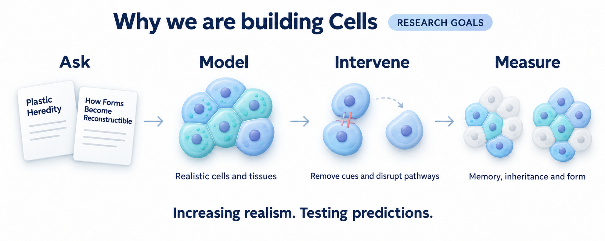
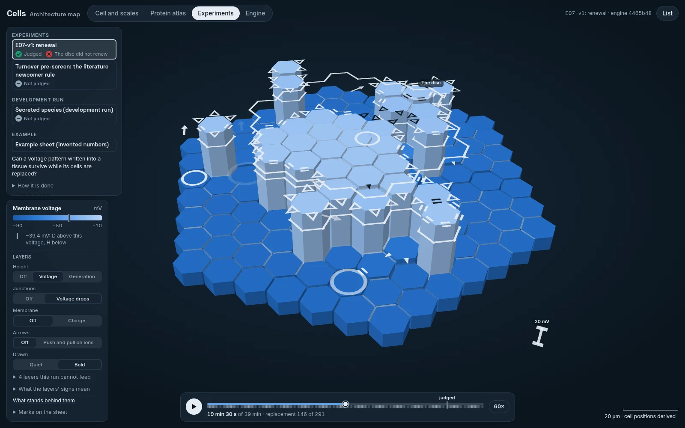
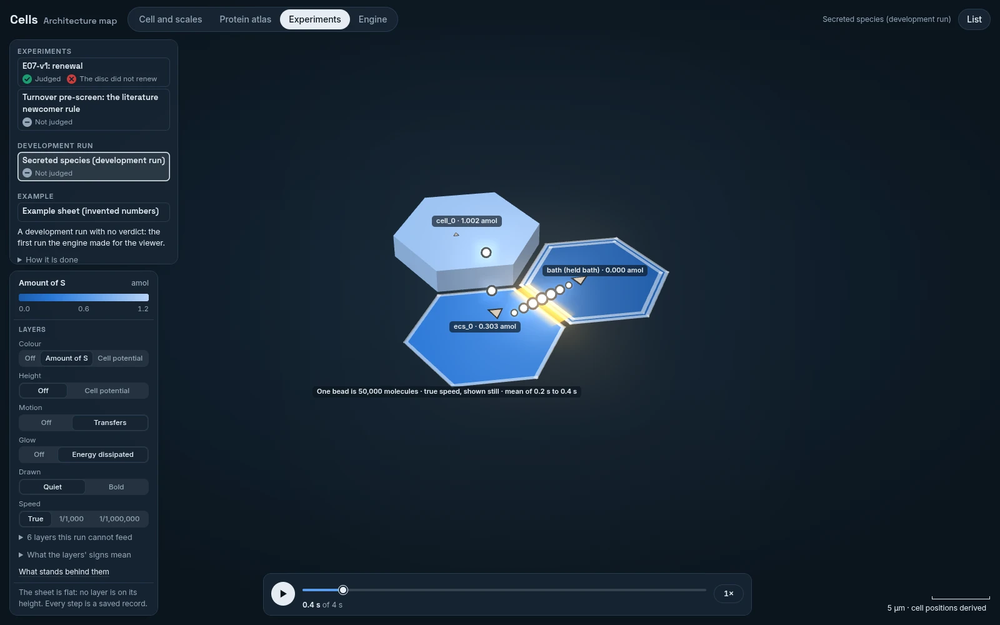

# Cells


Cells is a GPU-native multiscale simulator for investigating how
molecular assembly, cell physiology and communication shape memory, inheritance
and tissue organisation. We are building toward integrated whole-cell models,
whole organs and interacting organ systems. It is written in **Python and JAX**,
so the same models compile for NVIDIA GPUs and for CPUs, and the CPU runs serve
as independent references. A [3D visualizer](#the-visualizer-and-its-replays)
shows the engine, the proteins it models and replays of saved runs.
[Progress](PROGRESS.md) holds the detailed current status and evidence.


This schematic links cell structures and biological processes;
whole-cell integration is ongoing.

## Why we are building Cells

One of Cells' central goals is to test the ideas in our
[*Plastic Heredity*](https://doi.org/10.5281/zenodo.22143269) and
[*How Patterns Return*](https://doi.org/10.5281/zenodo.23327869) (early draft)
preprints in the most biologically and physically realistic simulations we can
build and verify.



- **Plastic Heredity:** When does inherited organisation break, recover or
  persist? What lets an acquired state pass to new carriers and be renewed?
- **How Patterns Return:** How do experience, retained cellular
  state and tissue organisation affect which patterns and functions can be
  expressed, repaired or reconstructed?

We are building toward experiments that remove cues, disrupt candidate memory
mechanisms, change cell membership and challenge cells with matched visible
states but different histories. The aim is to identify what carries history,
what it changes, and when it survives replacement.

Realism means explicit physical mechanisms, material and energy accounting, and
calibration against measurements. Bioelectricity, chemistry and assembly provide
the starting point; metabolism, mechanics, growth and turnover are planned
extensions. Cells' purpose is to study how these processes work together in the
same evolving cells and tissues. When an experiment shows that a mechanism is
missing, we add it to the engine as a cited, biologically grounded model rather
than working around it. The goal is to find where
the ideas hold, fail or need revision. See the
[research background](docs/SCIENTIFIC_BASIS.md) and
[planned experiments](docs/EXPERIMENTS.md).

## Ambition

Cells starts small on purpose. The first versions work with one cell up to a few
hundred. The aim at that scale is to reproduce published models and experiments,
run new ones, and see which mechanisms and equations produce each result. Larger
tissues and whole organs come later, built from parts that have already held up
at the smaller scale. The [roadmap](#roadmap) shows the order.

The simulator is modular. New mechanisms are added as separate, versioned models
or options. Each is checked on its own and stays off unless an experiment selects
it, so the biology can grow one piece at a time. The tissue model at the centre
of the engine is being restructured so that its laws become declared modules,
and a [design for external modules](docs/MODULE_SYSTEM_DESIGN.md) is proposed,
so that independently maintained packages can extend Cells under the same
contracts as built-in models.

On the molecular side, the one level we skip is protein folding itself. Beneath
it, we aim to simulate the gene regulation that sets how much of each protein is
made. Above it, we aim to simulate the assembly of proteins into complexes and
molecular machines, from protein cages today toward structures such as the
proteasome and larger, and how those machines are used in cells and tissues.

Our goal is a complete and faithful simulation of a real cell, and in time of the
tissues and organs it builds. Each qualified mechanism is a step toward it, and we
believe progress in AI and in mathematics can bring that goal closer than it
seems today. As a first whole cell we have taken up the minimal bacterium
JCVI-syn3A as a [track](docs/SYN3A_MINIMAL_CELL_TRACK.md). So far it holds an
evidence audit and capability probes, with no engine code written for it.

## Where things stand (16 November 2026)

Plain-language summary. Details, numbers and evidence are in
[Progress](PROGRESS.md), the order of work is in the
[current plan](docs/CURRENT_PLAN.md), and choices are in
[Decisions](docs/DECISIONS.md). Status words follow the plan's levels:
*implemented* (on main), *guarded* (held by tests), *numerically qualified*, or
qualified for short (a registered protocol passed, within its stated scope),
and *judged* (a model used in a registered experiment). A *judged run* is
something else: a run of a registered protocol or experiment, made once and
scored as registered. Development runs are evidence for development, not
judged results.

| Track | In simple terms | State |
| --- | --- | --- |
| **Checking the physics against BETSE** | We run the established BETSE simulator separately and compare its saved outputs with Cells' own physics, under rules fixed before each run. | Passes for every mechanism tested so far (one rung only after a revised method): BETSE's default tissue, calcium and its pump, extracellular barriers, scheduled interventions (pump block, sodium and potassium permeability, junction block), and voltage-gated channels including the heredity channels NaV1.2 and Kir2.1. These later rungs also pass on the L4 GPU. Still open: several intervention types, noise, networks and channel time constants. See the [current results](PROGRESS.md#plan-betse-parity-on-cpu-and-l4-then-jupiter-from-8-november), the [coverage map](docs/BETSE_CAPABILITY_ROADMAP.md) (which also records the earlier, superseded comparison track) and the [comparison tools](validation/betse/README.md) |
| **First heredity experiment** | Can a brief signal write a voltage pattern into a tissue, and does the pattern survive while its cells are replaced? | **Judged (13–14 November): when its cells were replaced one at a time by copies of neighbours, the written disc did not renew.** The pattern followed neutral copying closely, and 8 of 15 scored predictions held. In earlier development runs a brief cue wrote a depolarised disc and freshly written discs held for 70 minutes, but no disc renewed when newcomers arrived uncoupled and formed junctions over time, as the literature describes. A successor that writes, clears and then challenges the pattern is proposed. See the [registered design](docs/E07_V1_DESIGN.md), the [results](PROGRESS.md#runs) and the [proposal](docs/E07_V2_DESIGN.md) |
| **New biology in the engine** | Mechanisms that experiments showed were missing, and requested features, each added as a general model. | Qualified and on main from 11 November: osmotic water and cell volume, and cell replacement in which new cells form junctions over time. Volume regulation is on main with its stationary states judged. Numerically qualified since, on the composite tissue model: membrane added during cleavage, current injection and the partition of a dividing cell (division is prescribed, not yet set off by the cell's own state; [plan](docs/CELL_DIVISION_PLAN.md)); the transport of secreted species outside cells, with decay and clearance (their production and exchange across membranes are guarded only); and, on CPU only, reactions on the shared species inventory and species that regulate a channel's availability. Landed for development, not judged: a closed internal compartment, binding to sites, and scheduled changes of bath composition. In development: conduction in excitable tissue. Planned and on hold: gene regulation coupled to tissue. See the [feature requests](docs/FEATURE_REQUESTS.md) |
| **Engine restructure** | One tissue model whose laws, transporters, fuel and solvers become declared modules, compiled only where a world declares them. | In progress, in its final verification. Its engine changes are on an integration branch and reach main in one landing, after a results gate (existing worlds' outputs unchanged, bit for bit or within a stated rounding), the affected registered protocols and a block of GPU runs. Compartment pH and transfer across an internal membrane are being built in the same round; their judged runs follow the landing. See the [design](docs/INNER_MODEL_V4_DESIGN.md) |
| **Long-run time modes** | Faster ways to study hours to months, all optional. | A fixed-point and continuation analysis is qualified. Projective time-stepping failed its qualification. A quasi-steady electrical mode is planned |
| **Morphogenesis** | How tissues take and repair shape. | A morphogen gradient and a bistable voltage domain wall passed, and Turing patterning at its predicted wavelength passed on CPU (15 November). 2-D cell mechanics (a vertex model) is qualified and on main, after a revised second judged run. See the [morphogenesis plan](docs/MORPHOGENESIS_PLAN.md) |
| **Papers to test** | Published models we review and test in Cells. | Nine reviewed: three with test plans (Cortés-Poza, Deb et al., Shin et al.); the Myc–cyclin T1 heart papers, at high priority, which led to species regulating channels and to an excitable-tissue track; and five as notes (partial reprogramming, granzyme K and tissue ageing, kinetochore protein counts, bone mechanosensing and ageing, and a whole-cell model of the minimal cell). Secreted-species transport was promoted from the granzyme K review. A track of gene-network models validated against wet-lab experiments is logged for the coming gene-regulation layer. See the [paper backlog](docs/PAPER_BACKLOG.md) and [GRN wet-lab validations](docs/GRN_WETLAB_VALIDATION.md) |
| **Seeing the runs** | A 3D viewer of the engine, the proteins it models and replays of saved runs. | The viewer and its reader of saved runs are on main under `visualizer/`; the engine's run-view writer and looping replays per species are still to come. See [the visualizer and its replays](#the-visualizer-and-its-replays) |
| **Computing** | Where it runs. | Local CPUs and one NVIDIA L4 GPU, with many independent worlds batched on the GPU. JUPITER (GH200) throughput is not yet measured. See [GPU execution](docs/GPU_ENSEMBLES.md) and the [JUPITER runbook](docs/JUPITER_RUNBOOK.md) |

## What Cells can do (as of 16 November 2026)


The picture is of 11 November 2026; the list below is current.

- **Electrical cells and tissues:**
  - ion transport, membrane voltage and pumps;
  - voltage-gated and leak channels;
  - gap junctions and extracellular fields;
  - all with material, charge and energy accounting.
- **Tissue preparation and interventions:** tissue geometry, timed changes to pump,
  channel and junction availability, scheduled bath composition, current
  injection and cell removal, in selected model families.
- **Cell lifecycle:** cell replacement in which newcomers form junctions over
  time, and prescribed cell division that partitions a cell with closed ledgers.
- **Cell chemistry:** calcium and IP3 signalling, internal compartments,
  reactions, fuel, and osmotic water and cell volume in selected families; on
  the composite tissue model, secreted species, reactions on a shared species
  inventory and species that regulate a channel's availability.
- **Tissue mechanics:** 2-D vertex mechanics of a cell sheet.
- **Regulatory cell state:** isolated regulatory circuits and a bounded two-cell
  regulatory and ionic model.
- **Molecular assembly:** stochastic formation of a protein cage from folded
  subunits, with finite material pools. Folding itself is out of scope.
- **Repeatable experiments:**
  - checkpoints, restart and branching into alternative futures, including,
    when recorded, resumption across a change of source code or runtime;
  - batched independent worlds;
  - CPU and GPU comparisons.

Each capability's scope and limits are in its model guide; see the
[documentation index](docs/README.md).

## The visualizer and its replays

Cells has a 3D viewer in [`visualizer/`](visualizer/README.md), built with
three.js and web components. It is tooling, not part of the engine: it reads a
checkout and saved run outputs, and the engine never imports it. It has four
views: **Cell and scales** (a cell opened by a cut, its sheet, and placeholder
outlines of an organ and a body), the **Protein atlas** (the molecular machines
the engine's laws act on, and each species' own proteins), **Experiments**
(replays of saved runs) and **Engine** (the simulator's layers, mapped from the
code).



*A replay of the judged experiment E07-v1 at 19 min 30 s, after 146 of its 291 cell
replacements. Each cell stands as high as its membrane voltage, wedges mark the voltage drops
across junctions, and the outline is the disc written at the start. The voltages are the run's
own saved records (run `a-donor-fast-k1-d37-s1.0`, seed 5); the junction drops are worked out by
the viewer from them.*



*The engine's first run made for the viewer, at 0.4 s: one cell releases a species into a small
space that leaks to a held bath. Beads show what crosses each border (one bead is 50,000
molecules), and a glow shows where energy is dissipated. A development run with no verdict.*

Every picture keeps a part's status apart from how the engine represents it:
simulated, modelled in aggregate, prescribed, or illustration only, labelled as
such. The species list is the viewer's, not the engine's. Human, planarian,
fruit fly and thale cress lend names and outlines to the generic cell and sheet
that Cells models; JCVI-syn3A, *M. pneumoniae* and *E. coli* are proposed, with
nothing of them in the engine. A review of the viewer's statuses against the
record is still owed, so [Progress](PROGRESS.md) remains the record.

| Part | Where | Status |
| --- | --- | --- |
| The viewer, with its quantity layers and flux in the Cell view | [`visualizer/`](visualizer/README.md) | On main |
| The reader that packages saved runs for the viewer | `visualizer/tools/adapt_run.py`; format in [`visualizer/schema/RUN_VIEW.md`](visualizer/schema/RUN_VIEW.md) | On main. Its reading of `view.json` is tested on synthetic views and was tried on the writer's worked example; no replay comes from an engine-written view yet |
| The loop reader, for a species' looping run | `visualizer/src/layers/loop.js` | On main, tested on a fixture; no species has a looping run yet |
| The run view's design | [`docs/RUN_VIEW_DESIGN.md`](docs/RUN_VIEW_DESIGN.md) | On main, proposed |
| The engine's run-view writer | `src/cells/run_view.py`, on a development branch | Not on main. Shown on a worked example (the secreted-species development run); it merges after the restructure lands |
| Looping replay packages per species | [Feature request FR-11](docs/FEATURE_REQUESTS.md#fr-11--looping-replay-packages-of-living-cells-for-the-viewer) | Logged. Its design note is on a development branch, not yet on main; nothing is built |

**Replays** draw what a run saved and nothing else: the sheet coloured by
membrane voltage, a timeline, events such as cell replacement, and the class
and readouts that the experiment's own record gives. The viewer computes no
verdict. The catalogue keeps experiments, development runs and examples apart,
and shows whether each experiment was judged beside its answer. The project's
own catalogue, made from saved runs that stay outside the repository, holds
E07-v1's 38 judged runs (the disc did not renew), 21 arms of a turnover
pre-screen (development, not judged), the engine's first run made for the viewer
(synthetic values; a development run with no verdict) and an example sheet with
invented numbers, marked as such. A checkout can make only the example, whose
fixture is in the repository.
The runs save no positions, so the sheet is laid out from its junctions, and
the replay says so.

**Quantity layers** draw what cannot be seen: voltage as colour and height, the
drop across each junction, the push and pull on each ion, membrane charge,
transfers and ion traffic as beads, dissipated energy as a glow, and a secreted
species as a fog. Their numbers are saved records or one of four declared
derivations, shown as worked out by the viewer, which computes no physics of
its own. A direction is drawn only where a sign stands behind it, declared by
the run's view or confirmed as the engine's convention, and the legend says
which; what a run did not save is said
([rules](visualizer/schema/QUANTITY_LAYERS.md)).

**How a run reaches the viewer.** The engine's **run view** is one small file
beside a run's definition, `view.json` (`cells.run_view@1`). It states every
entity's identity, every unit, time base, event, layer and representation, and
each record's sign where it is known, so that a viewer infers nothing from a
driver's conventions. The arrays stay in the run's own files, and what the view
cannot state is refused or listed as unstated, with the reason. The viewer's
**reader** (`npm run adapt:runs`) packages each run for the browser and writes
the catalogue. It uses the run's `view.json` alone where there is one;
otherwise, as for every replay so far, it derives what it needs with its own
adapters and lists each derived piece.

**Flux in the Cell view.** A Flux switch, off as the page opens, shows what
flows as beads. No species has a looping run yet, so this is illustration,
marked "Illustration: not a run", with direction only. Pumps and secreted
signals are drawn one way, as the engine's own law declarations give it, and
only for a species shown as the generic cell; channels, junctions and water are
drawn both ways with neither claimed; fuel draws nothing.

**Looping replays per species.** The feature request asks the engine for a
short run of one cell of each of four cell types (human, planarian, Syn3A and
*M. pneumoniae*), packaged to loop as the cell's resting state. It is output,
not new physics: laws the engine has or gains through their own milestones, at
a declared low level of detail, written by the run-view writer and labelled an
illustration, never an experiment or a qualified result. The choices recorded
with it are periodic loops (a periodic drive, one period played and its seam
checked), a paced heart cell for human (it waits for the human cardiac laws, now being
designed), the cell cycle in scope for Syn3A and
*M. pneumoniae*, and the planarian's loop first. Its design note is on a
development branch, not yet on main. The loop reader on main already refuses a run that
does not declare its loop and say that it closes, names no engine model or
revision, or is an example.

**Build, run and test it** with Node 20 or later (tested on Node 24), and
Python 3 for the extractor and the reader (standard library only; tested on
3.13):

```bash
cd visualizer
npm install       # three.js and esbuild, both pinned
npm run extract   # read this checkout and rewrite the scene (a tracked file)
npm run serve     # http://127.0.0.1:4173/
npm test          # the browser-free tests
npm run adapt:runs -- --experiment example-sheet --root tests/fixtures/run-example --run invented-numbers
```

The Experiments view appears once replays have been made. The last line makes
the example replay from a fixture in the repository; the experiments' replays
need saved run folders that stay outside it
(`npm run adapt:runs -- --evidence PATH`). The real-click checks in headless
Chrome (`npm run check:all`) and publishing are in the
[visualizer's README](visualizer/README.md#run-it).

## Roadmap


The picture is of 11 November 2026. See the [roadmap](docs/ROADMAP.md) for
priorities, the [current plan](docs/CURRENT_PLAN.md) for the order of work and
[progress](PROGRESS.md) for current results.

## References and calibration

| Part of Cells | Reference and role |
| --- | --- |
| Bioelectric layer | [BETSE](docs/BETSE_CAPABILITY_ROADMAP.md): an external reference, run out of process, for electrical transport, channels, pumps, junctions and fields |
| Regulation and cellular-state transmission | [BITSEY](docs/ROADMAP.md#bitsey-replication): regulatory and ionic reference models |
| Protein-cage assembly | [Asor et al.'s measurements and stochastic model](docs/CAPSID_ASSEMBLY.md) |
| Physical chemistry and electrodiffusion | [Thermodynamic and electrodiffusion references](docs/SCIENTIFIC_BASIS.md#calibration-across-the-cells-stack) |

Comparisons cover declared models and conditions; experimental calibration needs
measured data. The [calibration plan](docs/SCIENTIFIC_BASIS.md#calibration-across-the-cells-stack)
lists the resources planned for whole-cell and organ work.

## Get started

Use Python 3.13 (tested with 3.13.5):

```bash
python3 -m venv .venv
.venv/bin/python -m pip install --no-cache-dir -r requirements-lock.txt
.venv/bin/python -m pip install --no-build-isolation --no-deps -e .
.venv/bin/python -m cells run configs/single_cell_pulse.json --output runs/my-first-cell --checkpoint-at 6
```

This simulates one cell for 12 seconds with an input pulse, and writes the
resolved configuration, trajectories, a summary and complete checkpoints. Every
output directory must be new. More examples, including restart and branching,
are in [Running the model families](docs/RUN_EXAMPLES.md). The lock is CPU-only;
see [GPU execution](docs/GPU_ENSEMBLES.md) for the CUDA environment.

## Verify

The routine gate runs the test tiers and compares each file's outcome with the
recorded baseline:

```bash
.venv/bin/python scripts/test_tiers.py run --tiers tests/test_tiers.json --tier 1 --out runs/my-gate --cpus 0,1,2,3
.venv/bin/python scripts/test_tiers.py run --tiers tests/test_tiers.json --tier 1 2 --out runs/my-gate-12 --cpus 0,1,2,3
```

`--cpus` lists the cores to pin test files to; the default is 4–7. The tier baseline
was recorded on the project host, so file times elsewhere will differ, but
outcomes should match. Tier 1 takes about 6 minutes on four cores. Add tier 2
before landing engine changes; tier 3 holds the slow files. [AGENTS.md](AGENTS.md) gives the full
working rules. The original spatial-build verification matrix is kept in the
[development history](docs/DEVELOPMENT_HISTORY.md#original-spatial-build-verification-matrix-moved-from-the-readme).
The tiers collect `tests/` only; the visualizer's own tests run with `npm test`
in `visualizer/`.

## Documents

| Document | Purpose |
| --- | --- |
| [Progress](PROGRESS.md) | Current status, per-run summaries and evidence |
| [Decisions](docs/DECISIONS.md) | Choices made with the user, with dates |
| [Roadmap](docs/ROADMAP.md) and [current plan](docs/CURRENT_PLAN.md) | Development priorities and completion criteria; the current order of work and the evidence that closes each gate |
| [Heredity experiment](docs/HEREDITY_FIRST_EXPERIMENT.md) and [morphogenesis plan](docs/MORPHOGENESIS_PLAN.md) | The two experimental tracks |
| [Feature requests](docs/FEATURE_REQUESTS.md) | Requested engine features, with priority and status |
| [Paper backlog](docs/PAPER_BACKLOG.md) | Papers under test, with reviews and plans |
| [GRN wet-lab validations](docs/GRN_WETLAB_VALIDATION.md) | Gene-network models checked against experiments, as benchmarks for the gene-regulation layer |
| [Architecture](docs/ARCHITECTURE.md) | Simulator structure, state, numerical execution and checkpoints |
| [Multiscale and parallel design](docs/MULTISCALE_EXECUTION_ARCHITECTURE.md) | How mechanisms, resolution, coupled clocks and device placement fit together |
| [Visualizer](visualizer/README.md) and [run view](docs/RUN_VIEW_DESIGN.md) | The 3D viewer, its replays and quantity layers, and the engine's record that makes a run viewable |
| [Scientific basis](docs/SCIENTIFIC_BASIS.md) | Research sources, hypotheses and evidence limits |
| [Running the model families](docs/RUN_EXAMPLES.md) | Command examples for each model family |
| [Project principles](docs/PROJECT_PRINCIPLES.md) | Working principles and how the documents are kept current |
| [Development history](docs/DEVELOPMENT_HISTORY.md) | Earlier milestones, qualifications and retained failures |
| [Documentation index](docs/README.md) | All model guides and specifications, plus the full capability overview |

## License

Cells is licensed under the [MIT License](LICENSE). Third-party materials retain
their existing license notices.
