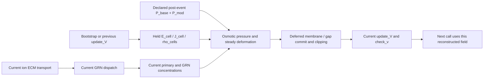

# Ordinary ECM fields and steady mechanics

The new prefix composes the frozen normal ECM field join01 and mechanics02.
Both components remain unexecuted candidates for this composition. No prior
scientific qualification is inherited. Their original source files and frozen
packets are not edited by this composition.

The reached normal source order determines the two different epochs at the
mechanics boundary:

`E_cell`, `J_cell` and `rho_cells` come from the actual bootstrap on the first
call and the preceding end-field result thereafter. The new GRN publications
do not cause a field refresh before mechanics. Primary and GRN concentrations
are current post-dispatch, pre-deferred-commit stores; the ECM rows already
contain current transport. Osmotic pressure uses the current runtime temperature
and the shared phase `dt`. The source initializer's fixed `sigma` is carried
separately from recomputed `sigma_cell`; conductivity/current/rho fields required
by the component schema are unused by reachable steady deformation.

Key's high-level `advance` observations do not expose the needed insertion
point. Its existing exported `material_step(on_network=...)` does. The new
callback restores and runs the complete existing GRN dispatch, records its
returned state, runs mechanics, then returns to the unchanged deferred material
code. It copies no material, network, field or mechanical numerical equations.
The end-field reconstruction still uses Key's original `reconstruct` function.
Complete original parents, conditional inputs, returned trials and source/raw
failure objects are written before later computations or comparisons.

Hydrostatic pressure is an explicit prerequisite. The native event handler
assigns `P_cells=P_mod+P_base` before pumps; Key's bounded component does not run
that event handler. This API accepts either the source zero baseline with no
pressure events or complete declared post-event `P_mod`/`P_base` rows at that
same boundary. It does not infer pressure from voltage, flux or displacement,
or claim to execute event scheduling. Source clocks are explicit labels;
neither phase `dt` nor an event history is inferred from the bounded wrappers.

The field specimens contain manufactured centres, membrane midpoints, areas
and volumes. They are not native polygon seeds and do not contain the required
DEC/neighbor declarations. The caller must provide those declarations on the
same cell/membrane IDs and order. The binding requires exact shared centres,
areas, volumes, owner matrix and source grid maps. The extra manufactured DEC,
neighbor directions and unused display coordinates are declared explicitly in
the new specimens. They are not inferred from the field data. A graph-origin
label is a conditional constructor prerequisite, not evidence that seeding or
cutting ran. No polygon, Voronoi, physical seed or geometry qualification follows.

The ordinary loader disables flow and dynamic deformation. Both remain refused,
as does FAST. The supplied velocity stores are held zero on the common grid;
there is no flow-to-deformation edge, field/advection conversion or geometry
feedback. Native sampled deformation changes only a persistent display copy,
with original membrane vertices retained and no active `deformWorld` call.
Sampling is refused here: the frozen native field adapter permits at most16
cells, while the available quartic display fit requires at least25. No bound is
widened and no synthetic display interpolation is substituted.

Native validation retains the complete unchanged normal ECM source history.
Its genuine post-GRN snapshot and previous field construct the mechanics
source inputs, which must match the port's archived inputs bit for bit. The
unchanged mechanics source bodies then run on those declared inputs. A static
source read/write audit records that pressure/steady mechanics writes only
mechanical stores, reads the reached current concentrations/old fields, and
writes no material, field or physical geometry store under the refused flow,
dynamic and sampling branches. This is correspondence between native phases,
not a monolithic native solver execution. Complete native objects, locals,
array dtype inventories, numeric NPZ data and private RNG witnesses remain
separate from bounded result summaries. No missing source phase is credited.

Fresh references receive actual archived cold, bootstrap, pre-material,
pre-GRN, pre-mechanics and pre-field inputs. No trajectory is independently
carried across these points. Existing frozen ECM check helpers retain their
original reference-fixed gross budgets, typed material floors, network and
source-accounting checks. Mechanics uses its unchanged `8e-12` relative and
existing pressure/operator/displacement/auxiliary floors; self-resolution must
remain at most0.1 of each budget. Fresh workers deny Cells, BETSE and every
scientific package, reproduce full conditional outputs at100/160 digits, and
recompute complete mechanical comparisons and saved error/budget rows.

The existing reference modules project through `plain` or `serial`. A read-only
trace observes each outer conversion argument and saves every Decimal string
and true binary64 node before projection; no source function or arithmetic is
replaced. Mechanics retains its full typed raw tree through its existing
observer. Complete projected outputs are separate sidecars. All returned raw
outputs precede gates. The original material39/40 failure stays failed at its
old budget, and raw negative-network/mechanics-overflow cases earn no accuracy
credit. Four changed-output controls and two wrong-epoch controls test the
numeric gates and the exact pre-commit/previous-field boundary respectively.

Preparation performs only source/AST auditing, code-object compilation, Ruff,
hashing and copying. It imports no scientific code, constructs no specimen,
collects or runs no test, starts no numerical job and edits no `PROGRESS.md`.
Chief owns review, the closed launch gate, resource coordination, a launcher
and the finalizer. Use the distinct new unit declaration, frozen Key01 source
with explicit mechanics02/new-prefix overlays and the frozen Pillow/runtime
dependency paths. Do not run an inherited component driver as this packet's
launcher or claim broader biological, conservation, field-energy or native
full-lifecycle equivalence.
