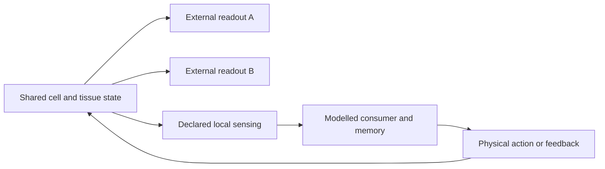

# Multiphysics, multiscale and parallel execution architecture

Design baseline: 2026-09-09, D045 / ARCH-003. Implementation and primary-source
review: **2026-10-11**. This is the target architecture for
[multiscale composition](MULTISCALE_DESIGN.md), BETSE calibration of the
bioelectric layer, [BITSEY regulatory/ionic and lineage replication](ROADMAP.md#bitsey-replication),
and experiments motivated by *Plastic Heredity* and
*How Forms Become Reconstructible*. [Progress](../PROGRESS.md) owns run status;
[BETSE coverage](BETSE_CAPABILITY_ROADMAP.md) owns the mechanism inventory.

The existing separation of physical state, observations, numerical methods and
device placement is a suitable foundation for investigating polycomputing.
The main additions are explicit task/readout contracts, overlapping functional
groups, modelled consumers of signals, and tests of concurrent function and
causal use. These are design requirements below, not implemented capabilities
or evidence that Cells already exhibits biological polycomputing.

## Current foundation and remaining design gaps

| Area | Foundation in the current stack | Still needed |
| --- | --- | --- |
| Shared physical dynamics | Versioned array models for ions, fields, gates, chemistry and selected coupled families; [dynamic BETSE junctions](../src/cells/models/betse_junction.py) use ordinary execution and snapshots | Broader physiological coupling, mechanics, growth and turnover; biological calibration of each new mechanism |
| Assembly and history | [Finite-pool stochastic assembly](CAPSID_ASSEMBLY.md) retains bonds, event clocks and material; assembly can regulate selected ionic channels | Physically justified feedback into assembly, resource-dependent synthesis/remodelling and additional writable slow state |
| Measurements and interventions | [Model observations](../src/cells/observers.py), scheduled controls, complete checkpoints and branching | A reusable collection of versioned task/readout definitions, restricted physical consumers and simultaneous-task assays |
| Resolution and clocks | Fixed-geometry fields, common-step integration and event-split assembly/ionic coupling | Qualified fine/coarse maps, coupled multirate/stiff solvers and preservation of task-relevant histories |
| GPU execution | CPU/L4 paths, independent-world queues, stable world identities and [offline plans for up to 16 GPUs](../src/cells/ensemble/plan.py) | JUPITER qualification, multi-node queue/failure handling and partitioning one interacting world |
| Field scaling | Explicit graph ownership and bounded dense field/linear solves in current families | Sparse or matrix-free solvers, preconditioning and communication costs qualified on larger fixtures |

This is a map of architectural responsibilities. Passing one model family does
not qualify arbitrary compositions of those families. Historical development
notes at the end retain their original, narrower claims.

## Five separate decisions

```text
Biological definition: mechanisms, compartments, geometry, organ ports
    -> Operator/boundary graph: who owns state and exchanges what
    -> Resolution plan: detailed cells, coarse regions, declared closures
    -> Numerical plan: coupled methods, clocks, tolerances, exchange stages
    -> Placement plan: CPU/GPU devices, partitions and communication
```

All five identities belong in a run manifest. The organ is data selecting
implemented mechanisms and wiring ports, not a solver branch. Organ membership,
physical connectivity, numerical resolution and device ownership are distinct
maps. The target permits one organ to span GPUs or one GPU to hold several organs
or resolutions; organ execution and distributed coupling are not implemented claims.
Changing a device must not silently change physics, precision or resolution.

Alongside these five decisions, save the **assay and readout definitions**:
preparation, permitted interventions, tasks, observers, calibration and evaluation
sets. They reference physical IDs without redefining ownership. A task describes
what an experiment tests; any goal or setpoint that changes the simulated world
needs an explicit physical storage and update law. Changing a readout revises
the measurement identity. Changing a sensor or feedback law revises the model.

Keep Python for assembly, validation, experiments and orchestration, and JAX
array kernels for the primary CPU/GPU path. Do not promise that one JAX function
or one explicit timestep will efficiently solve every future mechanism. A
specialized field/linear solver may be an independently qualified backend block
with explicit array residency and transfer costs; adopting one needs a concrete
fixture, not a new mandatory framework now.

## State ownership and geometry

| Entity | Owns | Must not be conflated with |
| --- | --- | --- |
| Species definition | Stable identity, valence, units, compartment eligibility | Hard-coded Na/K/Cl indices or an implicit charge-repair ion |
| Compartment | Amounts, declared volume and any dynamic resource/buffer state | A cell name, observer phenotype or maintained reservoir |
| Membrane surface | Endpoints, geometry, capacitance, channel/transport state | Cell volume, contact adjacency or experiment-imposed inhibition |
| Contact/transport edge | Endpoint mapping, route law and owned transfer history | A duplicated pair simulator for each neighbour |
| Field mesh | Cell volumes/faces, geometry, boundary conditions and field-owned inventory | One mandatory field node per biological cell |
| Mechanics/lifecycle | Position/shape/volume laws, topology events and partition rules | Moving array slots or arbitrary duplication of concentrations |
| Solver/execution | Required method state, coupled clock, events, random streams and pending exchanges | Biological inheritance or an observation-only snapshot |

Use structured arrays/PyTrees grouped by compatible model family and capacity.
Compartments, species, surfaces, edges and field sites have independent axes and
stable IDs. No dense all-cell connectivity matrix is required. Padding is finite
and mask-safe, and overflow is a checked checkpoint/reallocation boundary.
The explicit model registry and version-specific CPU/GPU schemas are not a
general assembly API; add exercised contracts incrementally and preserve old versions.

Amounts are primary where the model represents material. Derive concentrations
from amounts/volumes; changing volume requires the correct dilution and transport
terms. A chemical species, a fixed charge background and a maintained external
countercharge have different ownership and costs. State-changing reactions must
declare their stoichiometry and any externally supplied matter/energy.

Electrical closure belongs to a named physical model. The existing one-cell
affine voltage anchor is valid for its fixed-capacitance, fixed-potential bath.
Multiple facing potentials, electrode currents or evolving membrane capacitance
require a newly derived constraint/charge law. Do not copy that anchor to each
surface or evolve both voltage and charge independently without a constraint.
Geometry changes must account for any modeled capacitive/mechanical work.

## Small operator contracts, not a universal plugin runtime

A process declares the state it reads, the outputs or fluxes it owns, units and
signs, validity limits, required physical capabilities, and numerical needs.
Local reaction rates, membrane transfer, graph exchange, field transport and
algebraic constraints are different operator kinds. They can contribute to one
coupled state without all becoming arbitrary Python callbacks inside a hot loop.

Each physical transfer is calculated once and accumulated with opposite signs
at its endpoints. Convert amounts to concentration changes only with the
appropriate compartment volume. Charge current follows the declared species
fluxes and valences, plus separately modeled electrode/displacement/gating
currents where applicable. A ledger records transfer history, not extra matter.

Source-scaled EMT coordinates do not become physical ion amounts through a
generic field mapping. Adapters need explicit units, clock meanings and tested
approximations. Observers can inspect global state for analysis but cannot
silently provide nonlocal information to a biological process.

## Polycomputing: several functions in the same evolving substrate

Bongard and Levin describe polycomputing as concurrent computational uses of
the same physical substrate, with the useful interpretation depending on the
observer and its interactions. Their paper is a perspective spanning biological
and engineered examples, rather than a universal computational law.
[Published perspective](https://doi.org/10.3390/biomimetics8010110),
[author preprint](https://arxiv.org/abs/2212.10675).

Two primary studies give useful experimental patterns. Parsa et al. evolved
**simulated granular materials** with NAND responses at two driving frequencies
at the same output particle; physical construction remained future work.
[Parsa et al., GECCO 2023](https://arxiv.org/abs/2305.17872).
Biswas et al. screened **gene-regulatory network models** for several kinds of
memory using timed stimulation. Those predictions motivate assays; they do not
establish that the same memory mechanisms exist in our ionic/assembly models.
[Biswas et al., iScience 2021](https://doi.org/10.1016/j.isci.2021.102131).

The following requirements are **our design interpretation** of this research.
Polycomputing concerns functions within a simulated world; GPU parallelism
concerns where its numerical work runs. A single-device model can investigate
the former before distributed execution exists.

### Keep physical ownership separate from functional participation

A membrane, assembly or calcium state may participate in several functions.
Store and evolve it once. Multiple operators can read it, and declared fluxes
or reactions can contribute to its evolution through the common numerical
method. Software modules organise laws and checks; they must not force one
biological function per module or an exclusive cell-to-task assignment.

Allow sparse, many-to-many membership maps for functional groups. Groups can
overlap and cross tissue/organ or GPU boundaries. An inferred group is an
observer output; membership alone introduces no interaction, material, memory
or top-down force. Changes with time reference stable physical IDs and explicit
birth/death/lineage events when those exist. Overlapping summaries cannot be
summed as disjoint material or energy inventories.



The lower loop is an additional modelled mechanism. A post-processing decoder
does not supply that loop. A neighbouring cell that consumes a signal can have
effects even without feedback to its source; the forward causal route still
needs to be represented and tested.

### Make readouts, tasks and physical consumers explicit

These are small versioned definitions to introduce with a concrete fixture,
not a new universal plugin framework or an existing configuration API.

| Definition | Required information | Why it matters |
| --- | --- | --- |
| Readout | State fields and stable IDs; units and frame; spatial support; sample clock, bandwidth, lag and history window; filters/noise; decoder parameters and calibration | Two functions may depend on different phases, timescales or cell subsets in the same trajectory |
| Task | Physical input encoding and permitted interventions; required output; horizon and metric; training/evaluation split; validity limits and failure/censoring rules | A meaning or success label cannot be supplied secretly to the physical model |
| Physical consumer | Local sensing routes, delays, persistent internal state, parameter/learning rules, action ports and modelled resource costs | A claimed biological reader must obtain and use signals through its own causal dynamics |
| Functional group | Explicit overlapping memberships and their interpretation; provenance and time/identity policy | Functional organisation need not match an organ tree or numerical partition |
| Evaluation | Independent-world/biological replicate unit, nulls, held-out inputs, joint tasks, interference and ablation/rescue comparisons | Additional labels on one trace do not by themselves establish multiple useful functions |

Separate an external analysis decoder, an experimental feedback controller and
a physical consumer inside the model. An external controller can be useful,
but remains external support. For a physical consumer, bind reads to actual
variables/routes and actions to lawful reactions, transport or forces. Record
sensing bandwidth, response delays, saturation and any assumed costs; an
unmodelled cost remains unknown. Avoid arbitrary ATP charges without chemistry.

A fitted decoder can discover information already present without changing the
substrate. Report that separately from learning that writes substrate state,
and from changes to both reader and substrate. Archive decoder fitting and
search choices, freeze them before held-out evaluation, and prevent access to
future samples, hidden stimulus labels or simulator-only global information.
Online readers consume only available present/past data. Complete state and
future trajectories remain available to independent scientific analysis.
Keep related windows and descendants together when splitting training and test
data. Multiple readouts from one world do not create independent replicates.
Report decoder complexity and search cost so computation supplied by the analyst
can be distinguished from the substrate's contribution.

### Preserve the information needed to test the claim

Useful functions may depend on pulse timing, phase relationships, spatial modes,
gate history, bond topology or delayed responses. Mean voltage, endpoint class
and cage count can each discard such information. Select observation cadence,
filters and retained histories from the declared tasks; check sampling and
numerical refinement separately. Interpolation or extra output samples cannot
recover frequencies or events the integration never resolved.

Bounded streaming readouts need saved filter state, phase reference, history
buffers and counters. Persist them as analysis state when they only report,
and as physical model state when they affect evolution. Changing passive
observer order, output cadence, window size or device placement must preserve
the declared physical trajectory/replay contract. An observer's random noise
uses a separate stream from biological stochastic events.

Treat functional diversity as an accuracy requirement for a proposed coarse
model. Qualify each retained task and its response to interventions; a smaller
model that preserves task A but destroys task B has a restricted scope. Reduced
dynamics may require memory variables or delay kernels. Record lost capabilities
and reconstruction uncertainty instead of assuming the retained coarse state
is Markovian or reconstructs every microscopic history.

### Evidence to seek in Cells

Use three explicit claim levels: **decodable information**, **concurrent
task performance**, and **causal use by a modelled consumer**. The third is
needed when claiming that a biological subsystem uses a result; it is not a
prerequisite for exploring observer-dependent computational capability.
Report per-task and joint success, interference, causal controls and costs.
No single information measure or universal polycomputing score is selected.

The [first implementation protocol](TWO_TASK_READOUT_ASSAY.md) specifies the
location/timing panel, restricted voltage readers, calibration holdouts and
controls on the existing dynamic-junction runtime. Current run status remains
in [Progress](../PROGRESS.md); implementing the assay does not assume a positive
task or biological result.

1. Start with a small, already qualified physical family. Define two distinct
   input/output tasks and evaluate both from each shared trajectory. A possible
   first assay varies the location and temporal pattern of a local cue
   independently and attempts to recover both from restricted ionic readouts.
   This is a proposed test, with no assumed positive result or long-term memory.
2. Compare task A alone, B alone and A+B on the same substrate definition and
   resource assumptions. Include joint input combinations, unseen inputs/seeds,
   frozen readout calibration and a baseline using the same decoder class on
   the stimulus without the tissue. Measure interference and tradeoffs; task
   selection must not silently switch physical models between evaluations.
3. Use matched initial checkpoints and declared interventions to test dependence
   on shared state. Block a candidate route, reset a candidate carrier through
   a physically admissible operation, or disable a consumer action, then test
   rescue. Include matched-support controls so general damage or resource loss
   is not mistaken for selective loss of computation. Readout shuffles are
   analysis nulls, not physical interventions.
4. Add a physically specified consumer when testing biological use. Its success
   must depend on the signal through its allowed sensor/action routes, compared
   with open-loop or disabled-reader controls. Measure both tasks and collateral
   effects; distinguish simultaneous use from sequential task switching.
5. Extend the successful or informative negative assay to cue removal, matched
   visible states with different histories, reader replacement and actual carrier
   turnover. Retention, transmission and reconstruction remain separate outcomes.

This connects directly to [E04's history challenge](EXPERIMENTS.md#e04-extension-matched-phenotype-different-history)
and [E09/E11/E12](EXPERIMENTS.md#later-experiments), rather than creating a separate
polycomputing engine. *Plastic Heredity* asks what is carried and renewed;
*How Forms Become Reconstructible* adds whether changed carriers/readers can
restore a function. Multiple readouts alone establish neither.

The assembly layer supplies a candidate substrate with explicit structure and
history: the same bonds can be observed structurally and can alter channel
availability in the existing coupling. Additional signalling or mechanical
uses need their own laws. Ionic/calcium feedback into assembly rates, resource
regeneration and writable regulatory state remain extensions to test, not
properties inferred from the current one-way coupling. Whole-organ morphology
and autonomous renewal also require the mechanics and lifecycle work.

## Fidelity and resolution are explicit capabilities

Support named model families rather than an undocumented global "fast" flag:

- Conditioned endpoint relations can answer only their declared static queries.
- Dynamic lumped ionic compartments own amounts, voltage closure and fluxes.
- Spatial membrane/field models add polarization and environmental gradients.
- Reduced tissue/organ regions own their explicit coarse state and closure.

BIO-002, for example, cannot supply ionic flux or hidden gate history merely
because it predicts voltage. A reduced region can connect to a material port
only if its closure defines that port and accounts for the exchanged inventory.
Refuse unsupported observations, controls and couplings rather than inventing
the missing state.

Start fine/coarse coupling with **static region assignments**. Restriction maps
aggregate amounts, volume and relevant slow/history state; prolongation specifies
what can be reconstructed and its uncertainty. Coarse concentrations alone do
not uniquely recover hidden channel, regulatory or inheritance state. Adaptive
refinement/derefinement requires its own state-transfer and hysteresis/error
policy. Memory preservation is tested by future interventions, not just by
matching the current mean phenotype.

## Coupled numerical execution

Retain a common-step detailed reference before introducing multirate updates.
Candidate methods include explicit local stepping, implicit stiff blocks,
implicit-explicit splitting and field/pressure solves; no package or universal
method is selected in this design. Each block specifies its domain checks,
error target, dense-output/event semantics, constraint residuals and restart
requirements. Fast electrical dynamics cannot be assigned a larger timestep
just because the calculation moves to a GPU.

One interacting world has a coordinated physical timeline. Independent worlds
may retain their separate clocks. A coupled macrostep must:

1. Resolve the next intervention/topology event and the participating blocks.
2. Exchange the endpoint/stage data required by the selected method.
3. Evaluate local and interface operators, including any necessary global solve.
4. Reconcile integrated interface transfers and validate the candidate state.
5. Commit a common valid boundary, then publish requested observations/checkpoints.

For explicit RK coupling, halo exchange must match the required RK stages, not
just the output or recording window. For an implicit solve, communication and
constraint checks may occur during each iteration. Freezing neighbouring state
over several substeps is a numerical approximation to qualify, not a free
parallelization trick.

For multirate/fine-coarse interfaces, declare interpolation/extrapolation, flux
quadrature and synchronization intervals. An owned flux register can retain the
same integrated transfer for both sides; corrections must not conceal negative
inventories or failed intermediate states. Conservation is necessary but does
not establish temporal accuracy or stability. Refine both local timesteps and
coupling intervals against the common-step reference.

The assembly/ionic implementation already splits integration at cell-owned
stochastic events. Extending it to bidirectional coupling changes the numerical
problem: a voltage, calcium or resource change that alters a reaction propensity
can invalidate a previously sampled waiting time. Specify and qualify the hazard
integration or conditional event-rescheduling method before adding such feedback.
Checkpoint the required hazard/event state and resolve coincident intervention,
reaction and topology events deterministically. The present one-way coupling
with fixed rate parameters cannot silently stand in for this extension.

## Parallel GPU execution: three different workloads

| Workload | Partitioning | Required communication |
| --- | --- | --- |
| Independent experiments | Whole worlds across devices; compatible worlds batched within each device | Dispatch/results, no biological exchange between worlds |
| One interacting tissue/organ | Spatial cell/edge/mesh partitions within one world | Halo/stage values, single-owned boundary transfers, constraint reductions and field solves |
| Coupled organs | Organ ports plus whichever spatial partitions each organ needs | Conserved port transfers and shared transport/field dynamics on the coupled clock |

The existing ensemble queue assigns complete independent worlds to workers.
An interacting organ may instead require several devices within one world.
Use a partition ownership map with read-only ghost entries, deterministic edge
ownership and no double-counted flux at cross-device contacts. Model-family
buckets allow heterogeneous kinetics without one Python call per cell.

The deployment target is **one to four JUPITER Booster nodes, four GH200s per
node, up to sixteen GPUs**. The current site specification gives **96 GB HBM3
per GPU** and **72 Arm CPU cores / 120 GB LPDDR5X per superchip**. Intra-node
NVLink and inter-node InfiniBand are different placement costs. Budget each
device's memory and its CPU-side work explicitly; aggregate HBM is not a single
local allocation. These details were rechecked on 11 October 2026.
[JUPITER configuration](https://apps.fz-juelich.de/jsc/hps/jupiter/configuration.html).

Keep two execution paths distinct. Independent-world workers can take tasks
asynchronously; partitions of one coupled world must join the required
collectives together. A later hybrid deployment can allocate a fixed device
team to each coupled world and distribute independent worlds between teams.
World/replicate IDs, partition IDs and mesh axes must remain separate. Functional
groups and readout counts do not determine either map. Sixteen GPUs is the
planned deployment ceiling, not a limit on biological IDs or model dimensions.

Candidate JAX mechanisms are device meshes and explicit array sharding for
placement, with `shard_map` where explicit per-partition collectives are useful.
These are implementation candidates, not a promise that JAX automatically finds
our tissue decomposition or supplies a distributed PDE solver.
[Distributed arrays](https://docs.jax.dev/en/latest/201/sharding.html),
[manual parallelism](https://docs.jax.dev/en/latest/201/shard-map.html).

Multi-host operation comes after a single-host multi-GPU fixture. Participating
processes must execute compatible collective operations in the same order;
failure/rejection decisions cannot leave peers waiting in a different branch.
Distributed initialization, rank/device discovery and shutdown are execution
concerns, not biological state. Exact APIs and hardware support must be checked
against the eventual pinned deployment environment.
[JAX multi-controller guidance](https://docs.jax.dev/en/latest/multi_process.html).

Fields and incompressible flow may require nonlocal linear solves and global
reductions even when cellular interactions are local. Prefer sparse/matrix-free
operators and evaluate suitable preconditioning; do not assume a dense inverse
or all-gathering the entire world will scale. Communication, imbalance and
solver iterations belong in the cost model.

Keep state device-resident across bounded stepping windows where practical.
Host interaction handles scheduled structural changes, bounded data transfers
and output. Dynamic growth/repartitioning happens at declared safe boundaries
with identity-preserving migration and possible recompilation, not arbitrary
shape changes inside one compiled kernel. No asynchronous stale-halo mode is
enabled by default.

Compile compatible readouts over the same resident state; budget their filters
and bounded history buffers separately. Local physical readers run with the
model's required clocks. Analysis can reduce summaries or run offline when saved
data contain the required information. Neither a Python callback per cell/step
nor a full-world gather for every observer is the default design. Changing
diagnostic cost must not change physical sampling or stochastic streams.

For independent arms, use measured task costs to balance the shared queue and
reduce the final idle tail while preserving registered sample counts, seeds
and scientific conditions. For a coupled world, balance operator/solver and
communication work rather than cell count alone. Report elapsed time, per-arm
completion gaps, allocation idle time, node-hours and all allocated GPU-hours
(`4 × nodes × wall hours` for this target). Include compilation, CPU checks,
transfers, logging and checkpoint I/O. Record both GPU-busy and measured
SM-active with valid coverage, plus warmed intervals when meaningful. The 70%
target remains advisory; scientific throughput at equal accuracy and allocation
cost determine whether an optimization helps. See [GPU reporting](GPU_ENSEMBLES.md).

## Precision, randomness, failure and restart

CPU float64 remains the reference. GPU precision and each operator's tolerance
must be qualified; reductions may change rounding order across devices. Require
bounded scientific/numerical agreement, not universal bitwise cross-device
trajectories. Current exact-replay guarantees keep their original scope.

Stochastic assembly already derives draws from world identity, registered
seeds and event counters, with per-cell stream identities in coupled clusters.
It retains pending events across observation/window boundaries. Extend that
policy to new processes with stable world/entity IDs, process identity and
logical sample/event counters; keep scientific, observer and search streams
separate. Repartitioning must preserve the declared noise history. New births,
splits and merges require collision-free identity/stream rules. Adaptive
stochastic timesteps require their own consistent path scheme; ID-based keys
alone do not solve that problem.

A complete checkpoint includes primary biological state, slow/history state,
geometry/topology, control clocks, pending transfers and required solver state.
Physical reader/controller memory and delayed signals are part of that state;
passive streaming-analysis state is stored separately with its readout identity.
Changing a future assay preserves the recorded preparation and declares which
reader state is retained, reset or replaced. A full numerical restart remains
different from biological transmission or reconstruction after turnover.
Parallel publication needs a common committed epoch across all partitions;
uncommitted shards are not a resumable world. Retrying, resharding and changing
resolution have explicit policies and identities. Conservative redistribution
cannot be relabeled bitwise replay. Restart portability and distributed fault
tolerance remain future deliverables.

## Qualification before scale claims

- Recover existing small-model limits without changing their saved versions.
- Compare local operators and coupled CPU trajectories with independent references.
- Check disconnect, block/release, boundaries, conservation and required energy laws.
- Vary timestep, mesh and coupling interval separately; test fine/coarse responses.
- Compare unpartitioned and partitioned one/pair/star/field fixtures, including
  an edge crossing a partition and a field source on an interface.
- Test topology/ID permutation, complete restart and all-partition failure handling.
- Verify passive-observer independence, reader-state restart and simultaneous-task
  response to causal interventions; coarse models declare which readouts survive.
- Measure one GPU, multiple GPUs and then multiple hosts at equivalent accuracy;
  report strong scaling (fixed total problem) and weak scaling (fixed work/device).

Budget active and padded state, solver scratch, field/preconditioner storage,
halos, compilation, transfers, diagnostics, output and checkpoints. Report
end-to-end time alongside kernel time. No speedup, whole-organ capacity or
hardware purchase is inferred from this design.

## Build order

Keep the [current BETSE and physiology sequence](ROADMAP.md) moving. The
architecture additions can be exercised incrementally:

1. Add a small versioned task/readout collection to an existing qualified model,
   with frozen calibration and passive-observer invariance checks. Reuse ordinary
   branches, windows and independent-world execution.
2. Run the two-task assay above with bounded inputs and negative controls, then
   introduce a local physical consumer only when its mechanism is specified.
   This can begin on CPU/L4 without waiting for organs or sixteen GPUs.
3. Add bidirectional assembly/regulatory coupling and longer memory only with
   physical laws and qualified event/ODE coupling. Use E04/E09/E11 to locate
   state and test its use, then E12 to test reductions against both tasks.
4. Qualify JUPITER ensembles on one node before expanding to two/four. Develop
   sparse field solves and partitioned interacting-world fixtures separately;
   demonstrate local multi-GPU coupling before multi-host coupling.

No new experiment, controller, distributed runtime or polycomputing result is
delivered by this documentation review. Current run evidence stays in
[Progress](../PROGRESS.md).

## Historical implementation notes

The following notes retain their original September scope, including open
acceptance statements at that time. Use the current foundation above and
Progress for present capabilities.

<details>
<summary>Original production sequence</summary>

### Original production sequence

The [SPEC-005 contract](MULTISPECIES_MEMBRANE_SPEC.md) and
[instantaneous reference](../reports/SPEC005_DESIGN_CHECK.md) are now complete.
[NUM-006 now qualifies short trajectories](../reports/NUM006_REFERENCE.md) with
independent methods, explicit event/observation checks and retained dense data.
CORE-006 now implements the [first production assembly](MULTISPECIES_MEMBRANE.md),
with [bounded acceptance complete](../reports/CORE006_ACCEPTANCE.md). The existing
model identities and regression results are preserved while the new assembly
exercises the smallest species/compartment/membrane interfaces. SPEC-006's
[two-gate channel reference](VOLTAGE_GATED_CHANNEL_SPEC.md) now passes separate
analytic and instantaneous checks; that reference alone adds no production channel. NUM-007 now
[qualifies coupled gate/amount dynamics](../reports/NUM007_REFERENCE.md) at
0.5 ms RK4/cubic with passing refinement, full state/history and domain checks.
CORE-007 now implements a [state-bearing channel family](VOLTAGE_GATED_MEMBRANE.md),
with [complete replay/cohort acceptance](../reports/CORE007_ACCEPTANCE.md). The additional numeric channel
extent enters model-owned memory estimates and cohort compatibility before
allocation. Subsequent solver, field,
reduction and GPU stages each need an actual fixture. Design for those stages
now; do not implement placeholder organ hierarchies or a distributed framework
to run the first cell.

SPEC-007 now provides a [physical ionic graph contract](PHYSICAL_IONIC_GRAPH_SPEC.md)
and [passing scalar composition checks](../reports/SPEC007_DESIGN_CHECK.md).
Shared-recipient stars exercise the distinction between one local cell operator
and several edge contributions. The edge map stays sparse, with separate gate,
transfer and dissipation arrays. Future partitions must exchange matching solver
stage values and reconcile single-owned interface transfers; numeric reduction
order and restart policy need their own GPU qualification.
[NUM-008 now qualifies short coupled graph paths](../reports/NUM008_REFERENCE.md):
2 ms RK4/cubic with passing 1 ms refinement on twelve fixed cases, explicit
control splits and complete interface history. This is a shared-stage numerical
baseline for the [CORE-008 production graph](PHYSICAL_IONIC_GRAPH.md), not a
multirate or distributed solver. The new family composes existing physical
operators with sparse endpoint gather/scatter and independently padded channel/
junction histories; CPU acceptance uses the ordinary scalar and cohort paths.
No device placement or solver infrastructure is introduced solely for this graph.
Larger degree,
stronger coupling, smaller capacitance and coarser region boundaries require
their own stability/accuracy qualification before device placement or speedup claims.

</details>

<details>
<summary>Historical field-design foundations</summary>

### Historical field-design foundations

The following D055-D061 notes describe their original development stages;
later spatial and resolved models are covered in the [tissue guide](TISSUE_RETURN_CURRENT.md).

D055 / [SPEC-008](FINITE_EXTRACELLULAR_SPEC.md) adds a design/reference for one
shared finite outside, not a production field solver. One outside inventory
collects equal/opposite transfers from all membranes. With no junctions, cells
sharing that outside are still coupled through chemistry; they cannot be put
into independent-world slots. Each true independent world owns a separate outside.
For a later partitioned world, exchange the current solver-stage outside state
and reduce owned membrane transfers exactly once. Do not integrate private
outside replicas per GPU or count junction transfers in that reduction.
This reduction is an explicit communication dependency, not a measured scaling
result. Spatial compartment refinement may localize it later, but changes the
mixing/electrical approximation and needs separate convergence evidence.

D057 / [NUM-009 v2](FINITE_EXTRACELLULAR_NUMERICS_V2.md) separates physical inventory
from its anchored numerical representation. Initial amounts are immutable;
inside and outside increments are complete checkpoint-relevant state, not
transfer histories or a reason to reanchor partitions independently. The
implicit references and candidate all evolve every inventory explicitly.
Conservation-tangent Jacobian probes are a CPU reference linearization, not
state projection or a distributed algorithm. The original dependent-outside
reference remains a retained failed attempt. Future device placement must
preserve the candidate's same-stage conservative outside reduction and exact
inactive-inventory behavior, not absorb roundoff into a designated compartment.

D058 / CORE-009 now supplies the [CPU/JAX finite-outside implementation](FINITE_EXTRACELLULAR.md)
and [formal execution evidence](../reports/CORE009_ACCEPTANCE.md). Outside state,
anchors, volume and owner indices are independently padded numeric arrays, and
each independent cohort world retains its own complete outside state. Existing
scalar/cohort clocks and restart semantics are reused. No distributed runtime
or CPU-to-GPU speedup follows from this: splitting one coupled world still
requires same-stage reductions and synchronized outside state. The next spatial
contract must define extracellular potential constraints as well as transport;
several independent zero-potential baths would change the physics.

D059 / [SPEC-009](SPATIAL_EXTRACELLULAR_SPEC.md) now defines that first spatial
closure at the design/instantaneous-reference level. A membrane-capacitance graph
sets charge differences within its components; extracellular current continuity
sets their relative potential offsets. A membrane-free bulk node needs no fake
capacitance. The field block therefore has its own graph, gauge, residual budget
and solver/cache contract, distinct from the compartment inventory and transfer
ledgers. The passive first subset gives a sparse gauge-fixed linear problem at
each admissible state; more general cross-component transport can make it nonlinear.

Future distributed execution must exchange same-stage concentrations and
potentials, accumulate each interface flux once and qualify the coupled solve's
reductions/preconditioner. Independent-world batching cannot partition this one
interacting environment. Coarser geometry and faster hardware must not silently
change its electrical closure. Dense reference matrices, a passing arithmetic
panel and the existing 1 ms finite-outside step are not a spatial/GPU solver
qualification. [NUM-010](../reports/NUM010_REFERENCE.md) now provides the separate
bounded CPU numerical result: 0.125 ms with 0.0625 ms refinement on its panel,
not a GPU or arbitrary-resolution bound.

The [NUM-010 protocol](SPATIAL_EXTRACELLULAR_NUMERICS.md) treats temporal resolution,
spatial resolution and device placement as separate choices. Its 8/16/32-volume
line panel tests one finite-volume refinement path; it does not qualify all meshes.
Finer diffusion grids can require smaller explicit steps, even on a faster GPU.
Do not encode the selected reference step as a universal physical timescale.

Future GPU work should preserve independently sized inventory, membrane and
outside-face axes, once-owned flux accumulation and same-stage field residuals.
The small dense field solve and dense conservation-tangent implicit Jacobian are
reference techniques, not scalable kernels. A sparse or matrix-free field solver,
and any later implicit/IMEX or multirate evolution, must qualify their own coupling,
conservation, observation and restart behavior against this baseline. Device
placement alone cannot remove stiffness or a coupled field-solve dependency.

D061 / [CORE-010 development integration](SPATIAL_EXTRACELLULAR.md) now makes
that separation executable for the passive subset. Checkpoints store independent
cell/outside/membrane/face axes and sparse edge ownership; the explicitly named
`gauged_dense_kirchhoff@1` block uses quadratic temporary CPU workspace included
in pre-allocation scalar/cohort/window guards. No dense matrix, solver warm start
or additional hidden state is persisted. Existing JAX cohorts batch independent
worlds, not pieces of the same tissue. This bounded implementation is a baseline
for later sparse/matrix-free backend qualification, not a large-GPU scaling result.
Full captured production acceptance remains open.

</details>
