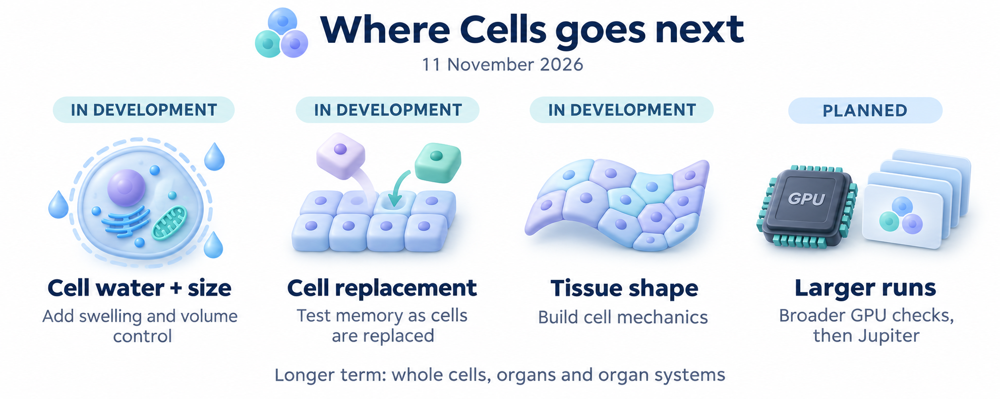

# Cells documentation

Start with the design guides below, then choose a model guide for the mechanism
you want to run. [PROGRESS.md](../PROGRESS.md) owns current run status and evidence;
the [project README](../README.md) gives the short feature overview.

## Design and direction

| Guide | What it explains |
| --- | --- |
| [Architecture](ARCHITECTURE.md) | State ownership, numerical execution, experiments, checkpoints and outputs |
| [Current plan](CURRENT_PLAN.md) | The current order, adopted 12 November 2026 (D145): gates and their completion evidence, after two architecture reviews |
| [Composite tissue model](PUMP_COMPOSITE.md) | `resolved_pump_composite@1`: `@3`'s step plus declared operators (water, symport, replacement), its contract and its bitwise guards |
| [Composite v2 design](PUMP_COMPOSITE_V2_DESIGN.md) | Reviewed design before code: declared energy roles, observation ownership, cross-operator writes, membrane state (S2), current injection, the L4 agreement protocol |
| [Architecture review notes](ARCHITECTURE_REVIEW_NOTES.md) | Read-only review of 12 November 2026: two coexisting designs, the operator contract, the GPU-native scope, execution paths and candidate follow-ups (for review) |
| [Multiscale composition](MULTISCALE_DESIGN.md) | How cells, regions and future organs compose without confusing membership with physical exchange |
| [Parallel execution architecture](MULTISCALE_EXECUTION_ARCHITECTURE.md) | Resolution, coupled clocks, device placement and the requirements for future distributed tissues |
| [BETSE capability coverage](BETSE_CAPABILITY_ROADMAP.md) | Implemented subsets, reference correspondence and remaining mechanism gaps |
| [BITSEY replication](ROADMAP.md#bitsey-replication) | Regulatory/ionic reference and planned reproduction of the *How Patterns Return* lineage experiments |
| [Scientific basis and calibration plan](SCIENTIFIC_BASIS.md#calibration-across-the-cells-stack) | References across the stack, future cell/organ data resources and the limits of model and experimental evidence |
| [Roadmap](ROADMAP.md) | Development priorities, dependencies and completion criteria |
| [Experiment programme](EXPERIMENTS.md) | Proposed memory and relay assays; implementing their prerequisites does not establish an assay result |
| [E07-v1 renewal-stage design](E07_V1_DESIGN.md) | PROPOSED, not registered: donor copies with state-blind donors, an isolated threshold-finding set, the copy-only null, and composite v2's decision 4 for donor copies |
| [E15 pattern-recovery experiment path](EXPERIMENT_PATH_PATTERN_RECOVERY.md) | Backlog, not active (13 November 2026): the engine features needed to test which layers restore a pattern after damage rather than only generating it, and a version 0 as E07-v2 arms |
| [Paper backlog](PAPER_BACKLOG.md) and [GRN wet-lab validations](GRN_WETLAB_VALIDATION.md) | Papers under test, and gene-network models validated against experiments (logged) |
| [Protein catalogue plan](PROTEIN_CATALOGUE_PLAN.md) | Path to protein identities linked to atlases (UniProt, Human Protein Atlas, PDB, Reactome) |

## Models and execution

- [GPU execution and ensembles](GPU_ENSEMBLES.md): local CPU/L4 support,
  independent workers, telemetry, checkpoints and the planned Jupiter path.
- [Protein assembly](CAPSID_ASSEMBLY.md): stochastic cages, finite pools,
  breakable bonds and experimental assembly-to-cell coupling.
- [BITSEY regulation](EMT_REFERENCE.md) and [coupled pair](SOURCE_EMT_PAIR.md):
  the existing bounded models behind the planned lineage replication.
- [Tissue electrical models](TISSUE_RETURN_CURRENT.md): cross-region return
  currents, resolved membranes and native BETSE comparison components.
- [Shared channel catalog](TISSUE_RETURN_CURRENT.md#hcn-leak-and-fixed-camp-variants):
  56 sodium, potassium, HCN, calcium and leak laws, including owned calcium/ER,
  finite-fuel and assembly-control compositions. Component correspondence,
  integrated qualification and experimental calibration remain distinct.
- [Legacy calcium-sensitive potassium](CALCIUM_ACTIVATED_POTASSIUM.md):
  a free-calcium/voltage equation with explicit source units and container
  limitations, now [composed with tissue, owned calcium and finite fuel](TISSUE_RETURN_CURRENT.md#calcium-sensitive-potassium-with-the-shared-catalog).
- [Morris–Lecar channels](MORRIS_LECAR_CHANNELS.md): five dynamic and eight
  instantaneous source laws, with explicit physical clocks, state contracts
  and shared tissue/calcium/fuel composition.
- [Channel catalog with compliant water](TISSUE_RETURN_CURRENT.md#shared-channel-catalog-with-compliant-water):
  all 53 laws use current compartment concentrations, with conservative water
  flow and separate water/gate timestep bounds.
- [Channel catalog with prescribed repair](TISSUE_RETURN_CURRENT.md#shared-channel-catalog-with-prescribed-repair):
  all 53 laws with owned calcium/ER, Na/K injury leakage and explicit resealing;
  fixed geometry and one-way assembly control.
- [Channel catalog with finite fuel and water](TISSUE_RETURN_CURRENT.md#shared-channel-catalog-with-finite-fuel-and-water):
  all 53 laws with owner-local ATP/ADP/Pi, explicit supply and current-volume
  concentrations; pool osmotic particles and mixing energy are counted once.
- [Owned calcium/ER with compliant cytosol](TISSUE_RETURN_CURRENT.md#owned-calcium-and-er-with-compliant-cytosol):
  shared chemical/water volume, fixed ER, one count per chemical particle and
  joint mixing, binding, capacitor and water energy accounting.
- [Owned calcium, finite ATP and water](TISSUE_RETURN_CURRENT.md#owned-calcium-finite-fuel-and-compliant-water):
  Na/K, plasma-calcium and ER pumps share one live fuel pool and cytosol volume;
  chemistry and fuel each contribute their osmotic particles and energy once.
- [Prescribed repair with calcium, ATP and water](TISSUE_RETURN_CURRENT.md#prescribed-repair-with-owned-calcium-finite-fuel-and-water):
  Na/K injury leakage reads the live volumes and preserves all shared owners;
  structural resealing remains prescribed. Development evidence is in Progress.
- [Shared fuel with owned calcium](TISSUE_RETURN_CURRENT.md#shared-finite-energy-with-owned-calcium-and-assembly):
  Na/K, PMCA and ER pumps share finite ATP/ADP/Pi, with explicit regeneration
  and internal pump-work accounting; assembly control remains one-way.
- [Finite mitochondrial ion/voltage coupling](TISSUE_RETURN_CURRENT.md#finite-mitochondrial-ion-and-voltage-coupling):
  passive internal exchange with actual cytosolic owners, capacitor energy and
  heat, composed with calcium/ER, finite fuel and configured plasma transport.
  [Mitochondrial cuts](TISSUE_RETURN_CURRENT.md#cell-removal-with-mitochondrial-owners)
  retain organelle inventories and paired internal charge; qualification is in Progress.
  Respiration and ATP synthesis remain outside this law.
- [Water-aware cuts](TISSUE_RETURN_CURRENT.md#cell-removal-with-compliant-water-and-finite-fuel):
  actual cytosol/exterior volumes and concentrations survive, while compliance
  references, pressure laws and all transfer/work histories stay explicit.
- [Live network regulation](TISSUE_RETURN_CURRENT.md#live-network-regulation-of-pumps-channels-and-junctions):
  bounded factors read actual free ions and finite fuel to regulate existing
  pumps, shared channels and junctions; public qualification is tracked in Progress.
  [Regulation-aware cuts](TISSUE_RETURN_CURRENT.md#cell-removal-with-live-network-regulation)
  preserve surviving rule order, physical sample owners and regulated fields.
- [Initial tissue geometry](TISSUE_GEOMETRY.md): prepare passive tissue from
  recorded native meshes with explicit physical measures and portable replay.
- [Static tissue-profile preparation](TISSUE_RETURN_CURRENT.md#static-tissue-profile-preparation):
  bind native regional profiles to resolved membrane/junction permeability using
  explicit physical thickness and owner maps, with a JSON/CLI preparation and replay interface.
- [Explicit INIT-to-SIM preparation](TISSUE_PHASES.md): carry passive, active or
  complete calcium/fuel inventories, intrinsic gates and accounting history into
  a new phase clock, with complete replay.
- [Scheduled active membrane profiles](TISSUE_RETURN_CURRENT.md#scheduled-active-membrane-profiles):
  apply regional background-permeability pulses while preserving channels, pumps,
  intrinsic gates, phase clocks and full transfer history.
- [Scheduled profiles with calcium and finite fuel](TISSUE_RETURN_CURRENT.md#scheduled-membrane-profiles-with-calcium-stores-and-finite-fuel):
  distinct models retain calcium/ER stores, buffers and ATP pool ownership;
  qualification is tracked in Progress.
- [Cell removal and continuation](TISSUE_RETURN_CURRENT.md#cell-removal-and-absolute-time-continuation):
  conservative passive tissue cuts, [active channel/pump cuts](TISSUE_RETURN_CURRENT.md#cell-removal-with-channels-and-maintained-fuel-pumps)
  and [owned calcium/ER cuts](TISSUE_RETURN_CURRENT.md#cell-removal-with-owned-calcium-and-er-stores),
  rebuilt electrical fields and complete archives retaining the original clock.
- [Two-task readout assay](TWO_TASK_READOUT_ASSAY.md): cue location and timing
  read from shared tissue trajectories, with frozen calibration and controls.
- [Compartment chemistry](COMPARTMENT_REACTIONS.md), [ER calcium](ER_CALCIUM.md),
  [spatial calcium](SPATIAL_CALCIUM.md) and [plasma calcium/IP3](PLASMA_CALCIUM.md):
  named model versions, ownership, equations and their synthetic test domains.
- [Finite exterior](FINITE_EXTRACELLULAR.md) and
  [spatial exterior](SPATIAL_EXTRACELLULAR.md): the earlier ionic model families.
- [Independent worlds](INDEPENDENT_WORLDS.md),
  [windowed execution](WINDOWED_EXECUTION.md) and
  [windowed cohorts](WINDOWED_WORLDS.md): the original shared-runner contracts.
  Later model and GPU guides state their supported extensions.

## Research and historical records

- [CCI-seq review](PAPER_REVIEW_CCI_SEQ.md) and
  [mitochondria review](PAPER_REVIEW_MITOCHONDRIA.md) record proposed uses of
  literature; they are not completed simulator validations.
- [Quantum birthmarks review](PAPER_REVIEW_QUANTUM_BIRTHMARKS.md) proposes
  classical history/readout tests inspired by a quantum theory and simulation
  paper, with explicit limits on biological and heredity claims.
- [Ion channel compensation review](PAPER_REVIEW_CHANNEL_COMPENSATION.md)
  examines Hazan and Levin's search methods, released GPU benchmark and
  possible functional-recovery experiments in Cells.
- [Cortical culture learning review](PAPER_REVIEW_CORTICAL_LEARNING.md) adds a
  future wet-lab benchmark for learning, persistence and error recovery, with
  data requirements, experimental limitations and missing simulator features.
- [T cell organelle coordination review](PAPER_REVIEW_T_CELL_ORGANELLES.md)
  proposes tests for calcium-linked clustering, directed delivery and imaging
  metrics, with explicit data and model prerequisites beyond BETSE parity.
- [Partial reprogramming review](PAPER_REVIEW_PARTIAL_REPROGRAMMING.md) reads Washizu et
  al.'s bioRxiv preprint for Cells: no engine feature, and write–clear–challenge rules for
  cue experiments.
- [Granzyme K and tissue ageing review](PAPER_REVIEW_GZMK_AGEING.md) checks a supplied
  secondary assessment and places a secreted-protease ageing module against the gates.
- [Kinetochore protein counts review](PAPER_REVIEW_KINETOCHORE_COUNTS.md) reads Hirano et al.'s
  FCS-calibrated counts as an abundance-evidence standard for the protein catalogue.
- [Bone mechanosensing review](PAPER_REVIEW_BONE_MECHANOSENSING.md) reads Zhang et al.'s abstract
  for Cells: mechanically gated conductance and state-dependent secretion as deferred features.
- [Decisions](DECISIONS.md) preserves dated design choices and stable decision IDs.
- [Development history](DEVELOPMENT_HISTORY.md) contains the milestones moved
  out of the project README.
- [Historical planning snapshots](history/) preserve superseded roadmap text.
- [Acceptance reports](../reports/) and [validation code](../validation/)
  retain the protocols, results and failed attempts behind scoped claims.

## Reading scope and status

The main design and coverage entry points were reviewed against the checkout and
recorded results on **2026-10-11**. Architecture documents distinguish implemented
building blocks from target interfaces. Older implementation notes are labelled
as history; their test counts and statements about future work apply to their
original stages.

Versioned model guides and frozen specifications describe a particular model,
source revision and numerical domain. A restriction in an older version is not
automatically a restriction on every Cells model. Consult its successor guide
and Progress before interpreting a historical "next" or "planned" statement.
Numerical qualification, native BETSE/BITSEY agreement and biological validation are
separate claims. L4 results do not establish Jupiter or multi-node scaling.

Paths under `/mnt/workspaces` and older `runs/` references identify local evidence
outside this checkout. They are not public downloads. Repository reports and
protocols provide the readable scope; the original artifacts retain the detailed
inputs, results, failures and hashes. External research-tree paths in the source
catalogue are provenance records, not bundled manuscripts.

## Capability overview and planned resources (moved from the project README)

**Historical overview.** Moved from the project README on 11 November 2026,
unchanged except for link paths and heading levels. It describes the project before
the 8 November reset; its "In progress" and "Planned" parts are out of date. The
README now carries a short current summary, and [Progress](../PROGRESS.md) holds the
current status.

### References and calibration

We draw on several sources, each serving a particular part of the simulator:

| Part of Cells | Reference and role |
| --- | --- |
| Bioelectric layer | [BETSE](BETSE_CAPABILITY_ROADMAP.md) provides scientific inspiration and a calibration and verification instrument for electrical transport, channels, pumps, junctions and fields. |
| Regulation and cellular-state transmission | [BITSEY](ROADMAP.md#bitsey-replication) supplies regulatory/ionic reference models; reproducing the Forms paper's writing, retention and replacement experiments is the first assay target. |
| Protein-cage assembly | [Asor et al.'s mass-photometry study and stochastic model](CAPSID_ASSEMBLY.md) underpin the assembly branch. The paper contains real measurements; fitting Cells to those data remains future work. |
| Physical chemistry and electrodiffusion | [Thermodynamic reaction-network and electrodiffusion references](SCIENTIFIC_BASIS.md#calibration-across-the-cells-stack) guide material, charge and energy accounting and numerical checks. |

Scientific feature parity with BETSE and BITSEY remains a verification goal for
the relevant layers within this broader programme. Comparisons cover declared
models and conditions; experimental calibration requires measured data.

For whole-cell and organ development, the planned resource set includes:

- **Cell physiology and energy:** published models from
  [Physiome/CellML](https://physiomeproject.org/data-repositories/physiome-model-repository)
  and [BioModels](https://www.ebi.ac.uk/training/online/courses/biomodels-quick-tour/what-is-biomodels/),
  alongside the [mitochondrial model and measurement leads](PAPER_REVIEW_MITOCHONDRIA.md).
- **Molecular quantities and locations:** [BioNumbers](https://bionumbers.hms.harvard.edu/aboutus.aspx)
  and the [Human Protein Atlas](https://www.proteinatlas.org/about/introduction),
  with each value traced to its experimental conditions.
- **Tissue composition and anatomy:** [CCI-seq](PAPER_REVIEW_CCI_SEQ.md),
  [Human Cell Atlas](https://data.humancellatlas.org/), and
  [HuBMAP](https://portal.hubmapconsortium.org/)/[Human Reference Atlas](https://humanatlas.io/asctb-tables)
  for cell types, neighbourhoods and spatial organisation.
- **Measured function:** matched experiments on voltage, calcium, ATP, oxygen
  use, transport, growth and mechanical responses; later, organ-level recordings
  from resources such as [PhysioNet](https://physionet.org/about/) where appropriate.

These are candidates for future benchmarks. The first organ and species are
still to be selected; human atlases apply to compatible human targets. Anatomical
or expression data do not by themselves specify transport rates or validate organ
function. See the [calibration plan](SCIENTIFIC_BASIS.md#calibration-across-the-cells-stack)
for source roles, existing evidence and the path to independent experimental tests.

### Current functionality

- **Electrical cells and tissues:** ion transport, membrane voltage, pumps,
  channels, gap junctions and extracellular fields in selected model families.
- **Tissue geometry:** [prepare passive tissue inputs from recorded BETSE meshes](TISSUE_GEOMETRY.md),
  with explicit volumes, membrane properties and a portable preparation recipe.
- **Regional tissue profiles:** [prepare different membrane transport properties
  and junction barriers](TISSUE_RETURN_CURRENT.md#static-tissue-profile-preparation)
  from explicit geometry for selected tissue, calcium, fuel, water and regulation
  models, with a reproducible preparation recipe. Timed interventions support
  [passive membranes](TISSUE_RETURN_CURRENT.md#scheduled-passive-membrane-profiles)
  and [tissues with active channels and pumps](TISSUE_RETURN_CURRENT.md#scheduled-active-membrane-profiles).
  Passive and active tissues support [carrying initialized state into a new experiment](TISSUE_PHASES.md).
- **Cell removal:** [cut and resume selected tissue models](TISSUE_RETURN_CURRENT.md#cell-removal-and-absolute-time-continuation),
  preserving surviving material, [channel and junction gate states](TISSUE_RETURN_CURRENT.md#cell-removal-with-channels-and-maintained-fuel-pumps)
  and [calcium/ER stores](TISSUE_RETURN_CURRENT.md#cell-removal-with-owned-calcium-and-er-stores),
  with complete prior history.
- **Cell chemistry:** calcium and IP3 signalling, internal compartments and
  chemical reactions, including [passive mitochondrial ion exchange and voltage](TISSUE_RETURN_CURRENT.md#finite-mitochondrial-ion-and-voltage-coupling).
- **Fuel and cell volume:** finite ATP supplies and osmotic water flow, including
  a [combined calcium/ER, ATP and water model](TISSUE_RETURN_CURRENT.md#owned-calcium-finite-fuel-and-compliant-water)
  with [prescribed injury and resealing](TISSUE_RETURN_CURRENT.md#prescribed-repair-with-owned-calcium-finite-fuel-and-water).
- **Regulatory cell state:** BITSEY-based isolated regulation and a bounded
  [two-cell regulatory/ionic model](SOURCE_EMT_PAIR.md).
- **Protein assembly:** stochastic cage formation, finite material pools,
  breakable bonds and experimental coupling to cell models.
- **Repeatable experiments:** checkpoints, restart, branching and independent
  simulation ensembles, with CPU/L4 comparisons and conservation checks.

For GPU ensembles, workers take batches of independent simulations from a shared
queue and save their results and checkpoints. Numerical qualification has used
CPUs and one L4; Jupiter
execution remains to be qualified. Distributing one interacting tissue across
multiple GPUs requires further development. See the
[GPU and ensemble guide](GPU_ENSEMBLES.md).

BITSEY's nominal model clock is kept distinct from physically calibrated time. The
[assembly-to-cell coupling](CAPSID_ASSEMBLY.md) is an experimental modelling
hypothesis.

### In progress

- Combining spatial fields, active membrane transport and dynamic junctions in
  BETSE comparisons.
- Extending verification of the integrated cell, tissue and assembly models.
- Bringing new components into the shared configuration, checkpoint and ensemble
  workflows.
- Qualifying [regional membrane interventions with calcium stores and finite ATP](TISSUE_RETURN_CURRENT.md#scheduled-membrane-profiles-with-calcium-stores-and-finite-fuel).

### Planned

The next directions are richer integrated cell physiology, broader BETSE/BITSEY
verification, reproduction of the Forms assays, and Jupiter qualification from
four to sixteen GPUs. Experimental calibration, broader energy and water
coupling, mechanics and organ models extend that programme.
Detailed scope and priorities are recorded in [Progress](../PROGRESS.md) and the
[Roadmap](ROADMAP.md).

### Development history

Earlier milestones, qualification results and retained failures are recorded in
[Development history](DEVELOPMENT_HISTORY.md). See [Progress](../PROGRESS.md)
for current status.

