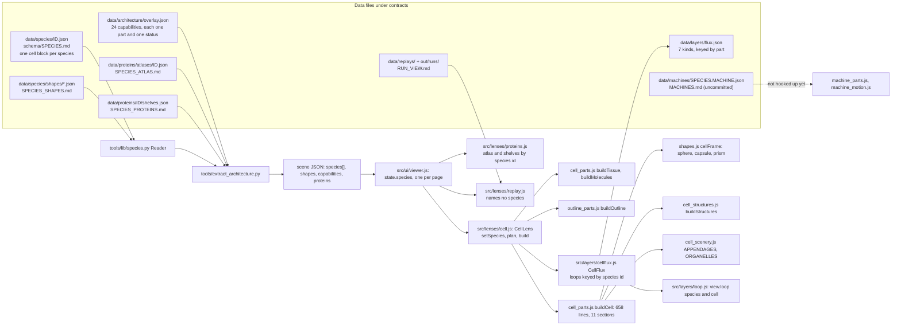
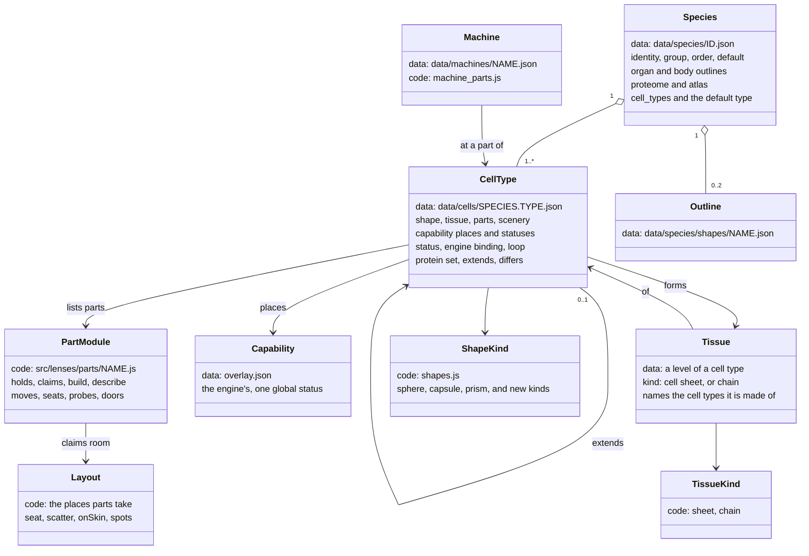

# Cell types in the viewer: the design, and the review behind it

## Decided

The user chose option B of this review on 16 November 2026 ("yes B then as you guys think is
best"), and left the details to the visualizer session and its advisor. As settled that day:

- **A cell type is a first-class thing**, each in its own data file under a new contract. Today's
  `cell` block of a species file is read as that species' one default cell type, so no existing
  species file changes. What hangs on a cell (flux, looping runs, the atlas's doors, machines) is
  keyed by species and cell type.
- **The cell builder is taken apart into part modules with one small interface**, in steps that
  each leave the page working. The first step is done: a test that holds the builder to numbers
  taken from what it draws (`tests/cell_build.test.mjs`), so that a step meant to move nothing can
  be shown to move nothing. A refactor step never writes those numbers again; only a commit that
  says the picture changes does, and it names the parts.
- **Status of the human's ventricular (endocardial) cell: planned**, until its design note is a
  tracked file on main, then designed. Nothing says "modelled" of a cell type before the record
  does.
- **The epicardial and M cells get no rows**: one sourced sentence in the endocardial cell's
  panel says that they will differ in parameters only (the engine's D184). `extends` is in the
  contract and is exercised by a test fixture.
- **The control for choosing a cell type** lands with the first second cell type, not before, and
  is designed after the phone-layout pass: no new control in the phone's top bar.
- **The human opens on the generic cell.**
- **Binding to the engine** stays optional in the files, and no id is invented: on main the
  engine has no cell-type object yet (section 6).
- **Order against other work:** the contract and its reader wait until main holds the engine's
  landing of 16 November 2026 and the map has had its pass (that step rebuilds the scene, and
  mends the refused `cell.loop` field and the table kept twice); the motor's hook-up into the Cell
  view goes before "the lens takes a cell type"; the builder's split and the bacteria's size
  switch both change `cell_parts.js`, so one goes at a time.

What follows is the review as it was handed over, unchanged but for this section: the options,
the findings behind them, and the step plan. Where it says "the user chooses", the choice above
is the answer.

## The review

Agent K's note to the coordinator, 16 November 2026. Review and options only: no file of the
source tree was changed, and nothing was built when it was written.

The user's question, on the human's line "No human cell type, organ or body is modelled": "we do
plan to model specific cells so look into [our] viz [architecture] is built for that in an module
object oriented way".

**Refs read.** The viewer: branch `visualizer`, head `e7cbe990` (the brief named `fe6f1fb5`; the one
commit since changes only the human's `modelled.text` and the scene), with the uncommitted tree as
it stands (other agents' phone-layout pass, machine files and ideas files, read around and not
touched). The engine, read only with `git show`: `main` at `cdeb0f04` (at `9a15108e` when I began;
the one commit between adds D186 to `docs/DECISIONS.md`); and the development branches
`integration-d172` `3c10b833` (checked again before handing back: not on main), `cardiac-laws`
`59ae93e3`, `run-view-d154` `fd008813` and `core-next` `17a3863b`. `run-view-d154` moved to
`8d29d787` while I wrote. That one commit adds `electrode_current_injection@1`'s run-view
declarations, and leaves `docs/LOOPING_REPLAY_DESIGN.md` unchanged. **Whatever is cited from a
branch other than main is on a development branch, not on main,** and is marked so. Paths of the
viewer are relative to `visualizer/`; paths of the engine are the repository's. My own estimates
and readings are marked **S**.

**Terms used below.**
- **D172's landing**: the batched round that lands the engine's one modular inner model on main.
  Its candidate is `integration-d172`.
- **Track E**: the engine's excitable-tissue track (D155; `docs/EXCITABLE_TISSUE_DESIGN.md`,
  main), with milestones M1 to M5.
- **H1 to H4**: the human cardiac lane's milestones in its design note (on `cardiac-laws`):
  - H1, the channel laws;
  - H2, calcium handling;
  - H3, the paced human cell;
  - H4, human tissue.
- **FR-11**: the feature request for looping replay packages, which keep each species' cell
  "alive" in the viewer (`docs/FEATURE_REQUESTS.md`, main).
- **@3**: `resolved_pump_tissue@3`, the inner tissue model.

**Checks run.** `taskset -c 12-15,28-31 npm test` once: 466 tests, 465 passed, 1 skipped, 0
failed, exit status 0 (in the tree as it stands, with the uncommitted work). No browser run.
Scratch scripts and copies of the engine documents are in `out/scratch-celltypes/`.

---

## 1. The answer, in short

**Not yet, though what is drawn is already data, read by modules that name no species.** "One
cell per species" is built into the species contract and its reader (one `cell` block), the Cell
view's lens, flux and looping runs (keyed by species), the doors into the Protein atlas, the
machine files and the "Generic cell" chip. The cell itself is drawn by one 658-line function laid
out for a 20 µm six-sided animal cell: given a 100 µm rod with a nucleus and neighbours, it
draws all six neighbours overlapping the cell and a sheet of hexagons (section 4.4). **The
smallest sound change** is to make the cell type a first-class object, each type its own file,
with today's `cell` block read as each species' one default type so that no existing file
changes; to key what hangs on a cell by species and type; and to take the builder apart into part
modules with one interface, step by step, before a heart cell's own parts are drawn.

## 2. Recommendation

**Option B (section 3): cell types as their own files, and the cell built from part modules with
one interface.** The reasons:

- **It passes all three test cases.** The ventricular cell (a) needs new structures and a new
  shape, which B adds as new modules and data. The epicardial cell (b) has the same laws and a
  different parameter set, so B draws it from the endocardial cell's file with `extends` and says
  that it differs in parameters only. E. coli and thale cress (c) keep their files byte for byte:
  their `cell` block is their one cell type.
- **It keeps what is drawn apart from what is modelled.** A cell type's drawing (shape, parts,
  scenery) is curated, with sources. What the engine models of it (law IDs, the definition, the
  parameter set, the looping run) is a separate binding, read from the engine's own declarations
  where they exist.
- **It is the pattern the viewer already follows.** It is the pattern of `cell_scenery.js`'s
  registries ("one word of the contract, one entry in a species file and one function here"), of
  `cell_structures.js` and of the machine files. It extends that pattern to the builder's
  remaining hard-wired sections.
- **It stops short of what the engine has not decided.** Option C draws tissues of mixed cell
  types and reads them from the engine's declarations. But the engine has no cell-type identity
  yet (section 6), its declarations manifest is designed and not built (D185), and "multiple cell
  types with different model sets" is "not on any current gate"
  (`docs/PAPER_REVIEW_MYC_CYCLINT1_HEART.md`, main). B's contracts are shaped so that C can follow
  without a rewrite: ids are `species.type`, and a tissue names cell types rather than holding
  them.

**The order of work** (section 8 has each step, with the tests and click checks that hold it):

1. Step 0, a "built exactly as before" digest test of the cell builder. It goes first, alone.
2. Step 5, the cell-type contract and the reader, with no visible change. It runs on files
   disjoint from steps 1 to 4, so it can go side by side with them.
3. Steps 1 to 3: the layout, then the part modules, then the handles contract. The geometry stays
   identical throughout.
4. Step 4, optional: each part gets its own stream of chance. This is the one step that moves
   the picture, and it is shown to the coordinator first. It can be left out, since a new part
   built last from a stream of its own already moves nothing else.
5. Step 6: the lens takes a cell type.
6. Step 7: the control on the page, after the phone-layout pass in `src/ui` is committed, since
   both touch `viewer.js` and `styles.js`.
7. Step 8: the human ventricular cell's file and the parts it needs, then the epicardial and M
   cells as `extends`.

**S** About 12 to 18 agent-days in all, of which steps 0 to 4 are about 5 to 7, steps 5 to 7
about 3 to 4, and step 8 about 4 to 7, depending on the parts and sources the user chooses.

## 3. The options

All three keep what the viewer does well (section 4.3): data under contracts, modules that name
no species, the `Part` binding of every drawn thing to an entity of the map or to neutral
scenery, statuses with sources, and the licence classes. They differ in how far they go.

### Option A: a list of cell types inside the species file (smallest)

- **Data.** A species file gains `cell_types`, a list. Each entry is today's `cell` block plus
  its own `cell` and `tissue` levels, a `status` and an `engine` binding. Today's `cell` block is
  the first entry.
- **Code.**
  - The reader (`tools/lib/species.py`) reads the list.
  - The lens (`src/lenses/cell.js`) gains `setCellType`, and `plan()` and `build()` read the
    chosen type.
  - Flux and looping runs are keyed by species and type.
  - The species list shows a species' types.
  - The builder (`buildCell`) is unchanged.
- **What it does for the cases.**
  - (a) The heart cell's new structures go into `cell_parts.js` and `cell_structures.js`, like
    the nucleus did.
  - (b) An `extends` key in an entry.
  - (c) Unchanged.
- **Cost (S).** About 3 to 4 agent-days.
- **Risks.**
  - The builder stays one long function. Its fixed places were laid out for a 20 µm six-sided
    cell (`SPOT`, `NUCLEUS_HOME` and the others). Given a 100 µm rod with neighbours, it bunches
    the parts in the middle, overlaps all six neighbours with the cell and draws the sheet as
    hexagons (section 4.4). Fixing that inside the one function is the same work as B's steps,
    done less safely.
  - Each new cell type makes that function longer, and its single stream of chance means a new
    part moves the parts drawn after it.
  - A species with several types becomes one large file, reviewed as one.
  - Machines and protein sets have no file of the type to name.

### Option B: cell types as their own files, and the cell built from part modules (recommended)

- **Data.**
  - `data/cells/<species>.<type>.json` under a new contract, `cells.visualizer.cell_type@1`
    (drafted in section 7). It holds the type's `cell` and `tissue` levels, its parts and
    scenery, the places and per-type statuses of the map's capabilities, its status, its engine
    binding, its looping run, its protein set, and `extends` for a variant.
  - A species file lists its types and the one it opens on. Its own `cell` block stays, read as
    its first type. Organ and body outlines stay the species'.
- **Code.**
  - A registry of part modules with one small interface (section 7.2), into which `buildCell`'s
    eleven sections are moved in steps.
  - A layout object that holds the places parts take.
  - Registries for shape kinds and tissue kinds as well.
  - The lens assembles a cell from its type's list of parts. Consumers (`animate()`, flux's
    `seatsOf`, the click checks' probes) read what each module declares, instead of named
    handles of one builder.
- **What it does for the cases.**
  - (a) New modules: the sarcoplasmic reticulum as a form of the ER part, the junctions at the
    cell's ends, and scenery for what the engine does not model. A new shape kind and a new
    tissue kind, if the user chooses them.
  - (b) `extends` with `differs`, drawn the same.
  - (c) Unchanged files. Thale cress may name its one cell a palisade cell, as its note already
    says.
- **Cost (S).** About 12 to 18 agent-days, as in section 2.
- **Risks.**
  - The builder's refactor touches the most-checked picture of the page. Step 0's digest test
    and the existing real-click checks hold it, and only step 4 moves anything.
  - A per-type status beside the map's per-capability status could confuse. Section 7.4 sets
    the rule: the dot shows the status in the type shown, and the panel gives both.

### Option C: an organism graph, read from the engine (furthest)

- **Data.**
  - Species, organs, tissues, cell types, compartments and structures, and machines become one
    entity graph. A tissue is a mix of cell types, with an arrangement and proportions: for
    example, a transmural strand of endocardial, M and epicardial cells, or myocytes with
    fibroblasts.
  - The capability map becomes per cell type, generated from the engine's manifest of declared
    pieces and from its organism definitions.
  - The scale rail becomes a path through the graph.
- **Code.**
  - As in B, plus a graph model in `src/scene/`.
  - The tissue builder draws mixed cells.
  - The extractor builds the per-type map from the engine's declarations.
- **Cost (S).** 25 agent-days or more. Most of it waits for engine pieces that do not exist:
  - organism definitions are "planned" (`exec.organisms` in the overlay; ARCHITECTURE "No
    organism definition yet", main);
  - the manifest is designed and not built (D185: "stage 1 ... starts after D172's landing. The
    manifest and the guide follow with it");
  - mixed cell types have no gate.
- **Risks.** It builds ahead of the record, which invites curated stand-ins for what the engine
  would declare. It also goes against the user's standing rule that options come before building:
  most of what it would draw has no decision behind it yet.

## 4. How the viewer is built today

### 4.1 The map of modules and data



### 4.2 Where "one cell per species" and "the generic cell" are assumed

| Place | What it assumes |
| --- | --- |
| `schema/SPECIES.md`, "File" and "Rules" | One `cell` block per species (`facts`, `parts`, `capabilities`). `levels` has one `cell` and at most one `tissue`. `cell.loop` names one looping run per species. `modelled.state` (`generic`, `proposed`, `modelled`) says what Cells models of the whole species |
| `tools/lib/species.py`, `Reader.species()` | Requires one `cell` block. **It refuses any key of `cell` beyond `facts`, `parts` and `capabilities`, so the `cell.loop` that `SPECIES.md` documents is a breach today.** A copy of `human.json` with `cell.loop` added was refused with "cell does not take loop", and the species was left out (`out/scratch-celltypes/loopcheck/`). Any contract change must move with the reader |
| `tools/lib/species.py`, `ANIMAL_ORGANELLES` and `NEEDS` | An animal cell's default (a cell with a nucleus holds an ER, a Golgi and mitochondria) and the structure each capability needs. The same two facts are written again in `src/lenses/cell_structures.js`, as `organelles()` and its own `NEEDS` |
| `src/lenses/cell.js`, `GENERIC` | A scene without species draws a built-in generic cell: a six-sided prism with a nucleus |
| `src/lenses/cell.js`, `MODELLED` | The chip's words: "Generic cell", "Proposed, not modelled", "Modelled". Read by `src/ui/viewer.js` (`speciesState`, `speciesRows`, the bar's fit test) and by `tools/check_species.mjs` (`WORDS`) |
| `src/lenses/cell.js`, `CellLens.setSpecies`, `plan()`, `build()` | The species is the unit of drawing. `plan()` reads `species.levels` and `species.cell.capabilities`; `build()` reads `species.cell.parts` and `levels.tissue` |
| `src/lenses/cell.js`, `describe()`, `inSpecies()`, `structural()`, `chrome()` | The species panel's "Its cell" from `species.cell.facts`. A capability's note from `species.cell.capabilities[...]`. Doors from the species' shelves (`proteins.shelves` by `species.id`). `view.species` in the chrome |
| `src/lenses/cell_structures.js`, `structureAbsence()`, `structureDoors()` | What a cell lacks and its doors, keyed by species. `SHELF_OF` and `SET_OF` map a part to a shelf or a set of the species' proteins |
| `src/layers/cellflux.js`, `CellFlux.loops`, `loop`, `setLoop(speciesId, run)` | "species id -> its looping run": one run per species |
| `src/layers/loop.js`, `readLoop(run, speciesId)` | Refuses "one made of another species' cell". `view.loop.cell` is the id of a cell in the run, not a type |
| `schema/RUN_VIEW.md`, `view.loop` | `{species, cell, period, closes, follows?}`. On the engine's side (`docs/LOOPING_REPLAY_DESIGN.md` §3, on a development branch, `run-view-d154`), `species` is "the caller's label" and `cell` "a declared cell id" |
| `schema/MACHINES.md` | The file is `<species id>.<machine id>.json`, with `species` and `at` (an appendage's foot, or a part). No cell type |
| `src/ui/viewer.js`, `state.species`, `setSpecies()`, `speciesChoices()`, `speciesPicker()` | One species for the page. Every lens's `setSpecies` and `setAtlas` follows it. Uncommitted phone-layout changes are in this file |
| `data/architecture/overlay.json`, `capabilities` | Each capability has one `part` and one global `status`. There is no status per species or per cell type; `species_held` is per species |
| `src/lenses/proteins.js`, `atlasOf()`; `protein_shelves.js`, `keyOf()` | A species' atlas and own proteins, keyed by species id. This is right for a proteome; a cell type would select within it |
| `tests/species_levels.test.mjs` | "no species is said to be modelled by the engine" tests a species-level state. The guard "names no species in its code" covers `src/lenses` and `src/ui` (except `replay.js`), with "worm", "brain", "heart" and "flask" |

Where the **generic animal cell** is built into the drawing:

- **The layout.** `cell_parts.js` holds the layout as module constants, laid out for a reference
  cell about 20 µm across (`REF` in `shapes.js`):
  - `SPOT`: angles round a six-sided cell for six channels, three pumps, the junction on side 0,
    water at two corners, and the wound, secretion, furrow and charges;
  - `GAP_CORNER`;
  - `NUCLEUS_HOME`, `ER_HOME`, `GOLGI_HOME`, `MACHINE`, `MITO_AT_SURFACE` and
    `CAGES_AT_SURFACE`;
  - `STYLE`: the nucleus's radius, the ER's ribbons and the Golgi's stack, for each size mode.
- **The tissue.** `buildTissue` has one kind, a sheet packed in sixes or squares. Replacement and
  mechanics sit at fixed cells (`{q: 3, r: -1}`, `{q: -2, r: 3}` and a patch).
- **The close-up.** `buildMolecules` is "one membrane patch with one channel and one pump"
  (README, Known limits).
- **The levels.** `LEVELS` is a fixed list (molecules, cell, tissue, organ, organism), in
  `cell.js` and again in `species.py`.

### 4.3 What is already modular, and should be kept

- **Species, shapes and outlines are data.** A species is "added with files alone"
  (`SPECIES_SHAPES.md`). `tests/species_levels.test.mjs` builds a made-up species with a rod and a
  body of its own from files, and keeps every drawing module free of species names.
- **One drawn thing, one entity.** `Part` (in `cell.js`) binds each shape to a capability of the
  map or to neutral scenery. It gives every planned part its sketch twin for "Colour: Status".
  Statuses, representation and size mode stay apart.
- **A small context.** `ctx.part`, `ctx.neutral`, `ctx.illustrate`, `ctx.scenery`,
  `ctx.sprite` and `ctx.known` (`CellLens.context()`): every builder draws through it, and the
  tests' stand-in (`stand()` in `tests/cell_scenery.test.mjs`) builds a cell in node without a
  browser.
- **Registries that already have the right shape.**
  - `cell_scenery.js`: `APPENDAGES` and `ORGANELLES` ("one kind is one word of the contract, one
    entry in a species file and one function here").
  - `cell_structures.js`: the nucleus, ER, Golgi, vesicles and ribosomes, each from "a stream of
    chance of its own", each saying "As drawn".
  - The machine files (uncommitted): a part described by a data file and drawn by a module
    (`machine_parts.js`) that names no species, with its own `problemsOf` check, a basis for every
    number, and a small context (`material(role)`, `add(object, id)`).
- **Truth rules carried in code.** `left_out` flags, `species_held`, the licence classes
  (`tests/licence_classes.test.mjs`), flux's two declared classes (QUANTITY_LAYERS rules 7 and
  11), and the loop reader's refusals.
- **Repeatable pictures.** Every random placement is seeded, so a "built exactly as before" test
  is possible. `tests/cell_scenery.test.mjs` already has one, for the layer's packing.

### 4.4 What is one long function or a hard-wired list

- **`buildCell`**, `src/lenses/cell_parts.js` lines 210 to 867 (658 lines), is one function with
  closures. Its eleven sections are: membrane; channels and pumps; junctions and neighbours; the
  part cut away and the plate; cytoplasm; nucleus, ER, Golgi and ribosomes (delegated); mitochondria
  and fuel; cages and machines; water, wound, division and secretion; the space between cells;
  and scenery (delegated).
  - **Fifteen capability parts by name** (21 `ctx.part` calls), and twelve `has(...)` checks.
  - **Shared closures** (`out/scratch-celltypes/closures.py`): one seeded `random` stream is used
    by seven sections in order, so moving or adding a section moves what follows. The sections
    also share `scatter`, `seat`, `onSkin`, `inCytoplasm`, `taken`, `cells` and `pack`, `SPOT`,
    `NUCLEUS` and `structures`.
- **What the lens reads from the builder's handles by name.**
  - `CellLens.animate()` reads `streams`, `signals`, `signalPath`, `cages`, `molecule.ions` and
    `ionPath`.
  - `CellLens.makeStops()` and `fades()` read `frame`, `shape`, `molecule.view` and `centre`.
  - `cellflux.js`'s `seatsOf(kind, cell, mode)` is a switch over kinds that reads `spots`,
    `streams`, `signals` and `molecule`.
  - `tools/check_input.mjs` clicks the probes `nucleus`, `chromatin`, `cutGel`, `uncutSide` and
    `sheetCell`.
- **Closed lists in the reader.** `CELL_KINDS` (sphere, capsule, prism), `PARTS`, `ORGANELLES`,
  `APPENDAGE_KINDS` and `NEEDS` in `species.py`. These are right as contracts, but each new kind
  needs both the list and a drawing.

**What today's builder does with a long cell, shown rather than asserted**
(`out/scratch-celltypes/long_cell.mjs`, through the tests' stand-in context, schematic mode).
No repository species combines a long shape with a nucleus and a tissue level. *M. pneumoniae*'s
10:1 rod has neither. So I built a made-up capsule 100 µm long and 22 µm across, with
`nucleus: true` and neighbours, beside today's human cell:

| | Today's human cell (six-sided prism) | A capsule 100 × 22 µm |
| --- | --- | --- |
| Length in the cell's frame | 19.4 units | 82.6 units (1.198 µm per unit) |
| The junction's anchor (`SPOT.junction = 0`) | (9.3, 0), on side 0 | (41.7, 0): **at the cell's end**, so junctions at the ends already follow from the convention |
| Nucleus, Golgi and mitochondria | (1.7, −1.3), (−4.9, 4.3), (6.6, 0.9) | the same places, all within about 7 units of the middle of an 83-unit cell: the parts bunch in its middle fifth |
| The six neighbours (a lattice in sixes, 18.4 units out) | none overlaps the cell | **all six overlap the cell itself** |
| A cell of the sheet | a six-sided prism | **a six-sided prism**: `buildTissue` takes 6 sides for any cell that is not a prism, so a sheet of rods is drawn as hexagons |

So a long cell needs a layout that spreads the parts along it, neighbours placed by the shape
(end to end, and side by side), and a tissue kind of its own. That is a new tissue kind (a
chain), not a new packing of sixes.

## 5. What a specific cell type needs: three cases

### (a) The human ventricular cell, endocardial (the engine's first)

What the record says:

- **The decisions (main).** D183 and D184 (`docs/DECISIONS.md`, main). The source is O'Hara and
  Rudy 2011's endocardial cell, at 310 K, with Hodgkin–Huxley sodium gates. "Epicardial and M
  cells later as parameter sets."
- **The design note (development branch).** `docs/HUMAN_CARDIAC_LAWS_DESIGN.md`, on
  `cardiac-laws`, not on main; "Status: PROPOSED ... Design only: no engine code yet".

| Aspect | What it needs | Modelled (when built), or illustration |
| --- | --- | --- |
| Shape | The source model's cell is "a cylinder of length 0.01 cm and radius 0.0011 cm" (100 µm long, 22 µm across), with capacitive area A_cap = 2·A_geo, as the design note reads Text S1 (§2, development branch; to be re-read from the paper before any file uses it). None of the viewer's kinds is a flat-ended cylinder: `capsule` has round ends, and `prism` is regular. A cell about five times as long as it is wide breaks today's layout: it bunches the parts, overlaps the neighbours and draws the sheet as hexagons (section 4.4) | The engine computes with the model's sizes: its capacitance and its pools' volumes. **S** A real myocyte's outline would be the picture's choice, from a cited source |
| Structures | The design note names pools that share the cell's potential: the bulk myoplasm, a dyadic subspace, and the network and junctional sarcoplasmic reticulum (SR). Their volume shares are 0.68, 0.02, 0.0552 and 0.0048 of the cell. Two patches of the one membrane face the subspace and the bulk (§2, §3.2 (a), development branch). Its buffers include TRPN in the bulk (**S** troponin, read by me from the abbreviation), held as a calcium buffer and nothing more | When built, the pools are modelled in aggregate: lumped, with no shape. Where they lie (an SR, dyads where the subspace-facing patch would be) is illustration. **S** Myofibrils, t-tubules and intercalated discs are not in the record I read; drawn at all, they would be scenery from a permissive source, like chloroplasts |
| Capabilities and places | `cap.channels`, `cap.pumps`, `cap.membrane`, `cap.calcium` (drawn at `er`; here the SR), `cap.energy`, `cap.mitochondria`, `cap.nucleus` (planned, as everywhere), `cap.junctions` (tissue only, later). The new laws do not fit today's capabilities' statuses (next row). Exchange cycles and release between pools have no capability of their own yet | — |
| Status, and what stands behind it | In the map's words, "Designed" ("A design or protocol is written or accepted; the code is not on main") or "Planned" ("Named in the plan or roadmap, or decided by the user; not started"). D184 (main) accepted the design's choices; the note is on a development branch and "reaches main after D172's landing". The human's text since `e7cbe990` says "Specific cell types are planned ... That choice is made and nothing of it is built yet". **A question for the user** (section 9) | — |
| Laws and models | Eight new channel laws, two transporter cycles, a release law, a calcium buffer read and CaMKII, plus moved leaks and pumps (§2). The IDs are "proposed" (**S** in the note), for example `fast_sodium_m3hj@1` and `l_type_calcium_cdi@1`. Engine models: `resolved_pump_composite@1` over `resolved_pump_tissue@3`, with `electrode_current_injection@1` for pacing (§7). Milestones H1 to H3, "about 20–30 working days elapsed" (§8). All on the development branch | When built: simulated (voltage, ions, pools). Today: none |
| Runs | FR-11's human loop: a paced cell at 1 Hz with a K⁺-only carrier, one beat, about 1,000 rows (§7, development branch). D184: "The viewer has no human loop until the human cell is ready". Its new kinds need run-view declarations (`KindView`, `core-next` `74a75241`) so their totals carry kind and sign | The loop's beads are the run's, under rule 7; until then illustration only, under rule 11 |
| Proteins | The species' own proteins (20,414 reviewed, on six shelves) stay the human's. A cell type's subset would need a source of where each protein is found, which README "Next" says needs the user's approval first. The law inventory (12 November 2026, engine `fec863f`) has none of the new laws | — |

### (b) The epicardial cell, a parameter set of the first

- **What differs.** "The cell types multiply conductances by factors in Text S1 p. 19's table;
  the epicardial cell's δ_epi is its one kinetic difference" (§2). "With kinetic coefficients as
  data ... they cost a parameter set each, not a law" (§4.2). Both are in the design note, on the
  development branch.
- **What the viewer does.** The same laws, the same structures, the same shape, so the same
  picture.
  - Its file says `extends: ventricular-endocardial`, with its own status ("Planned", D184
    item 2), its own label and a `differs` sentence.
  - Its panel shows the parameter set's differences only when the engine states them in a form
    the viewer can read (section 6). Until then it shows a sentence with its source, and no
    numbers.
- **The test this case sets.** A design in which a cell type owns its own drawing would draw a
  second copy, or invent a difference. In B, what is drawn and what is modelled are separate, so
  the variant inherits the drawing and binds another parameter set.
- **Runs.** A looping run of its own only if one is made. The note's loop is the endocardial
  cell's.

### (c) A cell type that is already a whole species' cell: E. coli and thale cress

- **E. coli.** It is single-celled, so its species has one cell type, the organism's cell.
  - Its file gives a shape (`capsule`), parts (two membranes, a wall, appendages with a motor
    foot), capability places, facts and sources, and `modelled.state: proposed`.
  - Its machine file names it (`data/machines/ecoli.flagellar-motor.json`, uncommitted).
  - It has no loop: FR-11's minimal-cell loops are for Syn3A and *M. pneumoniae* (`docs/FEATURE_REQUESTS.md`, main).
  - Under B its file is unchanged: its `cell` block is read as its one cell type, `ecoli.cell`.
- **Thale cress.** It already describes one cell type without saying so: its cell level's note
  reads "for a cell of the leaf's upper layer (a palisade cell)".
  - Under B the file may name it (`cell.id: "palisade"`, `cell.label: "Palisade cell"`) and
    nothing else changes.
  - "No plant cell is modelled", so the type has no status of its own (section 7.4).

**What a species and a cell type share, and what each holds alone:**

| | Species | Cell type |
| --- | --- | --- |
| Identity, sources, licence classes, facts | yes | yes |
| Organism, taxon, group, order, default | yes | — |
| Organ and body outlines | yes | names where it lies in them |
| Its proteome (shelves) and its atlas | yes | names a set within them |
| Shape of the cell, and the tissue it forms | — | yes |
| Parts, scenery, capability places, per-type statuses | — | yes |
| Engine binding (laws, definition, parameter set), looping run | — | yes |
| Machines | named by species today | located in a cell type's part |

## 6. How the engine identifies a cell type

**On main (`cdeb0f04`), there is no cell-type object in the engine.**

- **What the engine documents say.**
  - "Record model-family identifiers separately from observer-derived cell-type labels"
    (`docs/ARCHITECTURE.md`; `docs/MULTISCALE_DESIGN.md`: "Model family and initial cell-type
    configuration are distinct from a phenotype label inferred by an observer").
  - "Geometry and cell type remain data; changing the model's physics requires a versioned
    mechanism" (`docs/BIOELECTRIC_CELL_SPEC.md`).
  - "Fidelity is measured per declared cell type and environment" (`docs/CURRENT_PLAN.md`).
- **Organism definitions.** Biological definitions ("Organism, strain, conditions, parameter
  values, evidence references") live in "World builders and fixtures. No organism definition
  yet" (`docs/ARCHITECTURE.md`, Responsibilities). The structure proposed in
  `docs/SYN3A_MINIMAL_CELL_TRACK.md` §10 has:
  - "Law-set references: IDs from the inner model's law declarations";
  - "Parameter sets: values bound to declared parameters, each pointing to evidence records";
  - "The same structure takes Xenopus, the mouse heart, planarian and human. The structure lands
    with its first consuming milestone".
- **The decisions.** D184: "epicardial and M cells later as parameter sets". D185 adds "a
  declarations manifest ... of every registered law, operator and kind", which then appears "in
  the viewer's laws library without hand edits". It says nothing of definitions or parameter
  sets.
- **Name clashes.** In the engine, "species" means a chemical species
  (`src/cells/core/species_registry.py`). A "kind" is one module's contribution to the inner model
  (`src/cells/core/kind_registry.py`), such as a transporter or a buffer. Both files are on
  `integration-d172` (`3c10b833`), not on main. Neither is a cell type. The viewer's new object
  should therefore be called a **cell type** (`cell_type`), never a kind.

**On development branches, not on main:**

- **The definition's declared structure.** `InnerStructure` (`src/cells/models/inner_laws.py`,
  `integration-d172`) is "What one definition declares": its channel laws, junction laws, pump
  laws, fuel kinds and kinds. Two cell types with different laws are therefore two structures.
- **The cardiac note.** `docs/HUMAN_CARDIAC_LAWS_DESIGN.md` (`cardiac-laws`):
  - "a cell type or another source model is a parameter set in an organism definition" (§4.5
    (c));
  - H3: "The human ventricular cell's definition as cited parameter sets in `validation/` (no
    species-specific code in `src/cells`, D144)";
  - §9.2 question 11, "Where the human cell's definition lives", is open for the lead.
- **The looping-run design.** `docs/LOOPING_REPLAY_DESIGN.md` (`run-view-d154`):
  - "Each species' cell definition is a builder in `validation/replay/`";
  - `run_view.Loop(species, cell, ...)`: "`species` is the caller's label: the viewer's ids are its
    own", and `cell` is "a declared cell id".

**So a cell type would be bound to**, as far as the record goes:

1. a **structure**: the laws and kinds a definition declares, readable by ID from the D185
   manifest when it exists;
2. a **parameter set** bound to that structure. This is what tells the endocardial cell from the
   epicardial one;
3. a **biological definition** that holds both: a builder in `validation/replay/` for a looping
   run, or an organism definition;
4. the **runs** made from it, through the run view's `run.models`, `run.source.revision` and
   `view.loop`.

**What is not decided:**

- whether any of these has a stable id the viewer can name;
- whether the manifest will list definitions or parameter sets;
- whether a run says which cell type it is, or which cell type each of its cells is;
- where the human cell's definition lives.

These are the questions for the engine's lead in section 9.2. Until they are answered, the
viewer's binding is curated with sources, and the reader checks each law ID against the manifest
once the manifest exists.

## 7. The proposal in detail (option B)

### 7.1 Objects and responsibilities



- **Data** (each a file under a contract, checked at build, with a breach as a warning so a
  strict build fails): species, cell type, outline, machine, the overlay's capabilities, flux
  declarations, protein shelves and atlases.
- **Code** (each a module with a small common interface): part modules, shape kinds, tissue
  kinds, outline parts, machine parts, and quantity-layer marks as today.
- **Composition.**
  - The lens takes a species and one of its cell types, resolves the type's `extends`, builds
    the layout from the type's shape, and asks each listed part module for room and then to
    build.
  - The tissue level builds the cells its tissue names.
  - The outlines are the species'.
  - The page shows one species and one cell type at a time.

### 7.2 The part module's interface

What each module exports. Every field but `kind` and `build` is optional, and the names are **S**.

```js
export default {
  kind: "er",                      // the contract's word, in a type's `parts`
  draws: ["er"],                   // the map's part names it binds through ctx.part
  holds(type) {},                  // true, or {why}: read from the shared table below, never a list of its own
  claims(layout, spec) {},         // the room it takes: spots on the outline, a home inside, a share of the volume
  build(env, spec) {},             // draws through env.ctx; returns what the lens and layers need:
                                   //   anchors (labels), moves (what animate() moves at rest),
                                   //   seats(kind) (where a flux lane runs), probes (for check_input),
                                   //   said (the panel's "As drawn")
  describe(item, type) {},         // a panel for its scenery, as describeScenery does
  doors(type, proteins) {},        // into the Protein atlas or a machine's closer view
};
```

- **Discipline.**
  - `env` carries the type, the size mode, its own seeded stream (after step 4), the layout and
    the context.
  - A module never reads another module's objects; it reads the layout's claims.
  - The order of building is the registry's fixed order, so geometry is repeatable.
- **One table for what a structure needs.** Today the same facts are written twice: in Python
  (`species.py`: `NEEDS`, `ANIMAL_ORGANELLES`) and in JavaScript (`cell_structures.js`: `NEEDS`,
  `organelles()`). A JavaScript module cannot replace the Python reader's list. **S** I propose
  one data table, for example `data/architecture/structures.json`, giving each structure part,
  the `cell.parts` key it needs, the default for a cell with a nucleus, and the reason in words.
  The reader reads it with `json`, the modules import it as `cellflux.js` imports
  `data/layers/flux.json`, and a test holds both to it. The other way, keeping the two lists and
  adding a test that they are equal, is smaller but keeps two places to edit.
- **What stays as it is.** `Part` and `ctx` stay as they are, and so does the lens's
  `bind`/`neutral`. Shape kinds (`cellFrame`) and tissue kinds take the same pattern, with
  smaller interfaces: an outline and a solid; a list of cell places and links.

### 7.3 The data contracts that change

**`schema/SPECIES.md`** (the species contract), version 1, extended so that no existing file
changes:

- `cell_types` (optional): the ids of the species' other cell types, each a file
  `data/cells/<species>.<id>.json`.
- `default_cell_type` (optional): the one the page opens on. Left out, it is the species' own
  `cell` block.
- `cell.id` and `cell.label` (optional): the name of the cell type the `cell` block describes.
  Left out, the id is `cell`, and the label follows `modelled.state` ("Generic cell"), or "Its
  cell" for a species without tissue.
- `cell.loop` is accepted by the reader, as the contract already says.
- `levels` keeps `molecules`, `cell`, `tissue`, `organ` and `organism`. The `cell` and `tissue`
  levels describe the `cell` block's type; another type gives its own.

**`schema/CELL_TYPES.md`**, new: `cells.visualizer.cell_type@1`. The fields are those of the
example below. The rules:

- `extends` names a type of the same species. Every field the variant leaves out is the parent's,
  and `differs` is required.
- `status` is in the map's vocabulary (`qualified`, `landed`, `established`, `designed`,
  `planned`, `failed`), with `as_of`, `says` and `sources`. It is given only where the record
  states one for this type (section 7.4).
- A capability's entry may give `status` and `says` with sources, which the panel shows as "in
  this cell", next to the capability's own.
- `engine.laws` are law IDs. Each is checked against the manifest when it exists; until then,
  each is marked with the document and ref that names it.
- Every number has a basis, and only permissive sources stand behind numbers or words, as in
  every file under `data/`. D186 (main, 16 November 2026) adds cited numbers from open papers
  with no stated licence.

**`schema/MACHINES.md`**: an optional `cell_type`; the file name becomes
`<species>[.<type>].<machine>.json`.

**`schema/RUN_VIEW.md`**: `view.loop` may carry `cell_type`, if the engine's writer gives it
(question 9.2.3). Until then, the type's file names its run.

**The human, drafted** (`data/species/human.json`: four keys added, `cell.id`, `cell.label`,
`cell_types` and `default_cell_type`; nothing else changed):

```json
{
 "format": "cells.visualizer.species@1",
 "id": "human",
 "…": "every other field as it stands at e7cbe990",
 "cell": {"id": "generic", "label": "Generic cell", "facts": [], "parts": {"membranes": 1, "wall": false, "nucleus": true, "organelles": ["er", "golgi", "mitochondria"]}, "capabilities": {}},
 "cell_types": ["ventricular-endocardial", "ventricular-epicardial"],
 "default_cell_type": "generic"
}
```

`data/cells/human.ventricular-endocardial.json` is a draft, to show the contract and not the
biology:
- every value marked "to be read" must be read from its source before the file is made;
- "the inner layer of the wall", the intercalated discs and the myofibrils are **placeholders of
  mine**, not in the record I read: each needs a permissive source, or goes;
- the tissue's "planned" rests on Track E's M5 on main ("then the human law set") and the lane's
  H4 on `cardiac-laws` ("Conduction on chains and sheets of human cells"). "Chain" is my word for
  the tissue kind, after H4's chains;
- the words are the coordinator's to settle.

```json
{
 "format": "cells.visualizer.cell_type@1",
 "species": "human",
 "id": "ventricular-endocardial",
 "label": "Ventricular heart cell (endocardial)",
 "short": "Ventricular cell",
 "order": 20,
 "plain": "A muscle cell of the heart's ventricles, from the inner layer of their wall. Cells' human cardiac law set is designed for it: general laws, named by their mechanisms, with the equations and values of O'Hara and Rudy's model of 2011.",
 "status": {
  "state": "designed",
  "as_of": "2026-11-16",
  "says": "Designed, not modelled: the choices of its law set are made, and nothing of it is in the engine yet.",
  "sources": [
   {"path": "docs/DECISIONS.md", "where": "D184: The human cardiac law set's choices"},
   {"path": "docs/HUMAN_CARDIAC_LAWS_DESIGN.md", "ref": "cardiac-laws", "branch": true, "where": "4.2 Cell types"}
  ]
 },
 "in": {"level": "organ", "says": "It lies in the wall of the heart's ventricles. The heart is a placeholder outline."},
 "levels": [
  {"id": "cell", "shape": {"kind": "cylinder", "length_um": 100, "across_um": 22},
   "note": "Drawn as the source model's cell, a cylinder (to be read: Text S1 of O'Hara and others 2011). The engine will compute with this size; the outline of a real cell is not drawn."},
  {"id": "tissue", "shape": {"kind": "chain", "cells": 9},
   "status": "planned",
   "sources": [{"path": "docs/EXCITABLE_TISSUE_DESIGN.md", "where": "11, M5"}, {"path": "docs/HUMAN_CARDIAC_LAWS_DESIGN.md", "ref": "cardiac-laws", "branch": true, "where": "8, H4"}],
   "note": "Chains and sheets of human ventricular cells are planned (Track E's human tissue); none is simulated."}
 ],
 "parts": {
  "membranes": 1, "wall": false, "nucleus": true,
  "structures": [
   {"part": "er", "form": "sarcoplasmic", "label": "Sarcoplasmic reticulum", "pools": ["network", "junctional"], "sources": ["to be found: a permissive source"]},
   {"part": "mitochondria", "sources": ["to be found"]},
   {"part": "junctions", "where": "ends", "label": "Intercalated discs", "sources": ["to be found"]}
  ],
  "scenery": [
   {"kind": "myofibrils", "label": "Myofibrils", "sources": ["to be found"]}
  ]
 },
 "capabilities": {
  "cap.channels": {"place": "present", "status": "designed", "says": "In this cell, its currents are carried by new laws of the human set (D184).", "sources": [{"path": "docs/DECISIONS.md", "where": "D184, item 6"}]},
  "cap.calcium": {"place": "present", "status": "designed", "says": "In this cell, calcium is handled in pools at the cell's potential: a subspace and two pools of the sarcoplasmic reticulum.", "sources": [{"path": "docs/HUMAN_CARDIAC_LAWS_DESIGN.md", "ref": "cardiac-laws", "branch": true, "where": "3.2"}]},
  "cap.junctions": {"place": "present", "status": "planned", "says": "Junctions join cells in tissue, which is planned."}
 },
 "engine": {
  "definition": null,
  "parameter_set": null,
  "models": ["resolved_pump_composite@1", "resolved_pump_tissue@3"],
  "operators": ["electrode_current_injection@1"],
  "laws": {"proposed": ["fast_sodium_m3hj@1", "late_sodium_mh@1", "l_type_calcium_cdi@1", "…"], "named_in": {"path": "docs/HUMAN_CARDIAC_LAWS_DESIGN.md", "ref": "cardiac-laws", "where": "2"}},
  "says": "No definition yet. Where it will live is open (the design note's question 11)."
 },
 "loop": null,
 "proteins": null,
 "facts": [],
 "sources": {}
}
```

`data/cells/human.ventricular-epicardial.json`:

```json
{
 "format": "cells.visualizer.cell_type@1",
 "species": "human",
 "id": "ventricular-epicardial",
 "extends": "ventricular-endocardial",
 "label": "Ventricular heart cell (epicardial)",
 "order": 21,
 "plain": "A muscle cell from the outer layer of the ventricles' wall. In the design it has the endocardial cell's laws with another parameter set.",
 "status": {"state": "planned", "as_of": "2026-11-16", "says": "Planned: a parameter set of the endocardial cell's laws, to come later.", "sources": [{"path": "docs/DECISIONS.md", "where": "D184, item 2"}]},
 "differs": {"in": "parameters", "says": "It differs from the endocardial cell in the strengths of its currents and in the timing of one of them, not in its structures, so it is drawn the same.", "sources": [{"path": "docs/HUMAN_CARDIAC_LAWS_DESIGN.md", "ref": "cardiac-laws", "branch": true, "where": "2 and 4.2"}]},
 "engine": {"parameter_set": null}
}
```

**An existing species, unchanged** (`data/species/ecoli.json`, byte for byte). The reader gives
the scene:

```json
{"id": "ecoli", "…": "as today",
 "cell_types": [{"id": "cell", "label": "Its cell", "levels": ["the file's cell level"], "parts": "the file's cell.parts", "capabilities": "the file's cell.capabilities", "facts": "the file's cell.facts", "status": null, "engine": null, "loop": null}],
 "default_cell_type": "cell"}
```

Its machine file keeps its name; it means `ecoli.cell`.

### 7.4 What the page shows, and in which words

- **Choosing a cell type.** **S** I recommend rows under each species in the one species list,
  indented ("Human", then "Generic cell", "Ventricular cell (endocardial)", "Ventricular cell
  (epicardial)"). The README calls the list "the page's one Species control", and rows add no new
  control to a crowded bar or phone top ("On a phone the top of the cell view is crowded"). A
  species with one cell type shows no rows. The address takes `cell=<type id>`. The page reads no
  `cell` parameter today; a search of `src/` finds none, and `MACHINES.md` plans only `machine=`
  and `detail=`. The other choices
  are a second "Cell" list beside the species, or a row of chips in the Cell view's card
  (question 9.1.5).
- **The statement beside the switch** says what Cells models of the type shown, in the map's
  words:
  - "Generic cell" for a type with no status of its own (today's words);
  - "Designed, not modelled" for the endocardial cell;
  - "Planned, not modelled" for the epicardial and M cells.
  - "Modelled" appears only where the record names a registered model, as the species rule says
    today. `tests/species_levels.test.mjs`'s "no species is said to be modelled" is extended to
    cell types.
- **The caveat under the picture.** For a designed or planned type, as for a proposed species:
  "Ventricular cell (endocardial): designed, not modelled. Its laws are designed (D184); nothing
  of this cell is in the engine yet. The picture shows where its laws would act."
- **Statuses on parts.** The dot beside a part shows its status in the type shown. The panel gives
  both statuses, for example "Channel populations: established" and "In this cell: designed: its
  currents are carried by new laws of the human set (D184)". With "Colour: Status", a designed
  part is faint and a planned one a sketch, as today.
- **A variant.** The epicardial cell's panel says "Drawn the same as the endocardial cell: they
  differ in parameters, not in structures", with the source.
- **The scale rail** keeps one stop per level of the type shown. Organ and body are the species'.
  A type may say where it lies in them (`in`), so the heart's ring can name the ventricles' wall.
- **The species panel** gains "Cell types of this species", each with its status and source.

### 7.5 How flux, runs, the atlas, machines and the engine map tie to a cell type

- **Flux in the Cell view.**
  - Illustration (rule 11) is planned per type: `planFor` takes the type's parts and places, and
    each part module's `seats(kind)` says where a lane runs.
  - A type whose laws move calcium between pools would need new flux kinds in
    `data/layers/flux.json` (uptake and release between pools), seated by the SR module. Their
    directions would be cited from the laws when they exist, never from a textbook (rule 11's
    "No textbook direction is drawn").
- **Looping runs.**
  - `CellFlux.loops` is keyed by `species.type`, and `readLoop` refuses a run whose
    `view.loop.species` is not the type's species.
  - The type names its run (`loop`: a replay id), so nothing waits on the engine.
  - If the writer adds a `cell_type` label (question 9.2.3), the reader also refuses a run of
    another type.
  - The loop's new lanes (exchange cycles, release, routes between pools) need the kinds'
    run-view declarations, as the design note §7 says (development branch).
- **Replays of experiments.**
  - The Experiments view draws a run's own cells from its geometry and names no species. That
    stays.
  - A run of several cell types (a transmural chain, say) could outline each type through
    `view.regions` (`{id, label, set, indices}`, which `RUN_VIEW.md` already has). Its label would
    come from the experiment's overlay, which may name the cell type of a region (question
    9.2.4).
  - The close-up of a chosen cell's membrane would then name that cell's type.
- **Protein atlas.**
  - A species' own proteins stay the species'. A cell type may name a set within them (`proteins:
    {mark, value, sources}`), shown through the existing `highlights` and "Show by" machinery, as
    E. coli's chemotaxis set is. Getting such a set needs the user's approval (README, "Next").
  - The machines side ("units") would show a type's units once the law inventory or the manifest
    has the human set's laws.
  - The doors from a structure (`structureDoors`) are given by the part module, keyed by species
    and type.
- **Machines.** A machine file may name a `cell_type`, and `at: {part, place}` (already in
  `MACHINES.md`, unused) places it at a part of that type. A dyad's channel cluster at the SR
  would be one example; **S** none is proposed.
- **The engine map.**
  - The Engine view stays independent of species and type.
  - The legend's "Runs together in" filter (`model_groups` and each capability's `runs_in`) is
    kept as it is. It groups capabilities by the engine model they run in, and the ventricular
    cell would run in the same model group as the generic sheet, the composite over @3, with
    other laws. So a cell type adds no model group. It is told apart by its law set and its
    parameter set, which its panel lists.
  - A type's panel lists its engine binding, with links to the map's parts that exist today:
    `laws.excitable` (designed), `exec.organisms` (planned) and `fr.loop_packages` (planned).
  - When the manifest lands, each law ID of the type that it lists becomes a link into the laws
    library (`docs/LAWS_LIBRARY.md`, uncommitted, recommends drawing that library from the
    manifest).

### 7.6 Staying true as the engine adds cell types

- **Read from the engine.**
  - Law, operator and kind IDs, with what each reads, writes and conserves: the D185 manifest.
  - A run's models, revision and loop: the run view.
  - Later, if the engine lists them, definitions and parameter sets with their law sets.
  - The extractor then warns on a type's law ID that the manifest does not list (unless the type
    marks it as only proposed, with its source). It remarks on a definition the engine lists that
    no type file names.
- **Curated, with sources.** Shapes, structures drawn and scenery, places, plain words, statuses
  (until the record gives a status per definition), protein sets, and where a type lies in the
  organ.
- **The guard test**, extended to cell types: no drawing module names a species, an organ, a cell
  type's id or its label.

## 8. Taking the builder apart, in steps that keep the page working

Each step leaves `npm test` green and the real-click checks passing.

- **Unit tests.** `tests/cell_scenery.test.mjs`, `tests/cell_structures.test.mjs`,
  `tests/flux.test.mjs`, `tests/species_levels.test.mjs`, `tests/species_switch.test.mjs`,
  `tests/look.test.mjs` and `tests/visualizer.test.mjs`.
- **Real-click checks** (`npm run check:all -- --only ...`):
  - `input-cell`, `cell-ecoli`, `cell-thalecress` and `input-zoom`;
  - `species` and `input-species`;
  - `look-look`, `look-switch` and `look-views`;
  - `flux-light`, `flux-dark`, `flux-moving`, `flux-short`, `flux-phone`, `flux-address`,
    `flux-ecoli` and `flux-thalecress`.

| Step | What changes | What holds it |
| --- | --- | --- |
| 0. Freeze | A new test builds every repository species' cell, sheet and close-up, in both size modes, through the tests' stand-in context, with each species' own `has` (the lens's `draws`, as `flux.test.mjs` does), not `() => true`. It records, for each part name, the count of meshes, their vertices, a rounded hash of positions, and the material options the stand-in already keeps (hue, shade, clip, texture, drift). So a refactor that changes a colour, a clip or a binding fails, even where no vertex moves. The page does not change | The new digest test |
| 1. The layout | `SPOT`, the homes, `seat`, `scatter`, `onSkin`, `inCytoplasm` and the frame's set-up move into a layout object (`src/lenses/cell_layout.js`, **S** the name). The one `random` stream is passed in the same order. The closures that cross sections go there too: `taken` (what stands in the cut edge) becomes the layout's claimed spots, which the channels, pumps, wound and junction modules add and the membrane and extracellular modules read; `cells` and `pack` (where the neighbours stand) become the layout's neighbourhood; `junction` (a neighbour exists and the type has junctions) becomes a layout flag; `coreAt` and its radius (the nucleus or the free chromosome) become a home claimed by the structures module before the genome, mitochondria and extracellular modules ask for room; `structures` (what `buildStructures` returns) becomes a declared output that later modules may read | The digest, identical; the unit tests; `input-cell`, `cell-ecoli` and `cell-thalecress` (probes unchanged) |
| 2. Part modules | Each of `buildCell`'s sections becomes a module under `src/lenses/parts/`. A thin `buildCell` calls them in today's order with today's stream. `cell_structures.js` and `cell_scenery.js` join the registry as they are | The digest, identical; every check above |
| 3. The handles contract | Each module declares its `moves`, `seats`, `probes` and `said`. `CellLens.animate()`, `cellflux.js`'s `seatsOf` and `makeStops` read them through the registry. `check_input`'s probes keep their names | The digest; `flux.test.mjs`; every `flux-*` check; `look-*` |
| 4. A stream of chance for each part (optional) | Each module gets its own seeded stream, as the structures and scenery already have. **This is the one step that moves the picture:** scattered things take new places, and nothing else changes. It can be left out: the builder's own convention, by which a new part is built last from a stream of its own (as `cell_scenery.js` is), already keeps a new part from moving the others. Step 4 only frees the old sections to be reordered. If it is done, before-and-after pictures (`tools/check_look.mjs pictures`) go to the coordinator first | The digest, recorded once more; `look-*`; `input-cell` |
| 5. The cell type in data | `schema/CELL_TYPES.md`; `tools/lib/species.py` reads `cell_types`, `data/cells/` and `extends`; the legacy `cell` block becomes the implicit type; `cell.loop` is accepted. The scene carries `species[].cell_types[]`. No file in `data/species/` changes, and the page does not change | New reader tests: a made-up species with two types from files alone, `extends` resolved, every breach warned. The repository's species unchanged in the scene apart from the added block. `licence_classes.test.mjs`; `npm run extract -- --strict` |
| 6. The lens takes a type | `CellLens.setCellType`. `plan()` and `build()` read the type, an `inType()` applies per-type statuses and notes, flux loops are keyed by `species.type`, and doors and absence come from the modules. The address takes `cell=` | `species_levels.test.mjs`'s "the levels ... follow the species", extended to types; `check_species.mjs`; `input-species` |
| 7. The control | Rows under each species in the species list; the statement names the type's state; the species panel lists its types. After the phone-layout pass is committed | `species_switch.test.mjs`; `species`, `input-species` and `flux-phone`; the guard test extended to type ids and labels |
| 8. The first new type | The human ventricular cell's file, with the shape and tissue kinds and part modules the user chooses (section 9.1), then the epicardial and M cells as `extends` | A test for each new module (it draws only what its spec gives, says "As drawn", and binds its capability parts); a variant draws the same digest as its parent; `cell-human-ventricular` added to `check_all` (**S** the name) |

## 9. Questions

### 9.1 For the user (each with my recommended answer)

1. **Which option?** Option B, in the order of section 2.
2. **Which status word for the endocardial cell?** "Designed", resting on D184, with the panel
   saying its design note reaches main after the landing. "Planned" is the more careful word, if
   the map's "designed" must rest on a note that is on main.
3. **Should the epicardial and M cells be shown now?** Yes, as planned rows, drawn the same as
   the endocardial cell, with the sentence that they differ in parameters only.
4. **Which human cell type should the page open on?** The generic cell, the one Cells models
   today, until the ventricular cell has a looping run.
5. **How does a visitor choose a cell type?** Rows under each species in the one species list,
   rather than a second list or chips in the card.
6. **What shape is the ventricular cell?** The source model's own cylinder, as a new flat-ended
   kind, because it is the size the engine will compute with. The way with no new code is
   today's `capsule` at the model's sizes, with a note that its round ends are the picture's
   choice. A brick-like outline would be the picture's choice too, and needs a cited source.
   Whichever is chosen, a long cell needs step 8's layout that spreads its parts along it
   (section 4.4).
7. **How are its parts with nothing behind them drawn?**
   - Myofibrils, as scenery from a permissive source, like the chloroplasts.
   - The sarcoplasmic reticulum, as the ER's part, labelled for this cell and "designed".
   - Junctions at the cell's ends, as planned.
8. **What tissue does it form?** A chain of its cells end to end, drawn as planned, which is
   Track E's human tissue, rather than no tissue level until that is built. Today's sheet would
   draw these rods as hexagons (section 4.4), so either way a tissue kind of its own is needed.
9. **Should a cell type name its own set of proteins?** Not now. Getting where each protein is
   found needs your approval first (README, "Next"), so the panel says that no source gives the
   set yet.
10. **Should thale cress name its one cell?** Yes, as data only: "Palisade cell", as its note
    already says.

### 9.2 For the engine's lead

1. **What is the engine's identity for a cell type?** Is it a definition (a builder in
   `validation/replay/`, or an organism definition after `SYN3A_MINIMAL_CELL_TRACK.md` §10), a
   parameter set within it, or both? Will each have a stable id the viewer can name?
2. **Will the D185 manifest list biological definitions and parameter sets**, with the laws each
   declares, or only laws, operators and kinds? If only those, can definitions be listed when
   organism definitions land?
3. **Can `run_view.Loop` carry an optional cell-type label beside `species`**
   (`docs/LOOPING_REPLAY_DESIGN.md` §3, `run-view-d154`), so that a looping run says which cell
   type it is?
4. **Will a run with several cell types say each cell's type in its view?** For example a
   transmural chain in H4, through a `regions` entry per type or a constant per cell.
5. **Will the human cell's pools appear in the run view as a set with ids and records**, so the
   viewer can bind the SR and the subspace to them? These are the bulk, subspace, network SR and
   junctional SR of the cardiac note §3.2 (a), on `cardiac-laws`.
6. **Where does the human cell's definition live?** This is the cardiac note's §9.2 question 11.
   Will its geometry (the source model's cylinder, A_cap) be in the definition, for the viewer to
   read rather than restate?
7. **Does the record keep a status per cell type**, in PROGRESS or the plan, or should the viewer
   cite D184 and the lane's milestones H1 to H3?
8. **Are the epicardial and M cells parameter sets of one structure, with the same laws?** If so,
   the viewer may draw them the same as the endocardial cell and say that they differ in
   parameters only (cardiac note §4.2 and §4.5 (c)).
9. **Will the law inventory or the manifest gain the human set's laws after H1**, with the
   functional units they act on, so the Protein atlas can show a cell type's machines?

## 10. Sources read

- **The viewer** (branch `visualizer` at `e7cbe990`, with the uncommitted tree):
  - `README.md`;
  - `schema/SPECIES.md`, `SPECIES_SHAPES.md`, `SPECIES_PROTEINS.md`, `SPECIES_ATLAS.md`,
    `RUN_VIEW.md`, `QUANTITY_LAYERS.md` (rules 7 and 11), and `MACHINES.md` (uncommitted);
  - `data/species/*.json`, `data/architecture/overlay.json` (capabilities, statuses,
    representations, `model_groups`, components), and `data/layers/flux.json`;
  - `tools/lib/species.py` and `tools/extract_architecture.py`;
  - `src/lenses/cell.js`, `cell_parts.js`, `cell_structures.js`, `cell_scenery.js`, `shapes.js`,
    `proteins.js`, `protein_shelves.js`, and `machine_parts.js` (uncommitted);
  - `src/layers/cellflux.js` and `loop.js`;
  - `src/ui/viewer.js`;
  - `docs/CELL_STRUCTURES.md` and `docs/LAWS_LIBRARY.md` (uncommitted);
  - `tests/species_levels.test.mjs`, `cell_scenery.test.mjs`, `cell_structures.test.mjs`,
    `species_switch.test.mjs` (test names), and `tools/check_species.mjs` and
    `tools/check_input.mjs` (probes).
- **The engine, main** (`cdeb0f04`):
  - `docs/DECISIONS.md`: D142, D155, D172, D175, D180, D183, D184, D185 and D186;
  - `docs/EXCITABLE_TISSUE_DESIGN.md` §3, §7 and §11;
  - `docs/SYN3A_MINIMAL_CELL_TRACK.md` §10;
  - `docs/ARCHITECTURE.md` (Responsibilities; organism data);
  - `docs/MULTISCALE_DESIGN.md`, `docs/BIOELECTRIC_CELL_SPEC.md` and `docs/CURRENT_PLAN.md` (cell
    type);
  - `docs/FEATURE_REQUESTS.md` FR-11, and `docs/PAPER_REVIEW_MYC_CYCLINT1_HEART.md` (multiple cell
    types);
  - `src/cells/models/registry.py`.
- **The engine, development branches, not on main:**
  - `docs/HUMAN_CARDIAC_LAWS_DESIGN.md` (`cardiac-laws` `59ae93e3`);
  - `docs/LOOPING_REPLAY_DESIGN.md` (`run-view-d154` `fd008813`);
  - `src/cells/models/inner_laws.py` (`InnerStructure`), `src/cells/core/kind_registry.py` and
    `src/cells/core/species_registry.py` (`integration-d172` `3c10b833`; also `core-next`
    `17a3863b`).
- No engine code was imported or run.
